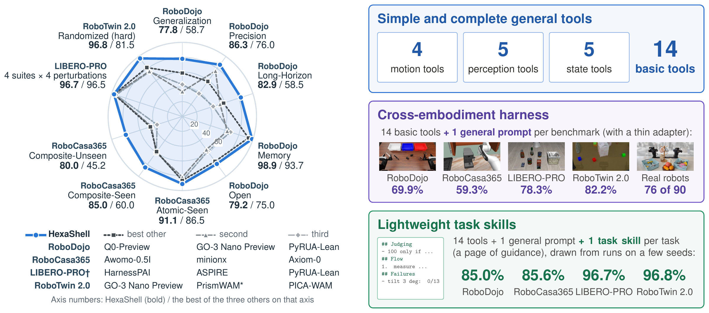
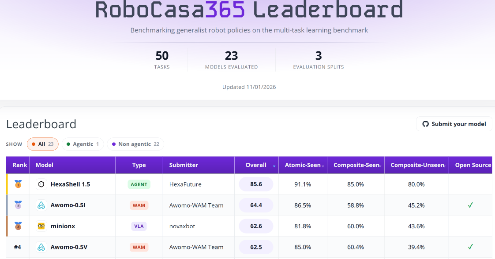
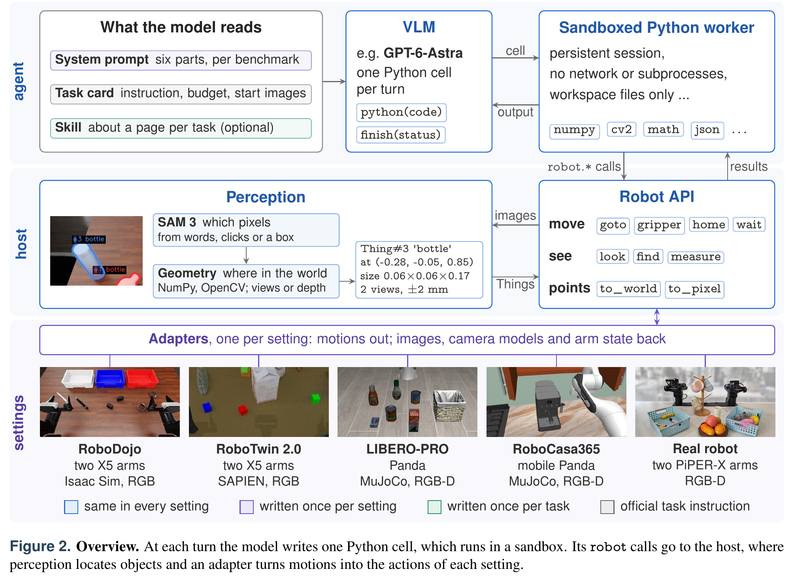
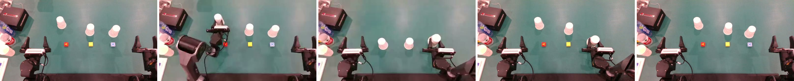

<h1 align="center">HexaShell&nbsp;&nbsp;<picture><source media="(prefers-color-scheme: dark)" srcset="assets/hexafuture-logo-dark.png"><source media="(prefers-color-scheme: light)" srcset="assets/hexafuture-logo-light.png"></picture></h1>

<p align="center">
  <strong>A Universal Harness for Robot Coding Agents in Simulation and the Real World</strong>
</p>

<p align="center">
  <a href="hexashell_paper.pdf">📄 Paper PDF</a> ·
  <a href="https://hexafuture.ai">🌐 Homepage</a> ·
  <a href="https://github.com/HexaFuture/HexaShell">💻 Project</a>
</p>

<p align="center">English · <a href="README_zh.md">简体中文</a></p>

<p align="center"></p>

<p align="center"><sub><b>HexaShell on four simulated benchmarks and real robots.</b> Left: success rates (%) of
HexaShell with task skills (blue) and of the three strongest other methods on each benchmark (grey), taken from the
leaderboards or, for LIBERO-PRO (†), from published papers; PrismWAM (*) uses depth. Each axis gives HexaShell's rate
(bold) and, after the slash, the best of the three others. Our results are self-evaluated, under protocols that differ
from the official ones. Right: the three components of HexaShell and their results: 14 basic tools; the same tools
with one general prompt for each benchmark or robot (success without task skills); and a skill of about a page for
each task (success with skills).</sub></p>

---

## 📰 News

- 🔥 **2026-11-03** — HexaShell is released: one task-agnostic harness with general tools for seeing and moving, on four
  simulated benchmarks and on real robots. With one short skill per task it reaches 85.0% success (score 88.8) on
  RoboDojo, 85.6 on RoboCasa365, 96.7% on LIBERO-PRO and 96.8% on RoboTwin 2.0, above the best published result we
  know of on each of the four benchmarks (our own evaluations, see [Results](#-results)). On real dual-arm robots it
  succeeds in 76 of 90 episodes across nine tasks. The earlier version HexaShell-Preview on the RoboDojo leaderboard
  stays available on the branch [`v1.0`](https://github.com/HexaFuture/HexaShell/tree/v1.0).
- 🔥 **2026-11-01** — HexaShell is **#1 on the [RoboCasa365 leaderboard](https://robocasa.ai/leaderboard.html)**, 85.6
  overall (atomic 91.1%, composite seen 85.0%, composite unseen 80.0%), ahead of Awomo-0.5I (64.4), minionx (62.6)
  and Awomo-0.5V (62.5). It is the leaderboard's agentic entry; the result is our own evaluation of the 50 tasks on
  30 test seeds each of the pretrain50 split, not RoboCasa's official protocol ([details](#other-split-pretrain50)).

  <p align="center"></p>

- **2026-10-19** — HexaShell-Preview (1.0) is released; it reaches the top of the RoboDojo
  leaderboard: success rate 46.9%, progress score 53.2 in RoboDojo's official evaluation.

## 🧩 Overview

Agents built on vision language models (VLMs) now control robots by writing code, but the strongest of them refine
task-specific code over many rounds of trial and revision. Such code tends to overfit the benchmark on which it was
tuned, can exploit the benchmark's shortcuts, and is costly to carry over to a new benchmark or robot. HexaShell is a
thin, task-agnostic harness built to test how far general tools can go instead. It provides a simple and complete set
of 14 basic tools, four for motion, five for perception and five for state, which the agent calls in one Python cell
per turn. Its perception pairs SAM 3, which segments an object from a few words or a click, with NumPy and OpenCV
geometry that turns the outlines in several cameras, or a depth image, into the object's position, size and grasp
angle. The robot API, agent loop and sandbox are shared across all tasks; a new simulator or robot needs only an
adapter of 350 to 1,450 lines and a prompt that describes its world, and the only task-specific input is an optional
skill of about a page of guidance. There is no trained policy and no demonstration data.

- **Simple and complete general tools.** The model acts through 14 basic tools shared by all tasks: motion (`goto`,
  `gripper`, `home`, `wait`), perception (`look`, `find`, `measure`, `to_world`, `to_pixel`) and state (`task`,
  `state`, `things`, `image`, `camera`). `robot.goto` moves an arm, `robot.find(camera, "bottle")` segments objects
  with SAM 3, `robot.measure(mask)` locates them in 3-D and `robot.state()` reports the arms and the remaining steps.
  Perception separates segmentation by SAM 3 from geometric localization, so the model receives metric 3-D positions
  with error estimates instead of judging distances itself. The API is written with a language model as its user:
  every motion can be checked with a dry run before it consumes steps, results report problems first, and errors state
  what to change. Thinking and looking cost no steps. With nothing written for any task, GPT-6-Astra in HexaShell
  reaches a success rate of 69.9% on RoboDojo, above every entry of its leaderboard, whereas the same model in the
  RoboDojo team's agent reaches 22.5%; in nine episodes out of ten it writes no vision code of its own.
- **Cross-embodiment harness.** The same tools, loop and sandbox run unchanged on four simulated benchmarks, built on
  three simulators with two kinds of arm, fixed and wheeled bases, and cameras with and without depth: RoboDojo (Isaac
  Sim, two ARX X5 arms), RoboCasa365 (MuJoCo, a PandaOmron mobile manipulator), LIBERO-PRO (MuJoCo, a Panda arm) and
  RoboTwin 2.0 (SAPIEN, two ARX X5 arms). They also run on real robots: on dual-arm PiPER-X robots HexaShell succeeds
  in 76 of 90 episodes across nine tasks ([below](#real-robot-urai)). Each setting needs only a thin adapter (350 to
  1,450 lines) and one general prompt. Without task skills, the agent reaches a success rate of 69.9% on RoboDojo,
  59.3 on RoboCasa365, 78.3% on LIBERO-PRO and 82.2% on RoboTwin 2.0.
- **Lightweight task skills.** What general tools cannot supply (a success condition that the instruction leaves
  implicit, a parameter that only contact reveals, the order of steps) fits in about a page of guidance per task,
  which an analysis agent drafts from the records of earlier runs on a few seeds and a person reviews (`skills/`).
  With the skills, HexaShell reaches 85.0% on RoboDojo, 85.6 on RoboCasa365, 96.7% on LIBERO-PRO and 96.8% on RoboTwin
  2.0, above the best published result we know of on each benchmark. On RoboDojo, the same 1,020 episodes outside the
  Open dimension go from 667 to 864 successes: 234 succeed only with skills, 37 only without.
- **Against HexaShell-TaskTools** (1.0, branch `v1.0`, listed as HexaShell-Preview on the RoboDojo leaderboard), an
  earlier version of our agent that supplied task knowledge as tools written for each task. After each failed episode,
  an optimizer agent wrote or repaired the task's tools; its 769 rounds left 327 task commands in about 78,000 lines of
  Python, which were then frozen. Re-run after freezing, these tools pass only 152 of the 420 development episodes on
  which they were built (36%). Success rate / score on RoboDojo; TaskTools' row is RoboDojo's official evaluation (a
  hidden seed, 50 episodes per task), HexaShell's rows are our own test runs ([Results](#-results)):

  | System | Written per task | Overall | Generalization | Precision | Long-Horizon | Memory | Open |
  |---|---|---|---|---|---|---|---|
  | HexaShell-TaskTools (1.0) | 327 tool commands, ~78,000 lines of Python | 46.85 / 53.18 | 34.50 / 39.22 | 32.00 / 41.25 | 31.50 / 42.91 | 81.00 / 84.53 | 55.25 / 57.97 |
  | HexaShell, no skills | nothing | 69.92 / 75.73 | 64.44 / 69.86 | 52.50 / 60.38 | 54.58 / 67.02 | 98.89 / 98.89 | 79.17 / 82.50 |
  | HexaShell, skills | 34 skills, ~2,700 lines of text | **85.00 / 88.81** | **77.78 / 82.22** | **86.25 / 88.25** | **82.92 / 92.21** | **98.89 / 98.89** | **79.17 / 82.50** |

  The ranking also holds on public episodes: on 420 episodes of seed 0, the frozen tools pass 157, HexaShell 284
  without skills and 351 with them. The two versions also differ in the loop, perception, motion and prompt, so this
  shows that general tools with short skills beat tools written for each task, not which change matters most.

This repository holds the code, prompts and skills behind the results below, and the adapter of the real robot with
two PiPER-X arms. Development records (episode records, analyses, earlier versions of the skills and prompts) are not
included.

## 🔍 How it works

<p align="center"></p>

```
 language model (OpenAI-compatible chat endpoint, or Anthropic Messages for Claude)
        │ a Python cell per reply                    ▲ the cell's printed output, the pictures it asked for
        ▼                                            │
 episode driver (hexashell/runtime) ──▶ sandboxed worker (hexashell/kernel) runs the cell: no network,
        │                                no processes, no writes outside its workspace, no API key
        │ robot calls
        ▼
 robot host: motion (hexashell/motion: IK, paths, one action at a time), vision (hexashell/vision: SAM3
 service, the robot's own mask, multi-view 3-D measurement), per-episode records
        │ joint targets ▲ observations
        ▼               │
 RoboDojo's simulator client (Isaac Sim) through XPolicyLab's websocket protocol (hexashell/xpl,
 xpolicylab/HexaShell), or a simulator server in the benchmark's own Python (hexashell/benches)
```

- **What the model sees**: the system prompt (`prompts/robodojo/` for RoboDojo, `prompts/<bench>/` for the others); a
  task card with the instruction, the step budget, the arms' start pose and the start pictures, for RoboDojo also the
  task's official scoring table (`prompts/ladders/`), and the task's skill when skills are on (`skills/`); then the
  output of each cell and the pictures it asked for.
- **What it does not see**: the simulator's state. The agent gets the benchmark's RGB(-D) cameras, the camera
  parameters, proprioception, the instruction and the budget; success is judged by the benchmark's own check. The
  robot's own pixels, which measurements leave out, are drawn from its meshes at the joint readings on RoboDojo, and
  taken from the renderer's segmentation of the robot's own parts on RoboCasa365, LIBERO-PRO and RoboTwin.
- **Budgets**: the benchmark's step limit (control steps), plus limits on replies and wall-clock time per episode.
  Thinking and looking cost no steps.

## 📊 Results

All results with `gpt-6-astra`, October–November 2026. With skills, HexaShell is above the best published result we
know of on each of the four benchmarks. "Best other": that result, each on its own episodes and protocol.

| Benchmark | Episodes | With skills | Without skills | Best other |
|---|---|---|---|---|
| [RoboDojo](https://robodojo-benchmark.com/LeaderBoard): 42 tasks, seeds 0–2, layouts 10–19 (a fifth of the official episodes, see [below](#evaluating-on-robodojo)) | 1260 | **85.0% success, score 88.8** (1054/1260) | 69.9% success, score 75.7 (857/1260) | Q0-Preview 68.9% / 74.2 (leaderboard, official evaluation) |
| [RoboCasa365](https://robocasa.ai/leaderboard.html): 50 tasks × test seeds 20–49 of the pretrain50 split (not the official protocol, see [below](#other-split-pretrain50)) | 1500 | **85.6** (1284/1500) | 59.3 (890/1500) | Awomo-0.5I 64.4 (leaderboard) |
| LIBERO-PRO: 156 tasks (four perturbations of the four LIBERO suites) × 10 initial states | 1560 | **96.7%** (1509/1560, test states 20–29) | 78.3% (1222/1560, validation states 10–19) | HarnessPAI 96.5%, ASPIRE 96.0%<sup>‡</sup> (papers, each on its own subset) |
| [RoboTwin 2.0](https://robotwin-platform.github.io/leaderboard): 50 tasks × 15 seeds, clean2random (randomized scenes, unseen instructions) | 750 | **96.8%** (726/750) | 82.2% (411/500, learning seeds, seen instructions) | GO-3 Nano Preview 81.5% (leaderboard); 90.4% reported in OmniBrain-0 |

<sub>‡ ASPIRE with GPT-6-Astra, the model we use, on the same perturbations of all four suites (our mean of its eight
per-cell results; 98.8% with Claude Opus 5.5).</sub>

- **Settings.** RoboDojo and RoboCasa365 at reasoning effort `xhigh`, LIBERO-PRO and RoboTwin at `high`. On RoboDojo
  the two columns differ only in the skills (the eight Open tasks have none; both columns share one run of them at
  `high`); on RoboCasa365 also in the picture window. The LIBERO-PRO and RoboTwin
  runs without skills used other episodes (development seeds), so they are not paired with the test.
- **None of these is a full official evaluation.** Our RoboDojo test uses public layouts and 30 episodes per task,
  RoboDojo's official evaluation 150 on layouts that are not public; HexaShell's official evaluation has been
  submitted and its result will be added here. RoboCasa365's official protocol (50 episodes per task) is also still
  to be run.
- Details for each benchmark, per-task results and how to run them are in the evaluation sections below.

## Requirements

- Linux with NVIDIA GPUs. RoboDojo (Isaac Sim 5.1) and RoboTwin (ray-traced cameras) need RTX GPUs; we ran them on
  RTX 4090s. RoboCasa and LIBERO-PRO render with MuJoCo's EGL backend on any NVIDIA GPU.
- A model endpoint with streaming: an OpenAI-compatible `/chat/completions` (tested with `gpt-6-astra`), or an
  Anthropic Messages endpoint for Claude (see [Using Claude](#using-claude)), and its key.
- The policy environment: Python 3.11 with [requirements.txt](requirements.txt).
- SAM3 for segmentation: torch 2.7 with CUDA, [sam3](https://github.com/facebookresearch/sam3) and its checkpoint
  `sam3.pt` (gated on Hugging Face: [facebook/sam3](https://huggingface.co/facebook/sam3)). One service per machine
  serves all episodes.
- For RoboDojo: RoboDojo with its simulator environment, assets and XPolicyLab, installed as RoboDojo's
  documentation describes, and conda (RoboDojo's scripts activate environments with `conda activate`).
- For the other benchmarks: the simulator environments made by `scripts/setup/` (below).
- For the real robot: a running [URAI](https://github.com/HexaFuture/URAI) service (see [Real robot](#real-robot-urai)).

## Setup

```bash
git clone --recurse-submodules https://github.com/HexaFuture/HexaShell.git && cd HexaShell
                                        # third_party/: RoboCasa and robosuite (only the RoboCasa port uses them)
conda create -n hexashell python=3.11 -y && conda activate hexashell
pip install -r requirements.txt         # the policy environment (POLICY_ENV)
python -m pytest -q tests               # no simulator or GPU needed
```

1. **SAM3.** Install torch 2.7.0 and torchvision 0.22.0 with CUDA, `timm` and `sam3` (from its repository), in this
   environment or another one; download `sam3.pt` to `checkpoints/sam3.pt` (or set `SAM3_CHECKPOINT_PATH`).
   sam3 0.1.0 also needs `einops`, `pycocotools` and `psutil`, which it does not declare, and `setuptools<81` (it
   imports `pkg_resources`). The checkpoint is gated: request access to `facebook/sam3` on Hugging Face first.
2. **Machine settings.** `cp config/env.example.sh config/env.sh` and edit the paths in it: the RoboDojo checkout
   (`ROBODOJO_ROOT`), the two environments RoboDojo activates (`POLICY_ENV`, `EVAL_ENV`), SAM3's Python and
   checkpoint, and the benchmark environments. The scripts read `$HEXASHELL_ENV` when it is set, else
   `config/env.sh` (git-ignored). The template puts `TMPDIR` under `/tmp`; where `/tmp` is small, point it at a disk
   with room before installing (pip unpacks the torch and CUDA wheels there, several GB). A single episode renders on
   the GPU `HEXASHELL_EGL_DEVICE` names (or `--egl`).
3. **The model's key.** Put it in `~/.config/hexashell/api-key` (one line, `chmod 600`), or in `$OPENAI_API_KEY`.
   The key stays in the episode driver; the process that runs the model's cells never gets it. Never commit it.
4. **The model endpoint** (required: there is no default). Set `api_base` (and `model`, if yours differs) in
   [xpolicylab/HexaShell/deploy.yml](xpolicylab/HexaShell/deploy.yml) for RoboDojo and in
   [config/benches.yml](config/benches.yml) for the other benchmarks. Both hold the placeholder
   `https://api.example.com/v1`. `bash scripts/gateway_ping.sh` sends one tiny request to the endpoint of
   benches.yml.
5. **Direct connections.** The websocket between RoboDojo's simulator and the policy server, and the model API, must
   not go through an HTTP proxy; `config/env.example.sh` unsets the proxy variables.
6. **Start the SAM3 service** (once per machine; its port must match `sam3_url` in deploy.yml and benches.yml):

   ```bash
   bash scripts/sam3_service.sh start 0 18300     # GPU 0, port 18300
   bash scripts/sam3_service.sh status 18300
   ```

### RoboDojo

Install RoboDojo as its documentation describes (the simulator environment with Isaac Sim 5.1, the assets, and
XPolicyLab, which its install script clones into the checkout). We tested with RoboDojo `09bd5f5` and XPolicyLab
`53c5da5`. Then link the policy into XPolicyLab (a symlink, not a copy: the policy finds the `hexashell` package
through it):

```bash
ln -s "$PWD/xpolicylab/HexaShell" "$ROBODOJO_ROOT/XPolicyLab/policy/HexaShell"
```

`scripts/run_one.sh` and `scripts/batch.sh` run chosen layouts of a seed; for that, RoboDojo needs a small change
(an environment variable `ROBODOJO_LAYOUT_IDS`, read by its seed manager; the patch is made against `09bd5f5`).
RoboDojo's own evaluation does not need it:

```bash
git -C "$ROBODOJO_ROOT" apply "$PWD/scripts/patches/robodojo-layout-ids.patch"
```

### RoboCasa365, LIBERO-PRO, RoboTwin 2.0

Each benchmark runs in its own Python environment (their Python, numpy and simulator versions differ from the
policy's). The scripts in [scripts/setup/](scripts/setup/README.md) build them inside the checkout by default
(`.venvs/`, `.bench-data/`; both git-ignored) and are safe to rerun:

```bash
bash scripts/setup/setup_robocasa.sh    # CPython 3.12 venv, the submodules patched, bench-env.sh (assets: below)
bash scripts/setup/setup_libero.sh      # CPython 3.11 venv, LIBERO-PRO sources and assets, env.sh
bash scripts/setup/setup_robotwin.sh    # CPython 3.11 venv, torch cu128, cuRobo built locally, assets, env.sh
```

Behind a slow proxy, `INDEX=<a PyPI mirror> bash scripts/setup/setup_robocasa.sh` takes the packages from a mirror.
RoboCasa's kitchen assets are downloaded with RoboCasa's own script, which asks before it starts:
`.venvs/bench-robocasa/bin/python -m robocasa.scripts.download_kitchen_assets --type all`. All of them are needed (the
kitchens use the generative textures too): about 11 GB of archives, 23 GB unpacked. On a slow link, fetching the
same archives with a multi-connection downloader and unpacking them where the script would is much faster.
A host without glvnd's `libEGL.so.1` and `libOpenGL.so.0` needs them added to `bench-env.sh` as the comment there
describes; `setup_robocasa.sh` rewrites `bench-env.sh`, so add them again after a rerun. Then point
`HEXASHELL_<BENCH>_PYTHON` and `HEXASHELL_<BENCH>_ENV` in `config/env.sh` at the environments (the template has the
default paths). Versions, and our changes to RoboCasa, are listed in [THIRD_PARTY_VERSIONS.md](THIRD_PARTY_VERSIONS.md).

## Configuration

| What | Where | Notes |
|---|---|---|
| Machine paths | `config/env.sh` (from `config/env.example.sh`) | read by all scripts; `$HEXASHELL_ENV` names another file |
| Agent settings for RoboDojo | `xpolicylab/HexaShell/deploy.yml` | endpoint, model, effort, skills, replies and time per episode, picture window, motion profile, SAM3 address |
| Agent settings for the other benchmarks | `config/benches.yml` | the same names, over each benchmark's own limits (RoboCasa: 40 replies for atomic tasks, 100 for composite ones; LIBERO-PRO and RoboTwin: 40; all: 2 h) |
| Per-run overrides | `HEXASHELL_<NAME>=value` | any setting, e.g. `HEXASHELL_SKILLS=yes`, `HEXASHELL_MAX_TURNS=6`, `HEXASHELL_MODEL=...` |
| One benchmark episode | `python -m hexashell.benches.run ... --set name=value` | overrides all of the above |
| The model's key | `~/.config/hexashell/api-key` or `$OPENAI_API_KEY` | `api_key_file` in the settings names another file |

deploy.yml holds the settings of our RoboDojo test with skills (reasoning effort `xhigh`, `max_tokens` 32000, a
picture window of 20/14); the test without them changed only `skills: false`. benches.yml has skills off and effort
`high`; our runs on the other benchmarks with skills turned them on with `--set skills=yes`. The RoboCasa365 runs at
`xhigh` also set `reasoning_effort=xhigh`, and the one without skills `images_max=50` and `images_low=30`.

### Using Claude

With `api: anthropic`, the same loop talks to an Anthropic Messages endpoint (`<api_base>/messages`, streamed); the
prompts, tools and records are unchanged.

- Thinking is adaptive, its depth set by `reasoning_effort`. With `thinking_display: summarized` (the default) the
  records hold a summary of it; `omitted` returns none.
- Each reply's content blocks (signed thinking, text, tool calls) are kept as they are and sent back with every later
  request, so the model continues from its own reasoning.
- `ca_file` names a private CA when the endpoint's certificate needs one.
- Pictures: Claude's thinking blocks are bound to the conversation before them. When the picture window drops an old
  picture, the replies after that point lose their thinking blocks (else the request would be rejected); their text
  and tool calls stay. So with Claude, raise `images_max` and `images_low` (e.g. both to 90).

```bash
HEXASHELL_API=anthropic HEXASHELL_API_BASE=https://<your endpoint>/v1 \
HEXASHELL_API_KEY_FILE=~/.config/hexashell/claude-key \
HEXASHELL_MODEL=claude-opus-5-5 HEXASHELL_REASONING_EFFORT=medium \
HEXASHELL_IMAGES_MAX=90 HEXASHELL_IMAGES_LOW=90 \
bash scripts/run_one.sh push_T 0 0 3
```

Our results were all obtained with `gpt-6-astra`.

## Evaluating on RoboDojo

### Official protocol

RoboDojo's own evaluation runs each of the 42 tasks with seeds 0, 1 and 2, 50 episodes per task and seed
(`--eval-num native`; for the twelve Generalization tasks, 25 episodes of the task and 25 of its `_random` variant,
which has clutter added). `summarize` then reads the records under `eval_result/RoboDojo/` and writes
`eval_result/RoboDojo/_summary.md`: success rate and score (task progress) per task and seed, and per capability
dimension. HexaShell runs in it unchanged:

```bash
source config/env.sh && cd "$ROBODOJO_ROOT"
for task in stack_blocks stack_blocks_random; do       # every task, and each Generalization task's _random variant
    for seed in 0 1 2; do
        bash scripts/robodojo.sh eval --policy-dir XPolicyLab/policy/HexaShell --task "$task" \
            --ckpt no-checkpoint --policy-env "$POLICY_ENV" --eval-env "$EVAL_ENV" --env-cfg arx_x5 \
            --action-type joint --seed "$seed" --eval-num native --policy-gpu 0 --env-gpu 0
    done
done
bash scripts/robodojo.sh summarize
```

`--action-type joint` is required (HexaShell sends joint targets); the checkpoint name is not used. The policy needs
no GPU of its own. `robodojo.sh benchmark` runs all tasks or a selection for a seed, also spread over several GPUs
(`--gpu-ids`; see its `--help`). Every episode is a conversation with the model of up to 100 replies and 90 minutes
(deploy.yml), so the full protocol (6300 episodes) is costly; we have not run it ourselves. HexaShell has been
submitted to RoboDojo's official evaluation; its result will be added here.

### Our test

We ran a fifth of the official episodes: the 42 tasks × seeds 0–2 × layouts 10–19 of each seed, 30 episodes per task
and 1260 in all (a Generalization task: layouts 10–14 of the task and layouts 10–14 of its `_random` variant).
Layouts that RoboDojo discarded as physically unstable were replaced by layout + 20, the same in every run.
Development (prompts, tools, skills) used seed 0, layouts 0–9; these are also among the official protocol's
episodes. The eight Open tasks got no skills and no task-specific changes. Code comments, tests and skills cite the
development rounds as R0–R4 and their layouts as l0–l9.

| Dimension | Tasks | Without skills | With skills |
|---|---|---|---|
| Generalization | 12 | 232/360 (64.4%) | **280/360 (77.8%)** |
| Precision | 8 | 126/240 (52.5%) | **207/240 (86.3%)** |
| Long-Horizon | 8 | 131/240 (54.6%) | **199/240 (82.9%)** |
| Memory | 6 | 178/180 (98.9%) | 178/180 (98.9%) |
| Open | 8 | 190/240 (79.2%) | 190/240 (79.2%): no skills, the same episodes |
| Non-Open | 34 | 667/1020 (65.4%) | **864/1020 (84.7%)** |
| All | 42 | 857/1260 (68.0%) | **1054/1260 (83.7%)** |
| Success rate (mean of the five dimensions) | | 69.9 | **85.0** |
| Score (task progress, mean of the five dimensions) | | 75.7 | **88.8** |

RoboDojo's `summarize` averages the tasks of each dimension and then the five dimensions; with 30 episodes per task,
that is the success-rate row. The score averages each episode's progress on the task's official scoring table the
same way.

- **The two columns** both use the settings in deploy.yml (reasoning effort `xhigh`, `max_tokens` 32000, a picture
  window of 20/14); without skills, `skills: false`, nothing else. The Open tasks have no skills; both columns
  share one run of them without skills at `high` (picture window 90/60).
- **What the skills do**, episode by episode on the 1020 non-Open episodes: 234 succeeded only with skills, 37 only
  without (667 → 864). At effort `high` the same skills went from 615 to 783 (+228/−60).
- **Reasoning effort**: without skills, `xhigh` scored 667 against 615 at `high` (+120/−68, exact sign test
  p < 0.001); with the skills of that pass, 847 against 804 (+113/−70, p = 0.002). The two gains add up. An earlier
  test of all 42 tasks without skills at `high` (picture window 90/60) scored 818/1260: success rate 66.6, score
  72.1. The picture window, without skills at `high`: 818 at 90/60 against 805 at 20/14 on the same 1140 episodes
  (p = 0.40).
- For under two hours of the `xhigh` pass with skills the model's upstream queued first tokens for about 95 s; outside
  those hours `xhigh` still gained (+92/−46 against `high`).

<details>
<summary>Per task (successes out of 30)</summary>

| Dimension | Task | Without skills | With skills |
|---|---|---|---|
| Generalization | arrange_largest_number | 26 | 26 |
| Generalization | fold_clothes | 22 | 23 |
| Generalization | hang_mugs | 2 | 7 |
| Generalization | make_toast | 15 | 21 |
| Generalization | pack_objects_into_box | 8 | 26 |
| Generalization | pour_liquid_into_cup | 17 | 29 |
| Generalization | push_T | 30 | 30 |
| Generalization | sort_nesting_dolls_by_size | 25 | 29 |
| Generalization | stack_blocks | 30 | 30 |
| Generalization | stack_bowls | 30 | 30 |
| Generalization | store_laptop_and_headphones | 0 | 1 |
| Generalization | sweep_blocks | 27 | 28 |
| Precision | build_tower | 14 | 29 |
| Precision | deposit_coin | 13 | 13 |
| Precision | fasten_screws | 10 | 30 |
| Precision | insert_key | 0 | 20 |
| Precision | insert_tubes | 24 | 29 |
| Precision | play_Xylophone | 28 | 30 |
| Precision | plug_in_charger | 9 | 28 |
| Precision | pour_balls_into_vase | 28 | 28 |
| Long-Horizon | classify_objects | 30 | 29 |
| Long-Horizon | fill_egg_holder | 4 | 19 |
| Long-Horizon | fill_pen_holder | 2 | 16 |
| Long-Horizon | make_kong | 0 | 30 |
| Long-Horizon | organize_table | 10 | 16 |
| Long-Horizon | play_stacking_toy | 26 | 30 |
| Long-Horizon | play_tic_tac_toe | 29 | 30 |
| Long-Horizon | put_bottles_into_dustbin | 30 | 29 |
| Memory | cover_blocks | 30 | 30 |
| Memory | imitate_sorting_sequence | 29 | 30 |
| Memory | match_and_pick_from_conveyor | 30 | 30 |
| Memory | press_by_number | 29 | 30 |
| Memory | swap_T | 30 | 30 |
| Memory | swap_blocks | 30 | 28 |
| Open | align_blocks | 29 | – (no skill) |
| Open | classify_objects_by_language | 28 | – (no skill) |
| Open | general_pickup | 29 | – (no skill) |
| Open | pick_from_conveyor_by_image | 20 | – (no skill) |
| Open | pour_by_language | 28 | – (no skill) |
| Open | solve_equation | 27 | – (no skill) |
| Open | stack_blocks_by_language | 29 | – (no skill) |
| Open | store_tools_in_toolbox | 0 | – (no skill) |

</details>

### Single runs and batches

These use the layout patch above.

```bash
source config/env.sh
bash scripts/run_one.sh stack_blocks 0 1 3       # task, seed, layout, simulator GPU [, episodes, run name]
mkdir -p logs && printf 'stack_blocks 0 1\nswap_T 0 2\n' > logs/demo.todo
GPUS=1,2,3 bash scripts/batch.sh demo 2          # "task seed layout" per line; at most 2 at once
python eval/report.py results/demo               # success, progress, turns, time, tokens per task
```

`batch.sh` starts episodes where there is free GPU memory, also beside other users' jobs, lists again those that
never started or that the model gateway cut short, and replaces a layout RoboDojo discards as unstable with
layout + 20. Its header lists the other settings.

## Evaluating on RoboCasa365

The port plays RoboCasa's kitchens, tasks and success checks unchanged, through robosuite's controllers: a PandaOmron
robot in the 50 target tasks (18 atomic, 16 composite seen, 16 composite unseen), three RGB-D cameras (left, right,
wrist) at 512 × 512.

### Official protocol

- **Split** `pretrain`: kitchen layouts and styles 11–60 with the pretraining objects; the seed draws the kitchen
  (RoboCasa draws again when a task cannot be built in it), the objects and their placement.
- **Episodes**: 50 per task, seeds 1000–1049.
- **Success**: RoboCasa's `_check_success()`, at every step; the episode ends at the first success.
- **Horizon**: each task's official horizon in 20 Hz control steps; besides, at most 40 replies of the model for an
  atomic task and 100 for a composite one, and two hours.
- **Score**: the success rate of each group (atomic seen, composite seen, composite unseen) and their weighted mean,
  18/16/16 over 50.

```bash
source config/env.sh                         # with HEXASHELL_ROBOCASA_SPLIT=pretrain, as in the template
# one episode
$HEXASHELL_PYTHON -m hexashell.benches.run --bench robocasa --task CloseFridge --seed 1000 --split pretrain \
    --set skills=yes --out results/demo
# the full protocol: 2500 episodes on warm simulator servers, two on GPU 0 and two on GPU 1, at most 4 at once
mkdir -p logs && $HEXASHELL_PYTHON -c 'from hexashell.benches.robocasa.protocol import TASKS
for tasks in TASKS.values():
    for task, _ in tasks:
        for seed in range(1000, 1050): print("robocasa", task, seed)' > logs/casa_official.todo
SETS="skills=yes" HEXASHELL_ROBOCASA_SPLIT=pretrain python3 scripts/bench_pool.py casa_official 0,0,1,1 4
python3 scripts/bench_score.py results/casa_official     # group rates and the weighted score
```

`scripts/bench_pool.py` keeps the list in `logs/NAME.todo` (lines can be added or removed while it runs), plays
episodes one after another on warm simulator servers, plays again an episode that ended in an error, and lists again
one the model gateway cut short, holding new starts for a while. `python3 scripts/pool_status.py . NAME` shows how a
batch is doing; `scripts/gateway_guard.sh . NAME` pauses it while the gateway does not answer.
`scripts/bench_batch.sh` works through the same list with a fresh simulator per episode. A server starts only on a
GPU with 3 GB free (`NEED`).

### Other split: pretrain50

The default split when none is given (`--split`, `$HEXASHELL_ROBOCASA_SPLIT`): 50 fixed
kitchens of the pretraining set, seed `s` in kitchen `s % 50`; seeds 0–9 for learning, 10–19 for validation, 20–49
for testing. The RoboCasa skills (`skills/robocasa/`) were written on seeds 0–9 and checked on 10–19. Its
kitchens are among those the official split draws from.

Our tests, with the code of an earlier version of this repository, which differs from this one on RoboCasa365 only
in checks of the GPU's pictures; 50 tasks × seeds 20–49 (30 episodes per task), with and without skills at reasoning
effort `xhigh` (`reasoning_effort: xhigh` in `config/benches.yml`, nothing else changed; without skills also a
picture window of 50/30 instead of 20/14):

| Group | Without skills, `xhigh` | With skills, `xhigh` |
|---|---|---|
| Atomic (18 tasks) | 354/540 (65.6%) | **492/540 (91.1%)** |
| Composite seen (16) | 243/480 (50.6%) | **408/480 (85.0%)** |
| Composite unseen (16) | 293/480 (61.0%) | **384/480 (80.0%)** |
| Weighted (18/16/16) | 59.3 | **85.6** |

- The skills were learned for all 50 tasks, so the composite "unseen" tasks were not unseen for HexaShell: their
  skills come from our own runs on seeds 0–9.
- **Skills**, episode by episode at `xhigh`: 466 episodes succeeded only with skills, 72 only without. The two runs
  also differ in the picture window, so not all of the gap is the skills'. Without skills the largest drops were
  ScrubCuttingBoard 2/30, WashLettuce 1/30, LoadDishwasher 3/30, RinseSinkBasin 4/30, PreSoakPan 6/30 and
  TurnOnSinkFaucet 7/30; six tasks scored one or two more without skills. Of the 610 failures without skills the
  model ended 393 itself, 215 ran out of steps and 2 out of time.
- After a first test, some skills and the system prompt's lines on placing were reworded so that nothing taken
  from the simulator is written plainly; the run with skills above used the reworded text.
- The model's upstream showed no change of behaviour during the run with skills; no episode was dropped. At `high` we
  watch for sudden jumps in reasoning length. That does not work at `xhigh`, which reasons longer by itself, so during
  the run 24 fixed requests were sent again at `high` every 20 minutes. At most 3 of the 24 reasoned over 100 tokens in
  any check; during the upstream changes we saw before, 40% and more did.
- With skills, of the 216 failures the model ended 159 itself and 57 ran out of steps. The weakest tasks were
  HeatKebabSandwich 10/30, PackIdenticalLunches 13/30, ArrangeTea 16/30, SteamInMicrowave 17/30, SeparateFreezerRack
  18/30 and MakeIceLemonade 19/30.

<details>
<summary>Per task (successes out of 30)</summary>

| Task | Group | Without skills, `xhigh` | With skills, `xhigh` |
|---|---|---|---|
| CloseBlenderLid | atomic | 15 | 21 |
| CloseFridge | atomic | 20 | 26 |
| CloseToasterOvenDoor | atomic | 6 | 28 |
| CoffeeSetupMug | atomic | 15 | 26 |
| NavigateKitchen | atomic | 25 | 26 |
| OpenCabinet | atomic | 14 | 27 |
| OpenDrawer | atomic | 22 | 29 |
| OpenStandMixerHead | atomic | 14 | 28 |
| PickPlaceCounterToCabinet | atomic | 23 | 26 |
| PickPlaceCounterToStove | atomic | 29 | 28 |
| PickPlaceDrawerToCounter | atomic | 24 | 28 |
| PickPlaceSinkToCounter | atomic | 28 | 27 |
| PickPlaceToasterToCounter | atomic | 25 | 27 |
| SlideDishwasherRack | atomic | 24 | 28 |
| TurnOffStove | atomic | 27 | 28 |
| TurnOnElectricKettle | atomic | 28 | 30 |
| TurnOnMicrowave | atomic | 8 | 29 |
| TurnOnSinkFaucet | atomic | 7 | 30 |
| DeliverStraw | composite seen | 23 | 28 |
| GetToastedBread | composite seen | 25 | 25 |
| KettleBoiling | composite seen | 29 | 28 |
| LoadDishwasher | composite seen | 3 | 27 |
| PackIdenticalLunches | composite seen | 9 | 13 |
| PreSoakPan | composite seen | 6 | 30 |
| PrepareCoffee | composite seen | 21 | 24 |
| RinseSinkBasin | composite seen | 4 | 26 |
| ScrubCuttingBoard | composite seen | 2 | 30 |
| SearingMeat | composite seen | 20 | 28 |
| SetUpCuttingStation | composite seen | 21 | 25 |
| StackBowlsCabinet | composite seen | 29 | 28 |
| SteamInMicrowave | composite seen | 10 | 17 |
| StirVegetables | composite seen | 20 | 28 |
| StoreLeftoversInBowl | composite seen | 20 | 25 |
| WashLettuce | composite seen | 1 | 26 |
| ArrangeBreadBasket | composite unseen | 25 | 23 |
| ArrangeTea | composite unseen | 18 | 16 |
| BreadSelection | composite unseen | 23 | 28 |
| CategorizeCondiments | composite unseen | 24 | 26 |
| CuttingToolSelection | composite unseen | 15 | 30 |
| GarnishPancake | composite unseen | 14 | 27 |
| GatherTableware | composite unseen | 10 | 23 |
| HeatKebabSandwich | composite unseen | 6 | 10 |
| MakeIceLemonade | composite unseen | 19 | 19 |
| PanTransfer | composite unseen | 24 | 25 |
| PortionHotDogs | composite unseen | 27 | 27 |
| RecycleBottlesByType | composite unseen | 30 | 30 |
| SeparateFreezerRack | composite unseen | 3 | 18 |
| WaffleReheat | composite unseen | 22 | 25 |
| WashFruitColander | composite unseen | 9 | 30 |
| WeighIngredients | composite unseen | 24 | 27 |
</details>

## Evaluating on LIBERO-PRO and RoboTwin 2.0

The same runners and scoring as for RoboCasa, with `libero` or `robotwin` as the first word of each list line:

```bash
$HEXASHELL_PYTHON -m hexashell.benches.run --bench libero --task libero_goal_swap_t3 --seed 20 --set skills=yes \
    --out results/demo
$HEXASHELL_PYTHON -m hexashell.benches.run --bench robotwin --task adjust_bottle --seed 100000 --set skills=yes \
    --out results/demo
# the test lists: 1560 and 750 episodes
mkdir -p logs
$HEXASHELL_PYTHON -c 'from hexashell.benches.libero.protocol import TEST_SEEDS, test_tasks
for task in test_tasks():
    for seed in TEST_SEEDS: print("libero", task, seed)' > logs/libero_test.todo
$HEXASHELL_PYTHON -c 'from hexashell.benches.robotwin.protocol import test_episodes
for task, seed in test_episodes(): print("robotwin", task, seed)' > logs/twin_test.todo
SETS="skills=yes" python3 scripts/bench_pool.py libero_test 0,0,1,1 4
python3 scripts/bench_score.py results/libero_test
```

Both test results come from this code with the settings of benches.yml and skills on (`--set skills=yes`). The
skills were learned and checked on development seeds; no record of a test seed went into them.

### LIBERO-PRO

LIBERO-PRO perturbs each of LIBERO's four suites (spatial, object, goal, 10) in one way at a time. We test four of
its perturbations: the objects start in exchanged places (`_swap`), the objects look different (`_object`), the
instruction is reworded (`_lan`), and another task in the same scene (`_task`): 16 suites of ten tasks
(`<suite>_t<i>`, e.g. `libero_goal_swap_t3`), of which four have no initial states in LIBERO-PRO's release, so 156
tasks. Seed `s` starts from the task's initial state `s`; seeds 0–9 are for learning, 10–19 for validation, 20–29 the
test: 1560 episodes. The scene settles for 10 control steps, as in LIBERO-PRO's own evaluation; then its step limit
for the suite applies (20 Hz control steps: 220 for spatial, 280 object, 300 goal, 520 for libero_10), with at most
40 replies and two hours. Success is LIBERO's goal check. The 71 tasks with a skill are those that failed in the
learning round (no skills) or in the validation round.

| Suite | `_swap` | `_object` | `_lan` | `_task` | All |
|---|---|---|---|---|---|
| libero_spatial | 97/100 | 90/100 | 96/100 | 77/80 | 360/380 |
| libero_object | 96/100 | 100/100 | 100/100 | 100/100 | 396/400 |
| libero_goal | 99/100 | 100/100 | 98/100 | 100/100 | 397/400 |
| libero_10 | 94/100 | 79/90 | 96/100 | 87/90 | 356/380 |
| **All** | 386/400 | 369/390 | 390/400 | 364/370 | **1509/1560 (96.7%)** |

- The tasks with a skill scored 696/710, the others 813/850 (they were the ones that never failed in learning, so
  some drop on new initial states was expected).
- **Without skills**, on the validation initial states (10–19): 1222/1560 (78.3%), from the validation round of the
  102 tasks that had no skill then, and a run with skills off for the other 54. These 54, the tasks of the first round
  of skills (not seen when those skills were written), scored 252/540 without their skills and 531/540 with them
  (episode by episode +286/−7).

  | Suite, without skills | `_swap` | `_object` | `_lan` | `_task` | All |
  |---|---|---|---|---|---|
  | libero_spatial | 87/100 | 83/100 | 82/100 | 74/80 | 326/380 |
  | libero_object | 92/100 | 70/100 | 82/100 | 84/100 | 328/400 |
  | libero_goal | 76/100 | 78/100 | 84/100 | 68/100 | 306/400 |
  | libero_10 | 70/100 | 56/90 | 80/100 | 56/90 | 262/380 |
  | **All** | 325/400 | 287/390 | 328/400 | 282/370 | **1222/1560 (78.3%)** |

- All 51 failures ran out of steps or ended with too few left. libero_10_object_t3 failed all ten (in every round;
  its bowl seems too wide for the drawer to close over it).

### RoboTwin 2.0

The test follows RoboTwin's own evaluation of the clean2random setting: the `demo_randomized` scenes, each task's
step limit (400–1700 steps; one step is one `take_action`, the joint targets of both arms of the aloha-agilex robot),
an instruction from the task's unseen description templates, and per task the first seeds from 100000 that
RoboTwin's expert solves, found as RoboTwin's evaluation finds them (`scripts/setup/scan_robotwin_seeds.py`; the
result is `hexashell/benches/robotwin/seeds.json`). We take the first 15 per task: 750 episodes, with at most 40
replies and two hours each. Seeds below 100000 are for development, 10 for learning and 10 for validation per task,
with instructions from the seen templates; the skills use only those wordings. The tasks are the 50 of RPent's
evaluation list (`eval_seeds.json`, see NOTICE). Scenes are built with three fixes to RoboTwin's runtime (see
`hexashell/benches/robotwin/protocol.py`). Perception uses the colour pictures and the camera models only, as on
RoboDojo (`--set depth=true` reads the depth pictures as well).

- **726/750 (96.8%)**; 36 tasks 15/15. Of the 24 failures the model ended 14 itself, 7 ran out of replies and 3 out
  of steps.
- The 15 tasks whose skills were revised after the validation round scored 205/225, the other 35 521/525.
- **Without skills**, the learning round (50 tasks × 10 learning seeds, randomized scenes, seen instructions) passed
  411/500 (82.2%). Its seeds and instructions differ from the test's, so it is not a paired control; we have no run
  without skills on the test seeds, and did not run clean2clean (`demo_clean`, seen instructions).

<details>
<summary>Per task (successes out of 15)</summary>

| Task | | Task | | Task | |
|---|---|---|---|---|---|
| adjust_bottle | 15 | open_microwave | 15 | place_object_stand | 15 |
| beat_block_hammer | 15 | pick_diverse_bottles | 14 | place_phone_stand | 14 |
| blocks_ranking_rgb | 15 | pick_dual_bottles | 14 | place_shoe | 15 |
| blocks_ranking_size | 15 | place_a2b_left | 15 | press_stapler | 15 |
| click_alarmclock | 15 | place_a2b_right | 15 | put_bottles_dustbin | 12 |
| click_bell | 15 | place_bread_basket | 14 | put_object_cabinet | 13 |
| dump_bin_bigbin | 14 | place_bread_skillet | 14 | rotate_qrcode | 14 |
| grab_roller | 15 | place_burger_fries | 15 | scan_object | 12 |
| handover_block | 15 | place_can_basket | 15 | shake_bottle | 15 |
| handover_mic | 15 | place_cans_plasticbox | 15 | shake_bottle_horizontally | 15 |
| hanging_mug | 12 | place_container_plate | 15 | stack_blocks_three | 15 |
| lift_pot | 15 | place_dual_shoes | 14 | stack_blocks_two | 15 |
| move_can_pot | 15 | place_empty_cup | 15 | stack_bowls_three | 11 |
| move_pillbottle_pad | 15 | place_fan | 15 | stack_bowls_two | 15 |
| move_playingcard_away | 15 | place_mouse_pad | 15 | stamp_seal | 15 |
| move_stapler_pad | 15 | place_object_basket | 14 | turn_switch | 15 |
| open_laptop | 15 | place_object_scale | 15 |  |  |

</details>

## Real robot (URAI)

`hexashell/real/urai` runs the same loop on two PiPER-X arms with a head camera and two wrist cameras, all RGB-D,
managed by [URAI](https://github.com/HexaFuture/URAI) ([paper](https://arxiv.org/abs/2609.39018)): on the real
robot, or on URAI's own kinematic simulator. The adapter talks to URAI only over its HTTP interface and does not
import it; URAI plans and executes every motion (inverse kinematics, collision checking, time scaling and execution).
Besides URAI's draft, preview, execute and state routes it uses two routes for HexaShell, `GET /api/harness/model`
and `POST /api/harness/observe`. URAI itself is not part of this repository.

<p align="center"></p>

<p align="center"><sub><b>HexaShell on two PiPER-X arms</b>, seen from the head camera. The agent covers three blocks
with cups from left to right and then uncovers them. From left to right: start, first cup, third cup, uncovering,
end.</sub></p>

With this adapter (robot A in the paper), five tasks reached 44 successes in 50 episodes:

| Task | Successes |
|---|---|
| Shuffle blocks | 10/10 |
| Sort blocks by language instruction | 10/10 |
| Stack blocks | 9/10 |
| Unstack blocks | 8/10 |
| Sort pens and plush toys | 7/10 |

GPT-6.1-Terra wrote the code. A real robot has no checker, so a second model, GPT-6-Astra, supervised each episode
and gave a verdict from fresh pictures and arm feedback; the counts come from these verdicts, not from a review of
every episode by hand, and prompts and supervision rules changed between episodes. The supervisor is not part of this
repository. The paper's two papaya tasks (14 of 20 episodes) ran on a second dual-arm PiPER-X robot with its own
adapter, which is not included here. The paper also counts cover blocks (10 of 10), run on a third PiPER-X robot,
and PushT (8 of 10, reported by a team member without per-episode records): 76 of 90 episodes over nine tasks.

1. Start URAI's service, installed in its own environment as [its README](https://github.com/HexaFuture/URAI)
   describes:
   - its simulator: `urai-robot --sim --host 127.0.0.1 --port 7860`;
   - the real robot: `urai-robot --calibration calib.json --rig rig.json --allow-motion --port 7860`. Without
     `--allow-motion` it is read-only: it plans, and refuses motions. On an address other than loopback it needs a
     token, which this side passes in `URAI_TOKEN`.
2. Run an episode here (the policy environment is enough; URAI need not be installed):

```bash
python -m hexashell.real.urai --url http://127.0.0.1:7860 \
  --task 'Move the red block to (0.20, -0.02).' --name move_block --results runs
```

- `--url` or `URAI_URL` is required. `--script cells.py` runs cells split by `# %%` instead of the model;
  `--config settings.json` gives the settings (the names of deploy.yml; `HEXASHELL_<NAME>` still overrides them);
  `--step-limit` is the motion budget, checked before the next call; `--speed` is the speed of `goto` and `home`
  (m/s, default 0.12).
- There is no segmentation service on the real robot yet, so `find`, `measure` and `things` are absent and `sam3_url`
  is not used. The model reads pixels off the pictures (`look`, `image`, with a grid or an enlarged crop) and turns
  them into points with `to_world`: from the measured depth first, then a plane at a height it gives, then a second
  view; it checks a point by projecting it back with `to_pixel`. The robot's own pixels come from URAI's collision
  capsules, projected into each picture.
- The six parts of the prompt (`prompts/urai/`), the task card, the API help and all messages are in English, and the
  model is asked to write in English; give tasks and scripts in English.
- A real robot has no checker: `finish` has one more status, `done`, `result.json`'s `success` is null, and the model's
  report is stored as `agent_report`; a person judges the result.
- Records go to `<results>/urai-<name>-<time>/`; `states.jsonl` holds URAI's measured state and the outcome after each
  execution.
- Tests: `tests/test_real_urai.py` needs no URAI; `tests/test_real_urai_sim.py` runs against URAI's simulator service
  (it needs urai, scipy, fastapi and uvicorn in the environment, and is skipped without them).

## Records

Each episode writes a folder under `results/` (a batch's under `results/<NAME>/`), named
`<task>_s<seed>_l<layout>-<time>` for RoboDojo and `<task>_s<seed>-<time>` for the other benchmarks:

- `result.json`: verdict, steps, replies, tokens, time (also the time lost to the model gateway) and the settings;
- `prompt.md`: the system prompt and the task card as sent; `transcript.json`: the conversation;
- `cells.jsonl` and `cells/NNN.py`: every cell's code, output, time, robot calls and steps;
- `events.jsonl`: requests to the model, motions, dropped pictures; `states.jsonl`: the arms after every action;
- `pictures/`: every picture the model was shown; `frames/`: the cameras after each cell that moved the robot.

`python eval/report.py DIR` summarises a folder of records; `python3 scripts/bench_score.py DIR [DIR2 ...]` scores
benchmark batches (the latest record per task and seed) and compares runs task by task.

## Layout

| Path | Contents |
|---|---|
| `hexashell/runtime/` | the episode loop (`episode.py`), model clients (`llm.py`: OpenAI-compatible or Anthropic, streamed), system prompt and task card (`card.py`), the conversation and its picture window, records |
| `hexashell/kernel/` | the sandboxed worker that runs the model's cells |
| `hexashell/robot/` | the `robot` object the cells see (`proxy.py`), its host side, and the results its calls return |
| `hexashell/motion/` | forward kinematics (`chain.py`), IK and paths (`ik.py`), the driver that turns motions into actions one at a time and judges what happened (`driver.py`) |
| `hexashell/vision/` | `find` / `measure`: SAM3 client, multi-view and depth measurement, the robot's own mask, picture overlays |
| `hexashell/xpl/`, `xpolicylab/HexaShell/` | the XPolicyLab adapter and the policy folder linked into RoboDojo (`deploy.yml`, `deploy.py`, `eval.sh`) |
| `hexashell/real/urai/` | the real robot: two PiPER-X arms through URAI's HTTP interface (planning, collision checks and execution in URAI) |
| `hexashell/benches/` | the RoboCasa365, LIBERO-PRO and RoboTwin 2.0 ports: protocols, simulator servers, robot hosts; `run.py` plays one episode; `gpucheck.py` tells a GPU that no longer draws |
| `prompts/robodojo/` | RoboDojo's system prompt in six parts: rules, world, API, seeing, acting, checking |
| `prompts/ladders/` | RoboDojo's task descriptions and official scoring tables, from RoboProbe (see NOTICE) |
| `prompts/robocasa/`, `prompts/libero/`, `prompts/robotwin/`, `prompts/urai/` | the other settings' system prompts (`urai/`: the real robot) |
| `skills/` | the skills: `robodojo/` (the 34 non-Open tasks), `robocasa/` (the 50 tasks), `libero/` (71 of the 156 tasks), `robotwin/` (the 50 tasks); see [skills/README.md](skills/README.md) |
| `services/sam3_server.py` | the machine's shared SAM3 service |
| `scripts/` | runs and batches (`run_one.sh`, `batch.sh`, `bench_batch.sh`, `bench_pool.py`), scoring (`bench_score.py`), the SAM3 service, gateway checks, patches for RoboDojo and RoboCasa, environment setup (`setup/`) |
| `eval/report.py` | summary of episode records: success, progress, turns, time, tokens, pictures |
| `bench/` | offline tools: the robot mesh points (`build_robot_points.py`), arm-base fits (`fit_bases.py`) |
| `config/` | `env.example.sh` (machine paths), `benches.yml` (agent settings for the other benchmarks) |
| `third_party/` | submodules: RoboCasa and robosuite |
| `tests/` | pytest, no simulator needed |

## 📚 Citation

The arXiv paper will be updated to this version soon.

```bibtex
@misc{gao2026hexashellharnessexploringlimits,
      title={HexaShell: A Thin Harness for Exploring the Limits of VLM Agents as Robot Coding Agents},
      author={Hongcheng Gao and Jianshu Zeng and Alex Zhou and Shijia Ge and Xuan Shangguan and Yazhe Wang and Yexing Wan and Zelin Zheng and Jay Zhu and Xiping Li and Di Wu and Yongli Wang and Lingyu He and Zhiqi Jia and Sihang Wu and Xiao He},
      year={2026},
      eprint={2610.23479},
      archivePrefix={arXiv},
      primaryClass={cs.RO},
      url={https://arxiv.org/abs/2610.23479},
}
```

## License

Apache License 2.0, see [LICENSE](LICENSE). [NOTICE](NOTICE) lists the files, facts and ideas taken from other
projects (RoboDojo, RoboProbe, PyRUA-Lean, HexaShell-Preview, RoboCasa, LIBERO, RoboTwin, RPent,
URAI, SAM3).

RoboCasa and robosuite are included only as git submodules, with a patch to RoboCasa. No simulator, benchmark asset
(scenes, objects) or model weight is part of this repository; each has its own license.

## ⭐ Star History

<a href="https://star-history.com/#HexaFuture/HexaShell&Date">
  <picture>
    <source media="(prefers-color-scheme: dark)" srcset="https://api.star-history.com/svg?repos=HexaFuture/HexaShell&type=Date&theme=dark" />
    <source media="(prefers-color-scheme: light)" srcset="https://api.star-history.com/svg?repos=HexaFuture/HexaShell&type=Date" />
    
  </picture>
</a>
