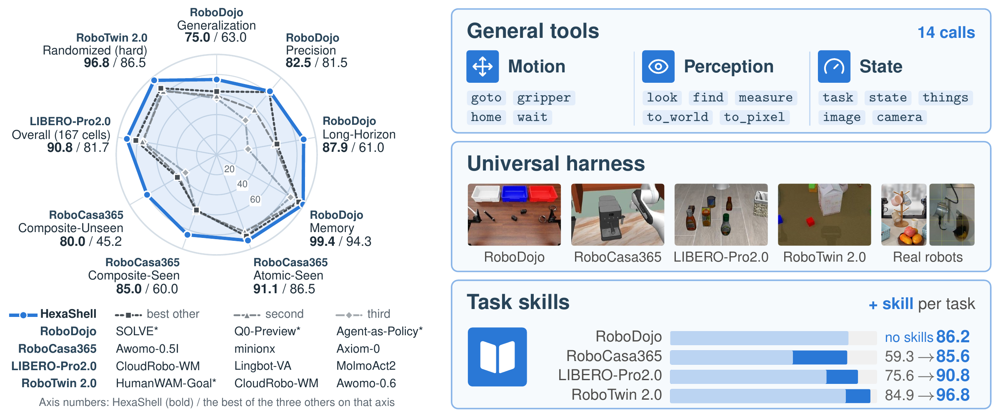
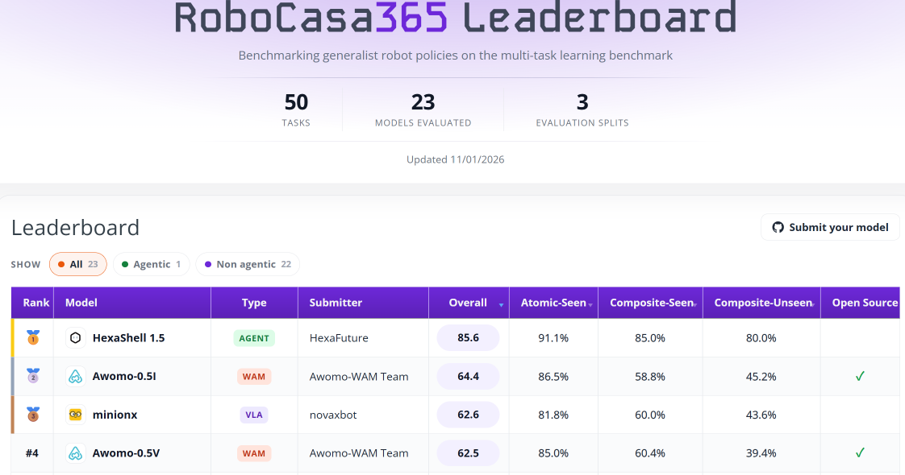
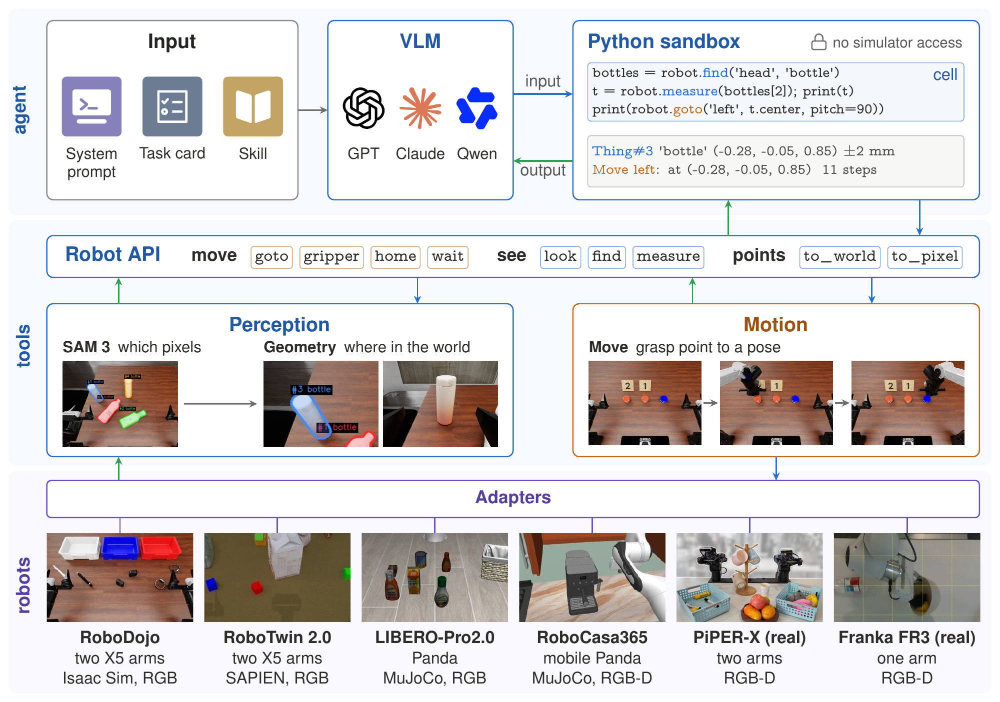
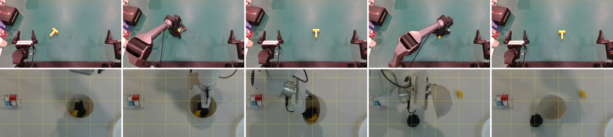

<h1 align="center">HexaShell&nbsp;&nbsp;<picture><source media="(prefers-color-scheme: dark)" srcset="assets/hexafuture-logo-dark.png"><source media="(prefers-color-scheme: light)" srcset="assets/hexafuture-logo-light.png"></picture></h1>

<p align="center">
  <strong>A Universal Harness for Robot Coding Agents in Simulation and the Real World</strong>
</p>

<p align="center">
  <a href="hexashell_paper.pdf">📄 Paper PDF</a> ·
  <a href="https://hexafuture.ai">🌐 Homepage</a> ·
  <a href="https://github.com/HexaFuture/HexaShell">💻 Project</a>
</p>

<p align="center">English · <a href="README_zh.md">简体中文</a></p>

<p align="center"></p>

<p align="center"><sub><b>HexaShell exceeds the best published result on each of four simulated benchmarks.</b> Left:
success rates (%) of HexaShell and of the top three leaderboard entries. Right: its three components. HexaShell's results
are our own evaluations; models, protocols and starred (*) entries are explained in <a href="#results">Results</a>.</sub></p>

---

<a id="settings"></a>

## 🤖 One harness, many benchmarks and robots

HexaShell connects a vision language model to a robot: the model writes one Python cell per turn, the cell calls the
robot API, and the model reads the printed results and the pictures. **The agent loop, the sandbox and the core of the
robot API are the same in every row of this table; only a thin adapter and a prompt that describes the robot change.**
Arms with parallel grippers share their motion calls; a moving base, a waist, walking, fingers and a movable camera each
add the calls they need. There is no trained policy and no demonstration data.

| Body | Benchmark or robot | Simulator | Cameras | HexaShell |
|---|---|---|---|---|
| **Two arms** | [RoboDojo](#robodojo-eval): two ARX X5 arms | Isaac Sim | head and wrists, RGB | **86.2%** success, score 89.0 (agent-track rules, no skills, GPT-6.2-Astra) |
| | [RoboTwin 2.0](docs/more_results.md#robotwin): two ARX X5 arms | SAPIEN | head and wrists, RGB | [results](docs/more_results.md#robotwin) |
| **Humanoid** | [RoboColiseum Season II](#robocoliseum-eval): AgiBot G2 driving its base, AgiBot G1; also the two-arm ARX and AgileX robots | Genie Sim 3.6 (Isaac Sim, Newton, libuipc, MuJoCo) | head and wrists, RGB-D | overall **53.4** with skills (GPT-6.2-Astra; entry under review) |
| | [RoboColiseum Season I](docs/more_results.md#robocoliseum1): AgiBot G2, two arms and a waist | Genie Sim 3.5 (Isaac Sim) | head and wrists, RGB-D | [results](docs/more_results.md#robocoliseum1) |
| | [SIMPLE](#simple-eval): Unitree G1, walking, three-finger hands | MuJoCo, rendered by Isaac Sim | movable gaze camera, RGB-D | **131/150** with skills |
| **One arm** | [LIBERO-Pro 2.0](docs/more_results.md#liberopro2): Franka Panda | MuJoCo | front and wrist, RGB | [results](docs/more_results.md#liberopro2) |
| | [LIBERO-PRO](docs/more_results.md#liberopro): Franka Panda | MuJoCo | front and wrist, RGB-D | [results](docs/more_results.md#liberopro) |
| **Arm on a wheeled base** | [RoboCasa365](#robocasa-eval): PandaOmron | MuJoCo | left, right and wrist, RGB-D | 59.3 without skills, **85.6** with them |
| **Dexterous hands** | [DexJoCo-X](#dexjoco-eval): one or two Franka Panda arms with five-finger, 20-joint Wuji hands | MuJoCo | scene and wrists, RGB-D | 286/300 without skills, **297/300** with them |
| | [RoboColiseum Season II](#robocoliseum-eval), `dexmanip` board: AgiBot G2 with two Wuji hands | Genie Sim 3.6 | head and wrists, RGB-D | **42.7** on this board, same entry |
| **Real robots** | [Two PiPER-X arms](#real-robot-urai) through URAI | – | head and wrists, RGB-D | **76/90** over nine tasks, no skills |
| | [Franka FR3](#real-robot-fr3), single arm | – | external and wrist, RGB-D | **41/50** over five tasks, no skills |

<sub>GPT-6-Astra unless stated; Claude Opus 5.5 on the real robots. The evaluations are our own, except RoboColiseum's,
which its platform runs and scores. Skills: an optional page of guidance per task. Episodes, protocols and comparisons are
in [Results](#results).</sub>

### Adapt it to your benchmark or robot with one sentence

[docs/adding_benchmarks_and_robots.md](docs/adding_benchmarks_and_robots.md) describes everything a new setting needs:
how the harness is structured, the protocol to settle first, the existing adapter to start from, the files to write,
how prompts and skills are learned in rounds, and the tests and acceptance checks, for simulated benchmarks and for real
robots. It is written so that the work can be handed to a coding agent (Claude Code, Codex, ...). Open this repository in
the agent and say, for a benchmark:

```text
Following docs/adding_benchmarks_and_robots.md, adapt HexaShell to <benchmark> (<repository URL or local path>).
Write an adaptation plan and a learning plan first, and wait for my confirmation before writing code.
```

and for a real robot:

```text
Following docs/adding_benchmarks_and_robots.md, adapt HexaShell to <robot> (arms: ..., hand: ..., cameras: ...,
control interface: ...). Write an adaptation plan and a learning plan first. Start with the service's simulator and its
read-only mode, and do not move the robot before I say so.
```

The agent answers with the two plans. The adaptation plan settles the tasks, the robot, the cameras, the limits, what the
benchmark's rules let the agent be given, the template and the files; the learning plan settles which episodes are for
learning, for validation and for the test, how many rounds there are, and what a round costs. After your confirmation it
writes the adapter, its tests and the prompt.

## 📰 News

- 🔥 **2026-11-25** — Code update. New adapters, prompts and skills: RoboColiseum Seasons I and II (AgiBot G2 and G1, ARX
  and AgileX arms, Wuji hands), SIMPLE (Unitree G1), DexJoCo-X (Franka arms with Wuji hands), LIBERO-Pro 2.0, and a real
  Franka FR3. A [guide](docs/adding_benchmarks_and_robots.md) with which a coding agent adapts HexaShell to a new benchmark
  or robot with one prompt. RoboDojo under the rules of its agent track: 86.2% success, score 89.0, without skills. The results of
  [HexaModel-27B](#training), Qwen3.8-27B fine-tuned on episodes of the harness. Figures and results follow the updated
  [paper](hexashell_paper.pdf).
- 🔥 **2026-11-10** — HexaShell is **#1 on the [RoboColiseum Season I leaderboard](https://robocoliseum.ai/robocoliseum/leaderboard?season=season1&model_type=all)**,
  96.47 overall, 98.45 after a rerun of the manipulation board ([details](docs/more_results.md#robocoliseum1)).
- 🔥 **2026-11-03** — HexaShell is released: one task-agnostic harness with general tools for seeing and moving, on four
  simulated benchmarks and on real robots. The earlier version HexaShell-Preview on the RoboDojo leaderboard stays
  available on the branch [`v1.0`](https://github.com/HexaFuture/HexaShell/tree/v1.0).
- 🔥 **2026-11-01** — HexaShell is **#1 on the [RoboCasa365 leaderboard](https://robocasa.ai/leaderboard.html)**, 85.6
  overall (atomic 91.1%, composite seen 85.0%, composite unseen 80.0%), ahead of Awomo-0.5I (64.4), minionx (62.6)
  and Awomo-0.5V (62.5). It is the leaderboard's agentic entry; the result is our own evaluation of the 50 tasks on
  30 test seeds each of the pretrain50 split, not RoboCasa's official protocol ([details](#casa-pretrain50)).

  <p align="center"></p>

- **2026-10-19** — HexaShell-Preview (1.0) is released; it reaches the top of the RoboDojo
  leaderboard: success rate 46.9%, progress score 53.2 in RoboDojo's official evaluation.

## 🧩 Overview

Agents built on vision language models (VLMs) can control robots by writing code. The strongest of them write code for
each task over many rounds of trial and error. Such code tends to fit the benchmark on which it was tuned, can exploit the
benchmark's shortcuts, and is costly to move to a new benchmark or robot. HexaShell is a harness whose robot API, agent
loop and sandbox are shared across all tasks. At each turn the model writes one Python cell that calls this API. With
camera geometry, the API turns pixels and SAM 3 outlines into 3-D positions, so the model never has to guess a distance.
Task-specific input is limited to an optional skill, typically about a page of guidance that an analysis agent drafts from
the records of earlier runs and a person reviews.

- **A small set of general tools.** The model acts through 14 calls shared by all tasks: motion (`goto`, `gripper`, `home`,
  `wait`), perception (`look`, `find`, `measure`, `to_world`, `to_pixel`) and state (`task`, `state`, `things`, `image`,
  `camera`). `robot.goto` moves an arm, `robot.find(camera, "bottle")` segments objects with SAM 3, `robot.measure(mask)`
  locates them in 3-D with an error estimate. The API is designed with a language model as its user: every motion can be
  checked with a dry run before it consumes steps, results report problems first, and errors state what to change. Looking
  and thinking cost no steps. In a paired ablation on 420 RoboDojo episodes, the success rate falls from 67.8% to about 41%
  when the model has no way to turn pixels into 3-D positions, whether or not it has the outlines of SAM 3.
- **One harness for many settings.** The same API, loop and sandbox run on the benchmarks and robots of the
  [table above](#settings). In the six settings of the paper (four simulated benchmarks,
  two kinds of real robot) an adapter takes 350 to 3,000 lines of code. With GPT-6-Astra and without skills, HexaShell
  reaches 59.3% on RoboCasa365; on RoboDojo, whose agent track admits no skills, it reaches 74.0% with GPT-6-Astra, the
  model with which the RoboDojo team's agent reaches 20.4%, and 86.2% with GPT-6.2-Astra. On real robots it succeeds in 117
  of 140 episodes across 14 tasks.
- **Short skills for what general tools cannot supply**: a success condition that the instruction leaves open, a parameter
  that only contact reveals, the order of steps. With them HexaShell reaches 85.6% on RoboCasa365, above the best
  leaderboard and published results we found. In two earlier runs on RoboDojo that differ only in the skills, 234 of 1,020
  episodes succeed only with them and 37 only without.
- **An open model that learns from the harness.** Because every setting shares the API, successful episodes of three
  benchmarks form one training set. Fine-tuned on it, Qwen3.8-27B becomes [HexaModel-27B](#training).
- **Against HexaShell-TaskTools** (1.0, branch `v1.0`, listed as HexaShell-Preview on the RoboDojo leaderboard), an earlier
  version of our agent that supplied task knowledge as tools written for each task. After each failed episode, an optimizer
  agent wrote or repaired the task's tools; its 769 rounds left 327 task commands in about 78,000 lines of Python, which
  were then frozen. Re-run after freezing, they pass only 152 of the 420 development episodes on which they were built
  (36%). RoboDojo's agent track, success rate by dimension and overall, score overall; TaskTools' row is RoboDojo's official
  evaluation, HexaShell's rows are our own test runs:

  | System | Written per task | Success rate | Score | Generalization | Precision | Long-Horizon | Memory |
  |---|---|---|---|---|---|---|---|
  | HexaShell-TaskTools (1.0), GPT-6-Astra | 327 tool commands, ~78,000 lines of Python | 44.8 | 52.0 | 34.5 | 32.0 | 31.5 | 81.0 |
  | HexaShell, GPT-6-Astra | nothing | 74.0 | 79.0 | 66.4 | 67.1 | 64.2 | 98.3 |
  | HexaShell, GPT-6.2-Astra | nothing | **86.2** | **89.0** | **75.0** | **82.5** | **87.9** | **99.4** |

  The ranking also holds on 420 public episodes of seed 0: the frozen tools pass 157, HexaShell (GPT-6-Astra) 284 without
  skills and 351 with them. The two versions also differ in the loop, perception, motion and prompt, so this shows that
  general tools beat tools written for each task, not which change matters most.

This repository holds the code, prompts and skills behind the results below, except the prompt and the skills of two
[earlier RoboDojo runs](#robodojo-skills). Development records (episode records, analyses, earlier versions of the skills
and prompts) are not included.

## 🔍 How it works

<p align="center"></p>

<p align="center"><sub><b>Overview.</b> The same agent and tools serve every setting; only the adapters and the prompt's
description of the robot change. At each turn the model (a GPT, Claude or Qwen model) writes one Python cell, which runs
in a sandbox and calls the robot API. Behind the API, perception and motion do the work. Blue arrows are calls, green
arrows results.</sub></p>

- **What the model sees**: the system prompt (`prompts/<setting>/`, six parts: rules, world, API, seeing, acting,
  checking); a task card with the instruction, the step budget, the start pose and the start pictures, on RoboDojo also
  the benchmark's official description and scoring of the task, and the task's skill when skills are on (`skills/`); then
  the output of each cell and the pictures it asked for.
- **What it does not see**: the simulator's state. The agent gets the benchmark's RGB(-D) cameras, the camera parameters,
  proprioception, the instruction and the budget; success is judged by the benchmark's own check. The robot's own pixels,
  which measurements leave out, are drawn from its geometry at the joint readings (RoboDojo, LIBERO-Pro 2.0, RoboColiseum,
  the real robots) or taken from the renderer's segmentation of the robot's own parts (the other benchmarks).
- **Budgets**: the benchmark's step limit (control steps), plus limits on replies and wall-clock time per episode.
  Thinking and looking cost no steps.

<a id="results"></a>

## 📊 Results

Success rates (%) of our own evaluations, October–November 2026, with `gpt-6-astra` unless stated. Without skills, nothing
is written for any task; with skills, the task's page of guidance is added to the prompt. "Other results": the best entry
of the benchmark's leaderboard or results reported in papers, each on its own episodes and protocol.

| Benchmark | Episodes | Without skills | With skills | Other results |
|---|---|---|---|---|
| [RoboDojo](https://robodojo-benchmark.com/LeaderBoard), agent track: 34 tasks, seeds 0–2, layouts 10–19 ([details](#robodojo-eval)) | 1,020 | **86.2**, score **89.0** (GPT-6.2-Astra); 74.0, score 79.0 (GPT-6-Astra) | not admitted by the track | SOLVE 75.0, score 79.5 (starred: not ranked); WorldScape-R²SI 37.3, score 45.9 (the best ranked entry) |
| [RoboColiseum](https://robocoliseum.ai/robocoliseum/leaderboard?season=season2&model_type=all) Season II (Genie Sim 3.6): 50 tasks on four boards, run and scored by the platform; overall score × 100 ([details](#robocoliseum-eval)) | – | – | **53.4** (GPT-6.2-Astra; under review, not on the leaderboard yet) | FF Omnimind 27.5; GPT-6.2 Astra (baseline) 27.4 (leaderboard) |
| [RoboCasa365](https://robocasa.ai/leaderboard.html): 50 tasks, test seeds 20–49 of the pretrain50 split ([details](#robocasa-eval)) | 1,500 | 59.3 | **85.6** | Awomo-0.5I 64.4 (leaderboard) |
| [SIMPLE](https://github.com/physical-superintelligence-lab/SIMPLE) (Unitree G1): five tasks, the official test episodes ([details](#simple-eval)) | 150 | – | **87.3** within the official step limits, 94.7 within 45 s | – |
| [DexJoCo-X](https://github.com/dexjoco-x/DexJoCo-X-public) (Wuji hands): six tasks, the first 50 official test seeds of each ([details](#dexjoco-eval)) | 300 | 95.3 | **99.0** | – |
| Real robots: 14 tasks × 10 episodes ([details](#real-robots)) | 140 | **83.6** (117/140; PiPER-X 76/90, Franka FR3 41/50; Claude Opus 5.5) | – | – |

- **More results.** RoboTwin 2.0 and LIBERO-Pro 2.0, two of the four benchmarks of the first figure, RoboColiseum Season I
  and LIBERO-PRO are in [docs/more_results.md](docs/more_results.md).
- **Settings.** The two RoboDojo runs and the two RoboCasa365 runs use reasoning effort `xhigh`, all others `high`. On
  DexJoCo-X the two columns differ only in the skills and ran on the same episodes; on RoboCasa365 they also differ in the
  picture window.
- **None of the simulated results is a full official evaluation**, except RoboColiseum's. Our RoboDojo test uses public
  layouts and 30 episodes per task; RoboDojo's official evaluation has 150 per task on layouts that are not public.
  HexaShell has been submitted to it, and its result will be added here. RoboCasa365's official protocol (50 episodes per
  task) is also still to be run.
- Leaderboards as of 18 November 2026 (RoboDojo), 1 November (RoboCasa365) and 25 November (RoboColiseum). In the first
  figure, RoboDojo's starred entries were tested before the rules of the agent track and are not ranked there, and the star
  of HumanWAM-Goal on RoboTwin 2.0 marks goal images generated by GPT Image 2.5.

**What perception contributes.** RoboDojo, the 420 episodes of seed 2, GPT-6-Astra at `high`, no skills, with calls removed
from the API and from the prompt (success rate over five dimensions, with Open):

| Perception | SAM 3 outlines | Geometry calls | Camera models | Success rate | Successes |
|---|:-:|:-:|:-:|---|---|
| Full system | ✓ | ✓ | ✓ | **67.8** | 278 |
| Without SAM 3 and geometry calls | – | – | ✓ | 63.2 | 256 |
| SAM 3 without geometry | ✓ | – | – | 41.8 | 169 |
| Pictures only | – | – | – | 40.2 | 165 |

<a id="training"></a>

### HexaModel-27B

For a model, the robot API is an action space shared by every setting, so episodes of different benchmarks can be pooled
into one training set without converting between robots. We fine-tuned Qwen3.8-27B on 10,698 successful trajectories of
HexaShell, run by GPT-6-Astra and Claude Opus 5.5 on training episodes of RoboDojo, RoboCasa365 and RoboTwin 2.0, together
with general instruction data. Success rates (%) without skills, on test episodes that no training trajectory uses:

| Model | RoboDojo | RoboCasa365 | RoboTwin 2.0 |
|---|---|---|---|
| Qwen3.8-27B | 13.1 | 5.3 | 43.2 |
| HexaModel-27B-Dojo (trained on RoboDojo alone) | 32.3 | 14.4<sup>†</sup> | 52.3<sup>†</sup> |
| **HexaModel-27B** (trained on all three) | **35.7** | **20.4** | **69.2** |

<sub>† No training trajectory from this benchmark. RoboDojo: 1,260 episodes (42 tasks, seeds 0–2, layouts 30–39; 20–29 for
three tasks), over its five dimensions. RoboCasa365: the 1,500 test episodes above. RoboTwin 2.0: the
[750 test episodes](docs/more_results.md#robotwin) without skills. The weights and the training data are not part of this
repository.</sub>

## Requirements

- Linux with NVIDIA GPUs. RoboDojo (Isaac Sim 5.1), RoboTwin (ray-traced cameras), SIMPLE and local RoboColiseum runs
  (Isaac Sim) need RTX GPUs; we ran them on RTX 4090s. RoboCasa, LIBERO-PRO, LIBERO-Pro 2.0 and DexJoCo-X render with
  MuJoCo's EGL backend on any NVIDIA GPU. RoboColiseum's online evaluation needs no simulator and only a GPU for SAM 3.
- A model endpoint with streaming: an OpenAI-compatible `/chat/completions` (tested with `gpt-6-astra` and
  `gpt-6.2-astra`), or an Anthropic Messages endpoint for Claude (see [Using Claude](#using-claude)), and its key.
- The policy environment: Python 3.11 with [requirements.txt](requirements.txt).
- SAM 3 for segmentation: torch 2.7 with CUDA, [sam3](https://github.com/facebookresearch/sam3) and its checkpoint
  `sam3.pt` (gated on Hugging Face: [facebook/sam3](https://huggingface.co/facebook/sam3)). One service per machine
  serves all episodes. The real robots do not use it.
- For RoboDojo: RoboDojo with its simulator environment, assets and XPolicyLab, installed as RoboDojo's
  documentation describes, and conda (RoboDojo's scripts activate environments with `conda activate`).
- For the other benchmarks: their simulator environments ([below](#other-benchmarks)).
- For the real robots: a running [URAI](https://github.com/HexaFuture/URAI) service with the
  [additions for HexaShell](#real-robot-urai), or the Franka FR3 service of this repository ([Real robots](#real-robots)).

## Setup

```bash
git clone --recurse-submodules https://github.com/HexaFuture/HexaShell.git && cd HexaShell
                                        # third_party/: RoboCasa and robosuite (only the RoboCasa port uses them)
conda create -n hexashell python=3.11 -y && conda activate hexashell
pip install -r requirements.txt         # the policy environment (POLICY_ENV)
python -m pytest -q tests               # no simulator or GPU needed
```

1. **SAM 3.** Install torch 2.7.0 and torchvision 0.22.0 with CUDA, `timm` and `sam3` (from its repository), in this
   environment or another one; download `sam3.pt` to `checkpoints/sam3.pt` (or set `SAM3_CHECKPOINT_PATH`).
   sam3 0.1.0 also needs `einops`, `pycocotools` and `psutil`, which it does not declare, and `setuptools<81` (it
   imports `pkg_resources`). The checkpoint is gated: request access to `facebook/sam3` on Hugging Face first.
2. **Machine settings.** `cp config/env.example.sh config/env.sh` and edit the paths in it: the RoboDojo checkout
   (`ROBODOJO_ROOT`), the two environments RoboDojo activates (`POLICY_ENV`, `EVAL_ENV`), SAM 3's Python and
   checkpoint, and the benchmark environments. The scripts read `$HEXASHELL_ENV` when it is set, else
   `config/env.sh` (git-ignored). The template puts `TMPDIR` under `/tmp`; where `/tmp` is small, point it at a disk
   with room before installing (pip unpacks the torch and CUDA wheels there, several GB). A single episode renders on
   the GPU `HEXASHELL_EGL_DEVICE` names (or `--egl`).
3. **The model's key.** Put it in `~/.config/hexashell/api-key` (one line, `chmod 600`), or in `$OPENAI_API_KEY`.
   The key stays in the episode driver; the process that runs the model's cells never gets it. Never commit it.
4. **The model endpoint** (required: there is no default). Set `api_base` (and `model`, if yours differs) in
   [xpolicylab/HexaShell/deploy.yml](xpolicylab/HexaShell/deploy.yml) for RoboDojo and in
   [config/benches.yml](config/benches.yml) for the other benchmarks. Both hold the placeholder
   `https://api.example.com/v1`. `bash scripts/gateway_ping.sh` sends one tiny request to the endpoint of
   benches.yml.
5. **Direct connections.** The websocket between RoboDojo's simulator and the policy server, and the model API, must
   not go through an HTTP proxy; `config/env.example.sh` unsets the proxy variables.
6. **Start the SAM 3 service** (once per machine; its port must match `sam3_url` in deploy.yml and benches.yml):

   ```bash
   bash scripts/sam3_service.sh start 0 18300     # GPU 0, port 18300
   bash scripts/sam3_service.sh status 18300
   ```

### RoboDojo

Install RoboDojo as its documentation describes (the simulator environment with Isaac Sim 5.1, the assets, and
XPolicyLab, which its install script clones into the checkout). The agent-track runs need RoboDojo `fbfbbcb` or later,
whose observations carry the official description of the task; we tested with `fbfbbcb` and XPolicyLab `30b2d4a`, and the
earlier runs with `09bd5f5` and `53c5da5`. Then link the policy into XPolicyLab (a symlink, not a copy: the policy finds
the `hexashell` package through it):

```bash
ln -s "$PWD/xpolicylab/HexaShell" "$ROBODOJO_ROOT/XPolicyLab/policy/HexaShell"
```

`scripts/run_one.sh` and `scripts/batch.sh` run chosen layouts of a seed; for that, RoboDojo needs a small change
(an environment variable `ROBODOJO_LAYOUT_IDS`, read by its seed manager; the patch applies to `09bd5f5`, `fbfbbcb` and
`c3af1ac`). RoboDojo's own evaluation does not need it:

```bash
git -C "$ROBODOJO_ROOT" apply "$PWD/scripts/patches/robodojo-layout-ids.patch"
```

<a id="other-benchmarks"></a>

### The other benchmarks

Each benchmark runs in its own Python environment (their Python, numpy and simulator versions differ from the
policy's). The scripts in [scripts/setup/](scripts/setup/README.md) build four of them inside the checkout by default
(`.venvs/`, `.bench-data/`; both git-ignored) and are safe to rerun:

```bash
bash scripts/setup/setup_robocasa.sh    # CPython 3.12 venv, the submodules patched, bench-env.sh (assets: below)
bash scripts/setup/setup_libero.sh      # CPython 3.11 venv, LIBERO-PRO sources and assets, env.sh
bash scripts/setup/setup_robotwin.sh    # CPython 3.11 venv, torch cu128, cuRobo built locally, assets, env.sh
bash scripts/setup/setup_dexjoco_x.sh   # the release's environment from its locks (MuJoCo 3.4.0), env.sh
```

LIBERO-Pro 2.0, SIMPLE and Genie Sim (RoboColiseum) have installers of their own; [scripts/setup/README.md](scripts/setup/README.md)
gives the steps and the environment files.

Behind a slow proxy, `INDEX=<a PyPI mirror> bash scripts/setup/setup_robocasa.sh` takes the packages from a mirror.
RoboCasa's kitchen assets are downloaded with RoboCasa's own script, which asks before it starts:
`.venvs/bench-robocasa/bin/python -m robocasa.scripts.download_kitchen_assets --type all`. All of them are needed (the
kitchens use the generative textures too): about 11 GB of archives, 23 GB unpacked. On a slow link, fetching the
same archives with a multi-connection downloader and unpacking them where the script would is much faster.
A host without glvnd's `libEGL.so.1` and `libOpenGL.so.0` needs them added to `bench-env.sh` as the comment there
describes; `setup_robocasa.sh` rewrites `bench-env.sh`, so add them again after a rerun. Then point
`HEXASHELL_<BENCH>_PYTHON` and `HEXASHELL_<BENCH>_ENV` in `config/env.sh` at the environments (the template has the
default paths). Versions, and our changes to RoboCasa, are listed in [THIRD_PARTY_VERSIONS.md](THIRD_PARTY_VERSIONS.md).

## Configuration

| What | Where | Notes |
|---|---|---|
| Machine paths | `config/env.sh` (from `config/env.example.sh`) | read by all scripts; `$HEXASHELL_ENV` names another file |
| Agent settings for RoboDojo | `xpolicylab/HexaShell/deploy.yml` | endpoint, model, effort, skills, replies and time per episode, picture window, motion profile, SAM 3 address |
| Agent settings for the other benchmarks | `config/benches.yml` | the same names, over each benchmark's own limits (RoboCasa365: 40 replies for atomic tasks, 100 for composite ones; LIBERO-PRO, LIBERO-Pro 2.0 and RoboTwin 2.0: 40; SIMPLE: 60; DexJoCo-X: 50; all: 2 h) |
| Per-run overrides | `HEXASHELL_<NAME>=value` | any setting, e.g. `HEXASHELL_SKILLS=yes`, `HEXASHELL_MAX_TURNS=6`, `HEXASHELL_MODEL=...` |
| One benchmark episode | `python -m hexashell.benches.run ... --set name=value` | overrides all of the above |
| The model's key | `~/.config/hexashell/api-key` or `$OPENAI_API_KEY` | `api_key_file` in the settings names another file |

deploy.yml holds the settings of our RoboDojo runs under the agent track's rules: effort `xhigh`, `max_tokens` 32000,
skills off, a picture window of 90/60. The GPT-6.2-Astra run changed only the model (`HEXASHELL_MODEL=gpt-6.2-astra`). The
two earlier RoboDojo runs used a window of 20/14 and the wiki's scoring table in the task card (`ladder: true`), without
and with skills (`skills: true` adds `skills/robodojo/<task>.md` where there is one; none are included).

benches.yml has effort `high`, skills off and a window of 90/60; runs with skills turn them on with `--set skills=yes`.
The reported LIBERO-Pro 2.0 runs used these settings; the RoboCasa365 run with skills and the LIBERO-PRO and RoboTwin 2.0
runs used a window of 20/14 (`images_max=20`, `images_low=14`), the RoboCasa365 run without skills 50/30, and both
RoboCasa365 runs `reasoning_effort=xhigh`.

`two_hands: true` adds `robot.both`, which moves both arms in the same actions at the cost of the longer motion (RoboDojo;
on the URAI robots it is always there). It was off in the reported runs.

<a id="using-claude"></a>

### Using Claude

With `api: anthropic`, the same loop talks to an Anthropic Messages endpoint (`<api_base>/messages`, streamed); the
prompts, tools and records are unchanged.

- Thinking is adaptive, its depth set by `reasoning_effort`. With `thinking_display: summarized` (the default) the
  records hold a summary of it; `omitted` returns none.
- Each reply's content blocks (signed thinking, text, tool calls) are kept as they are and sent back with every later
  request, so the model continues from its own reasoning.
- `ca_file` names a private CA when the endpoint's certificate needs one.
- Pictures: Claude's thinking blocks are bound to the conversation before them. When the picture window drops an old
  picture, the replies after that point lose their thinking blocks (else the request would be rejected); their text
  and tool calls stay. So with Claude, raise `images_low` as well (e.g. `images_max` and `images_low` both to 90).

```bash
HEXASHELL_API=anthropic HEXASHELL_API_BASE=https://<your endpoint>/v1 \
HEXASHELL_API_KEY_FILE=~/.config/hexashell/claude-key \
HEXASHELL_MODEL=claude-opus-5-5 HEXASHELL_REASONING_EFFORT=medium \
HEXASHELL_IMAGES_MAX=90 HEXASHELL_IMAGES_LOW=90 \
bash scripts/run_one.sh push_T 0 0 3
```

Unless marked otherwise, the results above were obtained with `gpt-6-astra`, and those on the real robots with
`claude-opus-5-5`.

A self-hosted open model on vLLM is an OpenAI-compatible endpoint as well; `history_reasoning: true` sends each reply's
reasoning back with it, for a model trained on conversations that kept it.

<a id="robodojo-eval"></a>

## Evaluating on RoboDojo

### Official protocol

RoboDojo's own evaluation runs each task with seeds 0, 1 and 2, 50 episodes per task and seed (`--eval-num native`; for
the twelve Generalization tasks, 25 episodes of the task and 25 of its `_random` variant, which has clutter added). The
agent track scores the 34 tasks of Generalization, Precision, Long-Horizon and Memory; the eight Open tasks are outside
it. `summarize` then reads the records under `eval_result/RoboDojo/` and writes `eval_result/RoboDojo/_summary.md`:
success rate and score (task progress) per task and seed, and per capability dimension. HexaShell runs in it unchanged:

```bash
source config/env.sh && cd "$ROBODOJO_ROOT"
for task in stack_blocks stack_blocks_random; do       # every task, and each Generalization task's _random variant
    for seed in 0 1 2; do
        bash scripts/robodojo.sh eval --policy-dir XPolicyLab/policy/HexaShell --task "$task" \
            --ckpt no-checkpoint --policy-env "$POLICY_ENV" --eval-env "$EVAL_ENV" --env-cfg arx_x5 \
            --action-type joint --seed "$seed" --eval-num native --policy-gpu 0 --env-gpu 0
    done
done
bash scripts/robodojo.sh summarize
```

`--action-type joint` is required (HexaShell sends joint targets); the checkpoint name is not used. The policy needs
no GPU of its own. `robodojo.sh benchmark` runs all tasks or a selection for a seed, also spread over several GPUs
(`--gpu-ids`; see its `--help`). Every episode is a conversation with the model of up to 100 replies and 90 minutes
(deploy.yml), so the full protocol (5,100 episodes of the 34 tasks) is costly; we have not run it ourselves. HexaShell has
been submitted to RoboDojo's official evaluation; its result will be added here.

### Our test under the agent track's rules

Since 14 November 2026 RoboDojo's agent track admits no task-specific input beyond the benchmark's own description and
scoring of each task: no skills, programs or tools written for single tasks, and no checker conditions in the prompt. Our
runs follow these rules. The task card gives the instruction and the official description and scoring
(`obs["extra_info"]["detailed_instruction"]`), not the task's name or dimension, and the system prompt
(`prompts/robodojo/`) leaves out the tolerances of checkers and advice that fits single tasks.

We ran 30 public test episodes for each of the 34 tasks, 1,020 in all: seeds 0–2 × layouts 10–19 of each seed (a
Generalization task: layouts 10–14 of the task and layouts 10–14 of its `_random` variant). Layouts that RoboDojo discarded
as physically unstable were replaced by layout + 20. Development (prompts, tools, skills) used seed 0, layouts 0–9; these
are also among the official protocol's episodes. Success rate per dimension and overall, and score, as RoboDojo computes
them (the mean over the four dimensions), against the agent track's leaderboard of 18 November 2026:

| Method | Score | Success rate | Generalization | Precision | Long-Horizon | Memory |
|---|---|---|---|---|---|---|
| SOLVE\* | 79.5 | 75.0 | 63.0 | 81.5 | 61.0 | 94.3 |
| Q0-Preview\* | 73.2 | 67.3 | 58.7 | 58.5 | 58.5 | 93.7 |
| Agent-as-Policy\* | 63.5 | 54.4 | 56.2 | 44.8 | 31.8 | 85.0 |
| GO-3 Nano Preview\* | 62.0 | 56.7 | 33.7 | 76.0 | 53.5 | 63.7 |
| SenseNova-RoboRSI\* | 57.1 | 49.2 | 48.8 | 32.0 | 52.5 | 63.3 |
| PyRUA-Lean\* | 53.9 | 48.4 | 43.2 | 38.3 | 43.8 | 68.3 |
| JoyAI-VL\* | 48.7 | 41.2 | 26.8 | 36.0 | 26.0 | 76.0 |
| WorldScape-R²SI | 45.9 | 37.3 | 35.8 | 15.5 | 34.3 | 63.7 |
| EmbodiedEvo\* | 43.4 | 36.4 | 30.8 | 16.3 | 21.8 | 76.7 |
| PhysicalRSI\* | 38.1 | 33.0 | 15.6 | 32.5 | 37.3 | 46.6 |
| GPT-6-Astra agent (RoboDojo team) | 27.6 | 20.4 | 30.5 | 4.0 | 8.3 | 38.7 |
| HexaShell-TaskTools\* (listed as HexaShell-Preview) | 52.0 | 44.8 | 34.5 | 32.0 | 31.5 | 81.0 |
| HexaShell, GPT-6-Astra | 79.0 | 74.0 | 66.4 | 67.1 | 64.2 | 98.3 |
| **HexaShell, GPT-6.2-Astra** | **89.0** | **86.2** | **75.0** | **82.5** | **87.9** | **99.4** |

<sub>\* Marked by RoboDojo for input that the rules exclude, such as task-specific programs or checker conditions; tested
before the rules and not ranked. The leaderboard's rows are RoboDojo's official evaluation on layouts that are not public;
HexaShell's two rows are our own, on the 1,020 public episodes above.</sub>

- **Counts.** GPT-6-Astra succeeds in 731 of 1,020 episodes, GPT-6.2-Astra in 857 of 1,019: one episode
  (pour_liquid_into_cup, seed 2, layout 11) is left out, because its scene was unstable. On the same 1,019 episodes
  GPT-6.2-Astra gains 168 and loses 41. The standard deviation over the three seeds is below one point.
- **Rates.** RoboDojo averages the tasks of each dimension and then the dimensions, with Generalization the mean of its
  standard and cluttered halves, so the rate differs from the share of successful episodes.

<a id="robodojo-skills"></a>

### Earlier runs, without and with skills

Two runs with GPT-6-Astra at `xhigh`, made before the agent track's rules, differ only in the skills. Their task card also
named the task and its dimension and gave the description and scoring from RoboDojo's wiki, and their prompt was the one
before the changes above; neither this prompt nor the skills are in this repository. The same 1,020 episodes, and the eight
Open tasks, which have no skills:

| Dimension | Tasks | Without skills | With skills |
|---|---|---|---|
| Generalization | 12 | 232/360 (64.4%) | **280/360 (77.8%)** |
| Precision | 8 | 126/240 (52.5%) | **207/240 (86.3%)** |
| Long-Horizon | 8 | 131/240 (54.6%) | **199/240 (82.9%)** |
| Memory | 6 | 178/180 (98.9%) | 178/180 (98.9%) |
| All four | 34 | 667/1020 (65.4%) | **864/1020 (84.7%)** |
| Success rate (mean of the four dimensions) | | 67.6 | **86.5** |
| Open | 8 | 190/240 (79.2%) | 190/240 (79.2%): no skills, the same episodes |
| Success rate, with Open (mean of the five dimensions) | | 69.9 | **85.0** |
| Score, with Open (mean of the five dimensions) | | 75.7 | **88.8** |

- **What the skills do**, episode by episode on the 1,020 episodes: 234 succeeded only with skills, 37 only without
  (667 → 864). At effort `high` the same skills went from 615 to 783 (+228/−60).
- **Reasoning effort**: without skills, `xhigh` scored 667 against 615 at `high` (+120/−68, exact sign test p < 0.001);
  with skills, 844 against 782 on the 990 episodes of 33 tasks (+116/−54, p < 0.001). The picture window, without skills
  at `high`: 818 at 90/60 against 805 at 20/14 on the same 1,140 episodes (p = 0.40).

<details>
<summary>Per task (successes out of 30)</summary>

| Dimension | Task | Agent track, GPT-6-Astra | Agent track, GPT-6.2-Astra | Earlier, without skills | Earlier, with skills |
|---|---|---|---|---|---|
| Generalization | arrange_largest_number | 28 | 29 | 26 | 26 |
| Generalization | fold_clothes | 23 | 13 | 22 | 23 |
| Generalization | hang_mugs | 8 | 14 | 2 | 7 |
| Generalization | make_toast | 16 | 29 | 15 | 21 |
| Generalization | pack_objects_into_box | 8 | 15 | 8 | 26 |
| Generalization | pour_liquid_into_cup | 24 | 24 (of 29) | 17 | 29 |
| Generalization | push_T | 30 | 30 | 30 | 30 |
| Generalization | sort_nesting_dolls_by_size | 27 | 29 | 25 | 29 |
| Generalization | stack_blocks | 30 | 30 | 30 | 30 |
| Generalization | stack_bowls | 29 | 29 | 30 | 30 |
| Generalization | store_laptop_and_headphones | 0 | 0 | 0 | 1 |
| Generalization | sweep_blocks | 16 | 27 | 27 | 28 |
| Precision | build_tower | 25 | 29 | 14 | 29 |
| Precision | deposit_coin | 15 | 21 | 13 | 13 |
| Precision | fasten_screws | 28 | 30 | 10 | 30 |
| Precision | insert_key | 0 | 1 | 0 | 20 |
| Precision | insert_tubes | 28 | 30 | 24 | 29 |
| Precision | play_Xylophone | 30 | 30 | 28 | 30 |
| Precision | plug_in_charger | 10 | 27 | 9 | 28 |
| Precision | pour_balls_into_vase | 25 | 30 | 28 | 28 |
| Long-Horizon | classify_objects | 30 | 30 | 30 | 29 |
| Long-Horizon | fill_egg_holder | 3 | 14 | 4 | 19 |
| Long-Horizon | fill_pen_holder | 8 | 29 | 2 | 16 |
| Long-Horizon | make_kong | 10 | 21 | 0 | 30 |
| Long-Horizon | organize_table | 14 | 29 | 10 | 16 |
| Long-Horizon | play_stacking_toy | 30 | 29 | 26 | 30 |
| Long-Horizon | play_tic_tac_toe | 30 | 30 | 29 | 30 |
| Long-Horizon | put_bottles_into_dustbin | 29 | 29 | 30 | 29 |
| Memory | cover_blocks | 30 | 30 | 30 | 30 |
| Memory | imitate_sorting_sequence | 30 | 30 | 29 | 30 |
| Memory | match_and_pick_from_conveyor | 30 | 30 | 30 | 30 |
| Memory | press_by_number | 27 | 29 | 29 | 30 |
| Memory | swap_T | 30 | 30 | 30 | 30 |
| Memory | swap_blocks | 30 | 30 | 30 | 28 |
| Open | align_blocks | – | – | 29 | – (no skill) |
| Open | classify_objects_by_language | – | – | 28 | – (no skill) |
| Open | general_pickup | – | – | 29 | – (no skill) |
| Open | pick_from_conveyor_by_image | – | – | 20 | – (no skill) |
| Open | pour_by_language | – | – | 28 | – (no skill) |
| Open | solve_equation | – | – | 27 | – (no skill) |
| Open | stack_blocks_by_language | – | – | 29 | – (no skill) |
| Open | store_tools_in_toolbox | – | – | 0 | – (no skill) |

</details>

### Single runs and batches

These use the layout patch above.

```bash
source config/env.sh
bash scripts/run_one.sh stack_blocks 0 1 3       # task, seed, layout, simulator GPU [, episodes, run name]
mkdir -p logs && printf 'stack_blocks 0 1\nswap_T 0 2\n' > logs/demo.todo
GPUS=1,2,3 bash scripts/batch.sh demo 2          # "task seed layout" per line; at most 2 at once
python eval/report.py results/demo               # success, progress, turns, time, tokens per task
```

`batch.sh` starts episodes where there is free GPU memory, also beside other users' jobs, lists again those that
never started or that the model gateway cut short, and replaces a layout RoboDojo discards as unstable by another one. Its
header lists the other settings.

<a id="robocoliseum-eval"></a>

## Evaluating on RoboColiseum

In [RoboColiseum](https://robocoliseum.ai) the benchmark is the client: Genie Sim asks the agent for action rows over a
websocket, locally or on the competition's platform, and HexaShell answers. Besides the shared calls the robot API has
those of the robot it meets: `waist`, `head` and `body` for the torso of the AgiBot robots, `drive` for the base, `hand`
for the Wuji hands. Local episodes are split into learning, validation and test parts by instance, and a run opens a
validation or test instance only when the part is named (`--part`). Skills are on with `HEXASHELL_SKILLS=1`. Season I is in
[docs/more_results.md](docs/more_results.md#robocoliseum1).

**Season II** (Genie Sim 3.6): 50 scored tasks on four boards, `finemanip` (8 tasks, AgiBot G2), `wbc` (8, G2 driving its
base), `crsemb` (24 on four robots: AgiBot G2, AgiBot G1, ARX and AgileX) and `dexmanip` (10, G2 with two Wuji hands), in
Isaac Sim (45 tasks), libuipc (3), Newton (1) and MuJoCo (1). The season is in progress.

```bash
source config/env.sh
# local, with the Genie Sim 3.6 image
HEXASHELL_SKILLS=1 $HEXASHELL_PYTHON -m hexashell.benches.robocoliseum.run \
    --config g2op_crsemb_hang_cups_on_cup_tree --instance 0
# online: one job plays all four boards
$HEXASHELL_PYTHON -m hexashell.benches.robocoliseum.challenge login
$HEXASHELL_PYTHON -m hexashell.benches.robocoliseum.challenge submit --name <name>    # --yes sends it
export HEXASHELL_MODEL=gpt-6.2-astra HEXASHELL_REASONING_EFFORT=high                  # the model of our entry
bash hexashell/benches/robocoliseum/online.sh 4 results/online_season2
```

| Score × 100, 25 November 2026 | Overall | Dexterous Manipulation (`dexmanip`) | Precision Manipulation (`finemanip`) | Whole-Body Coordination (`wbc`) | Cross-Embodiment Transfer (`crsemb`) |
|---|---|---|---|---|---|
| **HexaShell**, GPT-6.2-Astra, with skills (under review) | **53.41** | **42.66** | **68.14** | **50.96** | **51.88** |
| FF Omnimind | 27.46 | 38.86 | 32.05 | 24.61 | 14.34 |
| GPT-6.2 Astra (baseline) | 27.37 | 16.07 | 40.68 | 31.01 | 21.74 |
| Xiaomi-Robotics-1 | 19.69 | 34.01 | 7.44 | 30.18 | 7.15 |
| Claude Fable 5.2 (baseline) | 18.30 | 3.73 | 33.04 | 18.42 | 17.99 |

The platform ran and scored our entry (completed on 24 November 2026). It is under review and not on the
[leaderboard](https://robocoliseum.ai/robocoliseum/leaderboard?season=season2&model_type=all) yet; the other
rows are the leaderboard's first four entries. A board's score is the mean of its tasks, the overall score the mean of the
four boards.

For the review of the submitted entry (online job 1931):

- **Code.** The entry was played by this repository's code: the adapter `hexashell/benches/robocoliseum/` on the shared
  modules of `hexashell/`. This release differs from it only in comments, help texts, local paths and parts that Season II
  does not use. During the job the connection to the platform (`link.py`, `tunnel.py`) was updated once, for a hang of the
  simulator on one task and for failed model requests; prompts and skills did not change.
- **Model and budget.** GPT-6.2-Astra at reasoning effort `high`, with skills; at most 80 replies (160 on `wbc`) and 240
  minutes per episode; four episodes at a time; object outlines from SAM 3.
- **What the model sees.** The benchmark's instruction and stage texts, the robot and its start pose, how the benchmark
  judges an episode, the cameras' pictures, and what the robot calls compute from the pictures and the robot's readings,
  with depth and calibration where the benchmark sends them (the native runtimes send neither). Pictures and readings come
  from the requests of the platform's simulator; the agent has no other access to it.
- **Prompts and skills** are word for word those of the entry: `prompts/robocoliseum/` (with variants for the Wuji hands and
  for the native runtimes) and `skills/robocoliseum/`. The skills were learned on instances 0 and 5, checked on instances 1
  and 6 (and on layouts of our own for some tasks), and each task's version was chosen on our local test instances
  ([skills/README.md](skills/README.md)). The platform's episodes may include instances the skills were learned on.
- **Tasks played twice.** After the platform's simulator was fixed, the organizers reset seven tasks, the six on the AgiBot
  G1 and `wok_flip`; they were played again with the same prompts and skills, and the score counts the second run.

`python -m hexashell.benches.robocoliseum.batch` plans, runs and reports local batches over several machines, and
`challenge` also shows the account, the quota, the jobs, their scores, a failed job's log and the public ranking. Both
modules say in their headers how to use them. Use your own account and your own model key.

<a id="robocasa-eval"></a>

## Evaluating on RoboCasa365

The port plays RoboCasa's kitchens, tasks and success checks unchanged, through robosuite's controllers: a PandaOmron
robot in the 50 target tasks (18 atomic, 16 composite seen, 16 composite unseen), three RGB-D cameras (left, right,
wrist) at 512 × 512. `robot.drive` moves the base.

### Official protocol

- **Split** `pretrain`: kitchen layouts and styles 11–60 with the pretraining objects; the seed draws the kitchen
  (RoboCasa draws again when a task cannot be built in it), the objects and their placement.
- **Episodes**: 50 per task, seeds 1000–1049.
- **Success**: RoboCasa's `_check_success()`, at every step; the episode ends at the first success.
- **Horizon**: each task's official horizon in 20 Hz control steps; besides, at most 40 replies of the model for an
  atomic task and 100 for a composite one, and two hours.
- **Score**: the success rate of each group (atomic seen, composite seen, composite unseen) and their weighted mean,
  18/16/16 over 50.

```bash
source config/env.sh                         # with HEXASHELL_ROBOCASA_SPLIT=pretrain, as in the template
# one episode
$HEXASHELL_PYTHON -m hexashell.benches.run --bench robocasa --task CloseFridge --seed 1000 --split pretrain \
    --set skills=yes --out results/demo
# the full protocol: 2500 episodes on warm simulator servers, two on GPU 0 and two on GPU 1, at most 4 at once
mkdir -p logs && $HEXASHELL_PYTHON -c 'from hexashell.benches.robocasa.protocol import TASKS
for tasks in TASKS.values():
    for task, _ in tasks:
        for seed in range(1000, 1050): print("robocasa", task, seed)' > logs/casa_official.todo
SETS="skills=yes" HEXASHELL_ROBOCASA_SPLIT=pretrain python3 scripts/bench_pool.py casa_official 0,0,1,1 4
python3 scripts/bench_score.py results/casa_official     # group rates and the weighted score
```

`scripts/bench_pool.py` keeps the list in `logs/NAME.todo` (lines can be added or removed while it runs), plays
episodes one after another on warm simulator servers, plays again an episode that ended in an error, and lists again
one the model gateway cut short, holding new starts for a while. `python3 scripts/pool_status.py . NAME` shows how a
batch is doing; `scripts/gateway_guard.sh . NAME` pauses it while the gateway does not answer.
`scripts/bench_batch.sh` works through the same list with a fresh simulator per episode. A server starts only on a
GPU with 3 GB free (`NEED`).

<a id="casa-pretrain50"></a>

### Other split: pretrain50

The default split when none is given (`--split`, `$HEXASHELL_ROBOCASA_SPLIT`): 50 fixed kitchens of the pretraining
set, seed `s` in kitchen `s % 50`; seeds 0–9 for learning, 10–19 for validation, 20–49 for testing. The RoboCasa skills
(`skills/robocasa/`) were written on seeds 0–9 and checked on 10–19. Its kitchens are among those the official split
draws from.

Our test of 50 tasks × seeds 20–49 (30 episodes per task), with an earlier version of this code and the prompts and skills
of this repository, at reasoning effort `xhigh`, without and with skills:

| Group | Without skills | With skills |
|---|---|---|
| Atomic (18 tasks) | 354/540 (65.6%) | **492/540 (91.1%)** |
| Composite seen (16) | 243/480 (50.6%) | **408/480 (85.0%)** |
| Composite unseen (16) | 293/480 (61.0%) | **384/480 (80.0%)** |
| Weighted (18/16/16) | 59.3 | **85.6** |

- The skills were learned for all 50 tasks, so the composite "unseen" tasks were not unseen for HexaShell: their
  skills come from our own runs on seeds 0–9.
- **Skills**, episode by episode: 466 episodes succeeded only with skills, 72 only without. The two runs also differ in
  the picture window (20/14 with skills, 50/30 without), so not all of the gap is the skills'. Without skills the weakest
  tasks were WashLettuce 1/30, ScrubCuttingBoard 2/30, LoadDishwasher 3/30, SeparateFreezerRack 3/30 and RinseSinkBasin
  4/30. Of the 610 failures without skills the model ended 393 itself, 215 ran out of steps and 2 out of time; of the 216
  with skills it ended 159 itself, and 57 ran out of steps.
- With skills the weakest tasks were HeatKebabSandwich 10/30, PackIdenticalLunches 13/30, ArrangeTea 16/30,
  SteamInMicrowave 17/30, SeparateFreezerRack 18/30 and MakeIceLemonade 19/30.
- After a first test, some skills and the system prompt's lines on placing were reworded so that nothing taken from the
  simulator is written plainly; the run with skills above used the reworded text.

<details>
<summary>Per task (successes out of 30)</summary>

| Task | Group | Without skills | With skills |
|---|---|---|---|
| CloseBlenderLid | atomic | 15 | 21 |
| CloseFridge | atomic | 20 | 26 |
| CloseToasterOvenDoor | atomic | 6 | 28 |
| CoffeeSetupMug | atomic | 15 | 26 |
| NavigateKitchen | atomic | 25 | 26 |
| OpenCabinet | atomic | 14 | 27 |
| OpenDrawer | atomic | 22 | 29 |
| OpenStandMixerHead | atomic | 14 | 28 |
| PickPlaceCounterToCabinet | atomic | 23 | 26 |
| PickPlaceCounterToStove | atomic | 29 | 28 |
| PickPlaceDrawerToCounter | atomic | 24 | 28 |
| PickPlaceSinkToCounter | atomic | 28 | 27 |
| PickPlaceToasterToCounter | atomic | 25 | 27 |
| SlideDishwasherRack | atomic | 24 | 28 |
| TurnOffStove | atomic | 27 | 28 |
| TurnOnElectricKettle | atomic | 28 | 30 |
| TurnOnMicrowave | atomic | 8 | 29 |
| TurnOnSinkFaucet | atomic | 7 | 30 |
| DeliverStraw | composite seen | 23 | 28 |
| GetToastedBread | composite seen | 25 | 25 |
| KettleBoiling | composite seen | 29 | 28 |
| LoadDishwasher | composite seen | 3 | 27 |
| PackIdenticalLunches | composite seen | 9 | 13 |
| PreSoakPan | composite seen | 6 | 30 |
| PrepareCoffee | composite seen | 21 | 24 |
| RinseSinkBasin | composite seen | 4 | 26 |
| ScrubCuttingBoard | composite seen | 2 | 30 |
| SearingMeat | composite seen | 20 | 28 |
| SetUpCuttingStation | composite seen | 21 | 25 |
| StackBowlsCabinet | composite seen | 29 | 28 |
| SteamInMicrowave | composite seen | 10 | 17 |
| StirVegetables | composite seen | 20 | 28 |
| StoreLeftoversInBowl | composite seen | 20 | 25 |
| WashLettuce | composite seen | 1 | 26 |
| ArrangeBreadBasket | composite unseen | 25 | 23 |
| ArrangeTea | composite unseen | 18 | 16 |
| BreadSelection | composite unseen | 23 | 28 |
| CategorizeCondiments | composite unseen | 24 | 26 |
| CuttingToolSelection | composite unseen | 15 | 30 |
| GarnishPancake | composite unseen | 14 | 27 |
| GatherTableware | composite unseen | 10 | 23 |
| HeatKebabSandwich | composite unseen | 6 | 10 |
| MakeIceLemonade | composite unseen | 19 | 19 |
| PanTransfer | composite unseen | 24 | 25 |
| PortionHotDogs | composite unseen | 27 | 27 |
| RecycleBottlesByType | composite unseen | 30 | 30 |
| SeparateFreezerRack | composite unseen | 3 | 18 |
| WaffleReheat | composite unseen | 22 | 25 |
| WashFruitColander | composite unseen | 9 | 30 |
| WeighIngredients | composite unseen | 24 | 27 |

</details>

<a id="simple-eval"></a>

## Evaluating on SIMPLE (Unitree G1)

[SIMPLE](https://github.com/physical-superintelligence-lab/SIMPLE) ([paper](https://arxiv.org/abs/2606.08278)) is a
loco-manipulation benchmark for a Unitree G1 with three-finger hands: MuJoCo dynamics, rendered by Isaac Sim, with a
learned whole-body controller below the arms. We play its five public tasks (the code of XMoveBendPick is not public).
`walk`, `body`, `hand`, `fingers` and `gaze` take the place of `goto` and `gripper` in the robot API; the calls for seeing
and measuring are the shared ones.

```bash
source config/env.sh
$HEXASHELL_PYTHON -m hexashell.benches.run --bench simple --task bend_pick --seed 1001 --egl 0 --set skills=yes \
    --out results/simple_dev
```

The tasks are `bend_pick`, `tabletop_grasp`, `xmove_pick`, `locomotion_pick_between_tables` and `handover`. Seeds
1000–1999 draw learning layouts and 2000–2999 validation layouts; 3000–3029 are the 30 official evaluation episodes, which
open only with `HEXASHELL_SIMPLE_OFFICIAL_TEST=1` (and `SIMPLE_EVAL_DIR`). An episode runs to the first success or 45 s
(2,250 steps), with at most 60 replies; a success within the official step limit is also counted. The 150 official test
episodes, with skills:

| Task | Official limit (steps) | Within the official limit | Within 45 s |
|---|---|---|---|
| XMovePick | 800 | 30/30 | 30/30 |
| TabletopGrasp | 800 | 30/30 | 30/30 |
| BendPick | 400 | 23/30 | 23/30 |
| Handover | 800 | 22/30 | 29/30 |
| LocomotionPickBetweenTables | 1,200 | 26/30 | 30/30 |
| **Total** | | **131/150 (87.3%)** | **142/150 (94.7%)** |

- **How the setting differs from SIMPLE's own.** The agent sees through a movable RGB-D camera at the position of
  SIMPLE's fixed head camera and is given the robot's own state; the pose of the pelvis comes from the simulator, an
  odometry without drift. Thinking and looking cost no simulated time, so episodes are counted in steps.
- Episodes interrupted by the infrastructure were run again. One of them (BendPick), whose first attempt had already
  missed, counts as a failure.

<a id="dexjoco-eval"></a>

## Evaluating on DexJoCo-X (Wuji hands)

[DexJoCo-X](https://github.com/dexjoco-x/DexJoCo-X-public) has six tasks for one or two Franka Panda arms with dexterous
hands, in MuJoCo; we play it with the Wuji hand, five fingers with four joints each. An episode is the official one: the
official camera profile, the bounds of one step and the step limit of each task (1,000–2,000 steps at 20 Hz), besides at
most 50 replies. `hand`, `fingers` and `arc` take the place of `goto` and `gripper`.

```bash
source config/env.sh
$HEXASHELL_PYTHON -m hexashell.benches.run --bench dexjoco_x --task hammer_nail --seed 101165 --egl 0 \
    --out results/dexjoco_x_dev
```

Learning and validation use the scenes of the official training data (ten seeds each per task); the official evaluation's
seeds open only with `HEXASHELL_DEXJOCO_X_OFFICIAL_TEST=1`. Our test runs the first 50 of the 150 official seeds of each
task:

| Task | Without skills | With skills |
|---|---|---|
| bimanual_microwave_cook | 41/50 | 48/50 |
| bimanual_photograph | 47/50 | 50/50 |
| bimanual_unlock_ipad | 50/50 | 50/50 |
| hammer_nail | 49/50 | 49/50 |
| pick_bucket | 50/50 | 50/50 |
| single_hand_hanoi | 49/50 | 50/50 |
| **Total** | **286/300 (95.3%)** | **297/300 (99.0%)** |

- With skills 13 episodes are gained and 2 lost. Only bimanual_microwave_cook and bimanual_photograph had skills in this
  test, so the other four tasks were run twice in the same setting; hammer_nail's skill was written afterwards and checked
  on validation seeds only.
- The task card states what each environment checks (the conditions and tolerances of its success and failure), since the
  instructions alone leave them open. The agent gets proprioception and the RGB-D cameras, and no contact information from
  the simulator.

<a id="robotwin-eval"></a>
<a id="liberopro2-eval"></a>
<a id="liberopro-eval"></a>

## More benchmarks

RoboColiseum Season I, RoboTwin 2.0, LIBERO-Pro 2.0 and LIBERO-PRO: how to run them, their protocols and our results are in
[docs/more_results.md](docs/more_results.md).

<a id="real-robots"></a>

## Real robots

On real robots the loop, the sandbox, the API and the camera geometry are those of the simulated benchmarks. An adapter
talks to the robot's own service over HTTP, and the service plans, checks and executes every motion.

<p align="center"></p>

<p align="center"><sub><b>HexaShell on real robots</b>, time from left to right. Top: two PiPER-X arms push the T into its
target pose. Bottom: a Franka FR3 pours the objects out of a bowl.</sub></p>

Ten episodes of each of 14 tasks with Claude Opus 5.5, without skills (117 of 140 succeed):

| Two PiPER-X arms | Successes | Franka FR3, single arm | Successes |
|---|---|---|---|
| Shuffle blocks | 10/10 | Put lemon on plate | 10/10 |
| Sort blocks by language instruction | 10/10 | Take lemon off plate | 10/10 |
| Stack blocks | 9/10 | Lay bottle down | 7/10 |
| Unstack blocks | 8/10 | Stand bottle up | 4/10 |
| Cover blocks | 10/10 | Pour objects out of bowl | 10/10 (3 at the first attempt) |
| Sort pens and plush toys | 7/10 | **Total** | **41/50** |
| Put papaya on plate | 9/10 | | |
| Take papaya off plate | 5/10 | | |
| Push T | 8/10 | | |
| **Total** | **76/90** | | |

A real robot has no checker. On the PiPER-X a second model, GPT-6-Astra, supervised each episode and gave a verdict from
fresh pictures and arm feedback; the counts are these verdicts, not a review of every episode by hand, prompts and
supervision rules changed between episodes, and the supervisor is not part of this repository. On the FR3 a person judged
each episode; pouring succeeded three times at the first attempt and seven times after the agent resumed. With the URAI
adapter of this repository, five PiPER-X tasks (shuffle, sort by instruction, stack, unstack, pens and toys) reached 44 of
50. The two papaya tasks ran on a second PiPER-X robot with its own adapter, which is not included; cover blocks ran on a
third one, and push T was reported by a team member without records of each episode. The paper's appendix also logs the
harness's daily use on eleven robots since 27 October 2026.

<a id="real-robot-urai"></a>

### Two PiPER-X arms, through URAI

`hexashell/real/urai` runs HexaShell on two PiPER-X arms with a head camera and two wrist cameras, all RGB-D, managed by
[URAI](https://github.com/HexaFuture/URAI) ([paper](https://arxiv.org/abs/2609.39018)): on the real robot, or on URAI's own
kinematic simulator. The adapter talks to URAI only over its HTTP interface and does not import it; URAI plans and executes
every motion (inverse kinematics, collision checking, time scaling and execution). Besides URAI's draft, preview, execute
and state routes it uses two routes for HexaShell, `GET /api/harness/model` and `POST /api/harness/observe`, the motion
primitives `goto`, `home`, `gripper` and `wait`, and `completion: "hold"`. Our robots run a version of URAI with these
additions; the public URAI does not have them yet (cfc8a13, checked on 2026-11-25) and answers the two routes with 404.
[Section 11.3 of the guide](docs/adding_benchmarks_and_robots.md#113-a-new-robot-a-service-that-speaks-urais-interface)
lists the requests and replies, and the [FR3 service](#real-robot-fr3) of this repository answers them. URAI itself is not
part of this repository.

1. Start URAI's service (a version with these additions), installed in its own environment as
   [its README](https://github.com/HexaFuture/URAI) describes:
   - its simulator: `urai-robot --sim --host 127.0.0.1 --port 7860`;
   - the real robot: `urai-robot --calibration calib.json --rig rig.json --allow-motion --port 7860`. Without
     `--allow-motion` it is read-only: it plans, and refuses motions. On an address other than loopback it needs a
     token, which this side passes in `URAI_TOKEN`.
2. Run an episode here (the policy environment is enough; URAI need not be installed):

```bash
python -m hexashell.real.urai --url http://127.0.0.1:7860 \
  --task 'Move the red block to (0.20, -0.02).' --name move_block --results runs
```

- `--url` or `URAI_URL` is required. `--script cells.py` runs cells split by `# %%` instead of the model;
  `--config settings.json` gives the settings (the names of deploy.yml; `HEXASHELL_<NAME>` still overrides them);
  `--step-limit` is the motion budget, checked before the next call; `--speed` is the speed of `goto` and `home`
  (m/s, default 0.12).
- `goto` also moves in the hand's own axes (`hand_by`, `hand_turn`), and `robot.both(left=..., right=...)` moves both arms
  at once.
- There is no segmentation service on the real robot yet, so `find`, `measure` and `things` are absent and `sam3_url`
  is not used. The model reads pixels off the pictures (`look`, `image`, with a grid or an enlarged crop) and turns
  them into points with `to_world`: from the measured depth first, then a plane at a height it gives, then a second
  view; it checks a point by projecting it back with `to_pixel`. The robot's own pixels come from URAI's collision
  capsules, projected into each picture.
- The six parts of the prompt (`prompts/urai/`), the task card, the API help and all messages are in English, and the
  model is asked to write in English; give tasks and scripts in English.
- `finish` has one more status, `done`; `result.json`'s `success` is null, and the model's report is stored as
  `agent_report`; a person judges the result.
- Records go to `<results>/urai-<name>-<time>/`; `states.jsonl` holds URAI's measured state and the outcome after each
  execution.
- Tests: `tests/test_real_urai.py` needs no URAI; `tests/test_real_urai_sim.py` runs against URAI's simulator service
  (it needs urai with these additions, scipy, fastapi and uvicorn in the environment, and is skipped without them).

<a id="real-robot-fr3"></a>

### Franka FR3

`hexashell/real/franka` holds both sides for a single-arm FR3 with an external and a wrist camera, both with depth. A
service on the robot's computer keeps the connection to the arm (franky, libfranka) and the RealSense cameras and answers
the part of URAI's interface that the PiPER-X adapter uses, so an episode runs the same code with one arm. The service plans
with the FR3's kinematics: inverse kinematics, straight lines and joint swings, checked against the table and against the arm
itself with capsules round the links. After a collision reflex it stops until an operator recovers the arm.

```bash
# on the robot's computer; the first one needs neither robot nor cameras
python -m hexashell.real.franka.server --sim --port 7861                          # kinematic simulator
pip install -r requirements.txt -r requirements-franka.txt                        # franky must match the robot's firmware
python -m hexashell.real.franka.server --rig rig.json --port 7861                 # real robot, read-only
python -m hexashell.real.franka.server --rig rig.json --allow-motion --port 7861  # real robot, moving
# an episode
python -m hexashell.real.franka --url http://127.0.0.1:7861 --task 'Put the red block in the bowl.' \
    --name red_block --results runs
```

`rig.json` describes one cell (the robot's address, the measured table height, the tool, the cameras with their serial
numbers and poses); [hexashell/real/franka/rig.py](hexashell/real/franka/rig.py) lists its fields. The service listens on
loopback; on another address it needs a token in `FRANKA_TOKEN`. Try a task on the simulator and in read-only mode before
`--allow-motion`, and keep the robot's stop within reach.

To run HexaShell on another robot, see
[docs/adding_benchmarks_and_robots.md](docs/adding_benchmarks_and_robots.md).

## Records

Each episode writes a folder under `results/` (a batch's under `results/<NAME>/`), named
`<task>_s<seed>_l<layout>-<time>` for RoboDojo, `<task>_s<seed>-<time>` for the benchmarks that `hexashell.benches.run`
plays, and after the configuration and its layout or instance for RoboColiseum:

- `result.json`: verdict, steps, replies, tokens, time (also the time lost to the model gateway) and the settings;
- `prompt.md`: the system prompt and the task card as sent; `transcript.json`: the conversation;
- `cells.jsonl` and `cells/NNN.py`: every cell's code, output, time, robot calls and steps;
- `events.jsonl`: requests to the model, motions, dropped pictures; `states.jsonl`: the arms after every action;
- `pictures/`: every picture the model was shown; `frames/`: the cameras after each cell that moved the robot.

`python eval/report.py DIR` summarises a folder of records; `python3 scripts/bench_score.py DIR [DIR2 ...]` scores
benchmark batches (the latest record per task and seed) and compares runs task by task.

## Layout

| Path | Contents |
|---|---|
| `docs/` | how to adapt HexaShell to a new benchmark or robot: [English](docs/adding_benchmarks_and_robots.md), [简体中文](docs/adding_benchmarks_and_robots_zh.md); RoboColiseum Season I, RoboTwin 2.0, LIBERO-Pro 2.0 and LIBERO-PRO: [English](docs/more_results.md), [简体中文](docs/more_results_zh.md) |
| `hexashell/runtime/` | the episode loop (`episode.py`), model clients (`llm.py`: OpenAI-compatible or Anthropic, streamed), system prompt and task card (`card.py`), the conversation and its picture window, records |
| `hexashell/kernel/` | the sandboxed worker that runs the model's cells |
| `hexashell/robot/` | the `robot` object the cells see (`proxy.py`), its host side, and the results its calls return |
| `hexashell/motion/` | forward kinematics (`chain.py`), IK and paths (`ik.py`), the driver that turns motions into actions one at a time and judges what happened (`driver.py`) |
| `hexashell/vision/` | `find` / `measure`: SAM3 client, multi-view and depth measurement, the robot's own mask, picture overlays |
| `hexashell/xpl/`, `xpolicylab/HexaShell/` | the XPolicyLab adapter and the policy folder linked into RoboDojo (`deploy.yml`, `deploy.py`, `eval.sh`) |
| `hexashell/benches/` | the ports `robocasa`, `libero`, `liberopro2`, `robotwin`, `simple` and `dexjoco_x` (protocol, simulator server, robot host; `run.py` plays one episode) and `robocoliseum1`, `robocoliseum` (Seasons I and II: the benchmark's connection, local runs, batches, online agents); `gpucheck.py` tells a GPU that no longer draws |
| `hexashell/real/` | the real robots: `urai/` (two PiPER-X arms through URAI's HTTP interface) and `franka/` (a Franka FR3: the service on its computer and the episode side) |
| `prompts/robodojo/` | RoboDojo's system prompt in six parts: rules, world, API, seeing, acting, checking |
| `prompts/robocasa/`, `libero/`, `liberopro2/`, `robotwin/`, `robocoliseum/`, `robocoliseum1/`, `simple/`, `dexjoco_x/`, `urai/`, `franka/` | the other settings' system prompts |
| `prompts/ladders/` | RoboDojo's task descriptions and official scoring tables, from RoboProbe (see NOTICE; off under the agent track's rules) |
| `skills/` | the skills: `robocasa/` (50), `liberopro2/` (8), `libero/` (71), `robotwin/` (50), `robocoliseum1/` (12), `robocoliseum/` (81), `simple/` (5), `dexjoco_x/` (3); see [skills/README.md](skills/README.md) |
| `services/sam3_server.py` | the machine's shared SAM3 service |
| `scripts/` | runs and batches (`run_one.sh`, `batch.sh`, `bench_batch.sh`, `bench_pool.py`, `liberopro2_lists.py`), scoring (`bench_score.py`), the SAM3 service, gateway checks, patches, environment setup (`setup/`) |
| `eval/report.py` | summary of episode records: success, progress, turns, time, tokens, pictures |
| `bench/` | offline tools: the robot mesh points (`build_robot_points.py`), arm-base fits (`fit_bases.py`) |
| `config/` | `env.example.sh` (machine paths), `benches.yml` (agent settings for the other benchmarks) |
| `third_party/` | submodules: RoboCasa and robosuite |
| `tests/` | pytest, no simulator needed |

## 📚 Citation

The arXiv paper will be updated to this version soon.

```bibtex
@misc{gao2026hexashellharnessexploringlimits,
      title={HexaShell: A Thin Harness for Exploring the Limits of VLM Agents as Robot Coding Agents},
      author={Hongcheng Gao and Jianshu Zeng and Alex Zhou and Shijia Ge and Xuan Shangguan and Yazhe Wang and Yexing Wan and Zelin Zheng and Jay Zhu and Xiping Li and Di Wu and Yongli Wang and Lingyu He and Zhiqi Jia and Sihang Wu and Xiao He},
      year={2026},
      eprint={2610.23479},
      archivePrefix={arXiv},
      primaryClass={cs.RO},
      url={https://arxiv.org/abs/2610.23479},
}
```

## License

Apache License 2.0, see [LICENSE](LICENSE). [NOTICE](NOTICE) lists the files, facts and ideas taken from other
projects (RoboDojo, RoboProbe, PyRUA-Lean, HexaShell-Preview, RoboCasa365 and robosuite, LIBERO and LIBERO-PRO,
LIBERO-Pro 2.0, RoboTwin, RPent, RoboColiseum and Genie Sim, SIMPLE, HITCH, DexJoCo-X, URAI, franka_description, SAM3).

RoboCasa and robosuite are included only as git submodules, with a patch to RoboCasa. No simulator, benchmark asset
(scenes, objects) or model weight is part of this repository; each has its own license.

## ⭐ Star History

<a href="https://star-history.com/#HexaFuture/HexaShell&Date">
  <picture>
    <source media="(prefers-color-scheme: dark)" srcset="https://api.star-history.com/svg?repos=HexaFuture/HexaShell&type=Date&theme=dark" />
    <source media="(prefers-color-scheme: light)" srcset="https://api.star-history.com/svg?repos=HexaFuture/HexaShell&type=Date" />
    
  </picture>
</a>
