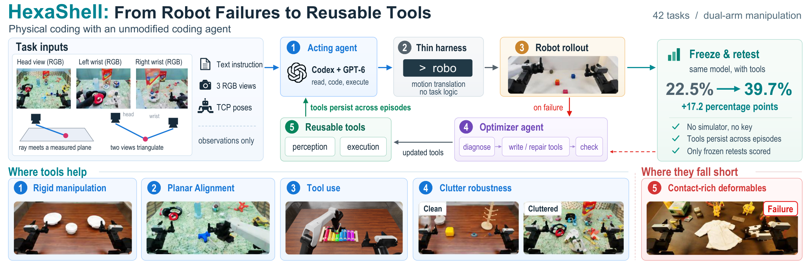
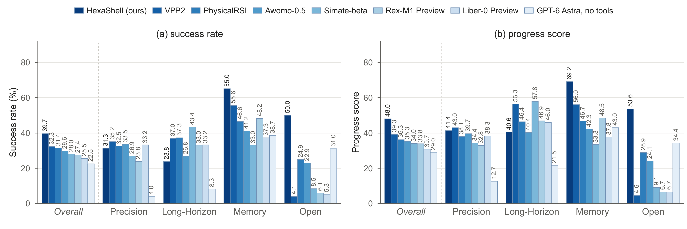

<p align="center">
  <picture>
    <source media="(prefers-color-scheme: dark)" srcset="assets/hexafuture-logo-dark.png">
    <source media="(prefers-color-scheme: light)" srcset="assets/hexafuture-logo-light.png">
    
  </picture>
</p>

<h1 align="center">HexaShell</h1>

<p align="center">
  <strong>A Thin Harness for Exploring the Limits of VLM Agents as Robot Coding Agents</strong>
</p>

<p align="center">
  <a href="paper/HexaShell.pdf">📄 Paper PDF</a> ·
  <a href="https://hexafuture.ai">🌐 Homepage</a> ·
  <a href="https://github.com/HexaFuture/HexaShell">💻 Project</a>
</p>

---

## 📰 News

- **2026-10-16** — The agent's prompt now also carries the task recipe and short notes on the task's tools, and
  the manual's rules are revised. The tools are unchanged except `swap_blocks`, which was developed again with
  RoboDojo's fix of its button reset. On ten new seed-0 layouts of each task, which the tools were not built on:
  success rate 39.7%, progress score 48.0. The paper is updated to these numbers.
- **2026-10-15** — The project is renamed HexaShell. The tools are replaced by the RGB-only version: no depth
  image is used, and positions come from triangulation. Success rate 38.3%, progress score 43.6 on the 42
  RoboDojo tasks.
- **2026-10-09** — First public release of the paper and the tools.

## 🧩 HexaShell

HexaShell asks how far a coding agent can go when it controls a robot instead of a computer. The harness is thin.
It only turns the agent's commands into robot motion. The agent gets one command line, `robo`, three RGB camera
images with their calibration, and a manual of one page. Its prompt is the task instruction, the task recipe and
short notes on the task's tools. It drives the dual-arm ARX X5 of RoboDojo in Isaac Sim.

What the agent learns is kept as **tools**: small Python programs that add sub-commands to `robo` and may use only
what the robot observes. After a failed attempt, a second agent of the same model reads the episode, finds the
cause, and writes or fixes a tool. The same layout is then tried again. Both agents are Codex with GPT-6-Astra at
medium reasoning effort. This repository releases the frozen tools and the interface they are written against.

<p align="center">
  
</p>

## 💎 Highlights

- **One interface for all 42 tasks.** The same command line, camera images and one-page manual. Nothing in the
  harness is specific to a task.
- **Failures become tools.** Each failed attempt can lead to a new or fixed tool, with its own unit tests. A
  repair round takes a median of 6.3 minutes.
- **Triangulation instead of depth.** A point seen by two calibrated cameras lies where the two pixel rays meet.
  A point on a measured plane, such as the table or the top of a block, lies where its ray meets that plane.
  When the head camera is not enough, the robot moves a wrist camera to get a second view.
- **Robust to clutter.** On the development layouts, with 13 to 18 extra objects on the table, HexaShell keeps 95% of its success, because a
  tool measures the object the agent points at and nothing else.
- **Clear limits.** Success follows the contact a task needs. Pushing reaches 92.5% and tight insertion 8.3%.

## 📊 Evaluation

Frozen tools, one episode on each layout, with RoboDojo's own checkers. The overall score uses the leaderboard's
formula: the mean of the five task types.

- **New layouts:** seed-0 layouts 10–19 of every task (Generalization tasks: five standard and five cluttered
  layouts, 5–9). The tools were not built on these layouts. The prompt carries the recipe and the notes.
  `swap_blocks` runs with RoboDojo's fix of its button reset. These are the main numbers in the paper.
- **Development layouts:** the ten seed-0 layouts the tools were built on (Generalization tasks: layouts 0–4 of
  each kind), scored before the recipes, the notes and the new rules were added.

| Task type | New layouts: success rate | New layouts: progress score | Development layouts: success rate | Development layouts: progress score |
| --- | ---: | ---: | ---: | ---: |
| Generalization | 28.3% | 35.4 | 34.2% | 37.7 |
| Precision | 31.3% | 41.4 | 21.3% | 28.4 |
| Long-Horizon | 23.8% | 40.6 | 18.8% | 32.2 |
| Memory | 65.0% | 69.2 | 73.3% | 73.3 |
| Open | 50.0% | 53.6 | 43.8% | 46.6 |
| **Overall** | **39.7%** | **48.0** | **38.3%** | **43.6** |

The figure shows the new-layout results from the paper.

<p align="center">
  
</p>

`results/new_layout_tests.md` and `results/dev_layout_retests.md` list every task, and the `.json` files next to them
hold the same numbers.

## 🔧 What is here

```
tasks/<task>/enabled_tools.txt   the tools loaded for the task (and its _random variant)
tasks/<task>/tools/<name>/       tool.py (the program), interface.md (the text the agent reads), helper modules
tasks/<task>/notes.md            notes on the task's tools from earlier runs, added to the agent's prompt
tools/table_plane/, tools/pick/  the two shared tools: table height from two views, and a grasp from above
interface/INTERFACE.md           the base manual the agent sees; tool interface files are appended to it
interface/EpisodeAPI.md          the contract a tool is written against
recipes/                         the task recipes added to the agent's prompt (from RoboProbe, Apache-2.0)
hexashell/                       the constants and helpers that tools import from the harness
results/                         the evaluations above, per task
paper/HexaShell.pdf              the paper; assets/ holds its first two figures
```

The 42 tasks hold 227 tools. The 163 enabled ones add 327 commands: 169 measure without moving the robot, and 158
move it. Tool code names no task or object; what each tool computes is described in its `interface.md`.

The harness itself (server, executors, agent container and evolution loop) is not included.

## 🚀 Using the tools

A tool runs inside the HexaShell server, which calls `run(api, command, args)` with the `api` object documented in
`interface/EpisodeAPI.md`. To run the tools you need a harness that provides that object over RoboDojo (ours, or
your own built from the contract) together with RoboDojo's Isaac Sim environment. Tools depend on numpy, OpenCV,
SciPy and transforms3d, and import constants and helpers from `hexashell/`.

The agent's prompt has three parts:

```
<official instruction>

TASK RECIPE:
<recipes/<task>.md>

TASK NOTES (from earlier runs of the same tools in other scenes):
<tasks/<task>/notes.md>
```

`_random` variants use the recipe and the notes of the base task. The recipe is the RoboDojo wiki text of the task.
A model wrote the notes from the development-layout runs of the frozen tools. They cover time, failed commands and
what worked after them, checks before stopping, and known problems. They hold no object positions, sizes or layout
numbers.

The tools are frozen at the versions scored above, and `enabled_tools.txt` lists the tools each task was scored
with. The optimizer's development notes and the tool tests are not included.

## 📚 Citation

```bibtex
@misc{gao2026hexashell,
      title={HexaShell: A Thin Harness for Exploring the Limits of VLM Agents as Robot Coding Agents},
      author={Hongcheng Gao and Alex Zhou and Jay Zhu and Zelin Zheng and Shijia Ge and Xiping Li and Di Wu and Yazhe Wang and Jianshu Zeng and Xuan Shangguan and Yongli Wang and Yexing Wan and Lingyu He and Zhiqi Jia and Sihang Wu and Xiao He},
      year={2026},
      note={HexaFuture technical report},
      url={https://github.com/HexaFuture/HexaShell},
}
```

## License

Apache License 2.0; see `LICENSE`.
