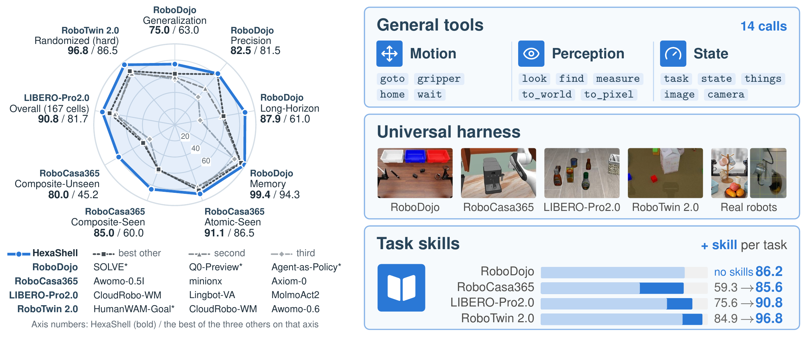
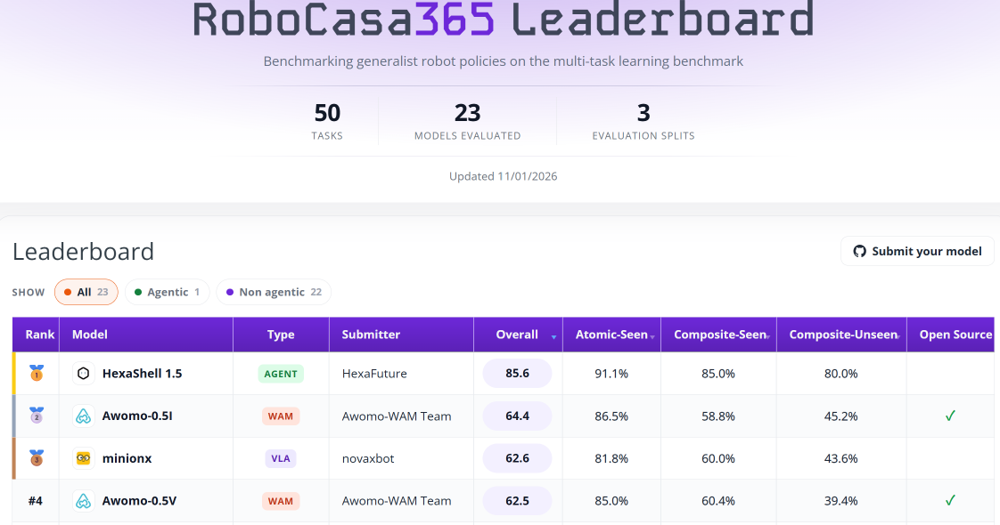
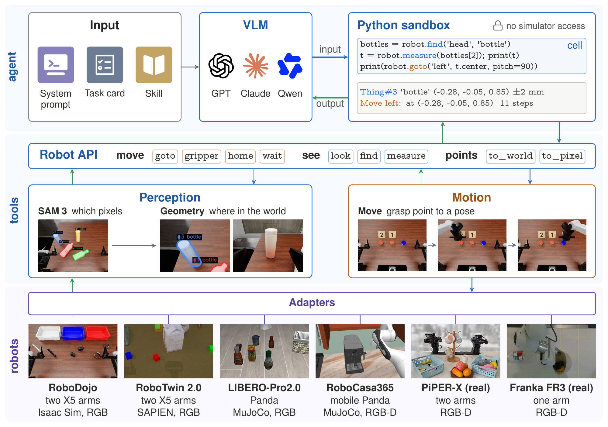
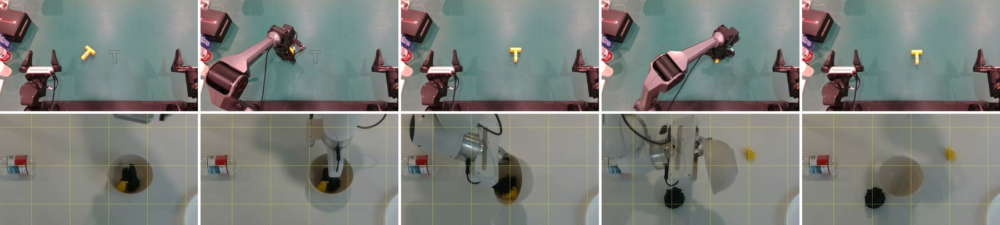

<h1 align="center">HexaShell&nbsp;&nbsp;<picture><source media="(prefers-color-scheme: dark)" srcset="assets/hexafuture-logo-dark.png"><source media="(prefers-color-scheme: light)" srcset="assets/hexafuture-logo-light.png"></picture></h1>

<p align="center">
  <strong>A Universal Harness for Robot Coding Agents in Simulation and the Real World</strong><br>
  面向仿真与真实世界的机器人编程智能体通用 harness
</p>

<p align="center">
  <a href="hexashell_paper.pdf">📄 论文 PDF</a> ·
  <a href="https://hexafuture.ai">🌐 主页</a> ·
  <a href="https://github.com/HexaFuture/HexaShell">💻 项目</a>
</p>

<p align="center"><a href="README.md">English</a> · 简体中文</p>

<p align="center"></p>

<p align="center"><sub><b>HexaShell 在四个仿真基准上都超过了已发表的最好结果。</b>左：HexaShell 与各基准排行榜前三名的成功率（%）。
右：HexaShell 的三个组成部分。HexaShell 的结果为自行评测；模型、协议和带星号（*）的条目见<a href="#results">结果</a>。</sub></p>

---

<a id="settings"></a>

## 🤖 一个 harness，多个基准与机器人

HexaShell 把视觉语言模型接到机器人上：模型每一轮写一个 Python 单元（cell），单元调用机器人 API，模型再阅读打印出的结果和
图片。**下表每一行的智能体循环、沙箱和机器人 API 的核心都相同，不同的只有一层薄适配和一份描述该机器人的提示词。** 带平行
夹爪的机械臂共用同一套运动调用；移动底盘、腰部、行走、手指和可转动的相机各自增加所需的调用。系统中没有训练得到的策略，也
没有示教数据。

| 本体 | 基准或机器人 | 仿真器 | 相机 | HexaShell |
|---|---|---|---|---|
| **双臂** | [RoboDojo](#robodojo-eval)：两台 ARX X5 机械臂 | Isaac Sim | 头部与双腕，RGB | 成功率 **86.2%**，得分 89.0（智能体赛道规则，无技能，GPT-6.2-Astra） |
| | [RoboTwin 2.0](docs/more_results_zh.md#robotwin)：两台 ARX X5 机械臂 | SAPIEN | 头部与双腕，RGB | [结果](docs/more_results_zh.md#robotwin) |
| **人形** | [RoboColiseum 第二赛季](#robocoliseum-eval)：智元 G2（移动底盘）、智元 G1；以及 ARX、AgileX 双臂机器人 | Genie Sim 3.6（Isaac Sim、Newton、libuipc、MuJoCo） | 头部与双腕，RGB-D | 有技能，总分 **53.4**（GPT-6.2-Astra；参赛结果审查中） |
| | [RoboColiseum 第一赛季](docs/more_results_zh.md#robocoliseum1)：智元 G2，双臂与腰部 | Genie Sim 3.5（Isaac Sim） | 头部与双腕，RGB-D | [结果](docs/more_results_zh.md#robocoliseum1) |
| | [SIMPLE](#simple-eval)：宇树 G1，行走，三指手 | MuJoCo，由 Isaac Sim 渲染 | 可转动的视线相机，RGB-D | 有技能 **131/150** |
| **单臂** | [LIBERO-Pro 2.0](docs/more_results_zh.md#liberopro2)：Franka Panda | MuJoCo | 前方与腕部，RGB | [结果](docs/more_results_zh.md#liberopro2) |
| | [LIBERO-PRO](docs/more_results_zh.md#liberopro)：Franka Panda | MuJoCo | 前方与腕部，RGB-D | [结果](docs/more_results_zh.md#liberopro) |
| **轮式底座机械臂** | [RoboCasa365](#robocasa-eval)：PandaOmron | MuJoCo | 左、右与腕部，RGB-D | 无技能 59.3，有技能 **85.6** |
| **灵巧手** | [DexJoCo-X](#dexjoco-eval)：一条或两条 Franka Panda 机械臂，五指 20 关节的 Wuji 手 | MuJoCo | 场景与腕部，RGB-D | 无技能 286/300，有技能 **297/300** |
| | [RoboColiseum 第二赛季](#robocoliseum-eval)的 `dexmanip` 榜：智元 G2 与两只 Wuji 手 | Genie Sim 3.6 | 头部与双腕，RGB-D | 同一次参赛，本榜 **42.7** |
| **真实机器人** | [两条 PiPER-X 机械臂](#real-robot-urai)，通过 URAI | – | 头部与双腕，RGB-D | 九个任务 **76/90**，无技能 |
| | [Franka FR3](#real-robot-fr3) 单臂 | – | 外部与腕部，RGB-D | 五个任务 **41/50**，无技能 |

<sub>除另行说明外使用 GPT-6-Astra，真实机器人上使用 Claude Opus 5.5。除 RoboColiseum 由其平台运行和评分外，均为自行评测。
技能：每个任务一份可选的、约一页的指导。回合、协议和对比见[结果](#results)。</sub>

### 一句话适配到你的基准或机器人

[docs/adding_benchmarks_and_robots_zh.md](docs/adding_benchmarks_and_robots_zh.md) 写明了接入一个新设置所需的一切：harness 的
结构、先要定下的协议、可以作为起点的现有适配、要写哪些文件、提示词和技能怎样分轮学习，以及仿真基准和真实机器人的测试与验收。
它的写法便于直接交给编程智能体（Claude Code、Codex 等）。在智能体里打开本仓库，接入仿真基准时说：

```text
参考 docs/adding_benchmarks_and_robots_zh.md，把 HexaShell 适配到 <基准名>（<仓库地址或本地路径>）。
先制定适配计划和学习计划，等我确认后再写代码。
```

接入真实机器人时说：

```text
参考 docs/adding_benchmarks_and_robots_zh.md，把 HexaShell 适配到 <机器人>（手臂：…，手：…，相机：…，控制接口：…）。
先制定适配计划和学习计划。先用服务的仿真模式和只读模式，没有我的同意不要让机器人动。
```

智能体会先给出这两份计划。适配计划确定任务、机器人、相机、各项上限、基准规则允许给智能体的输入、所用模板和要写的文件；
学习计划确定哪些回合用于学习、验证和测试，分几轮，以及一轮的代价。你确认之后，它再编写适配层、测试和提示词。

## 📰 新闻

- 🔥 **2026-11-25** — 代码更新。新增适配层、提示词和技能：RoboColiseum 第一、第二赛季（智元 G2 与 G1、ARX 与 AgileX 机械臂、
  Wuji 手），SIMPLE（宇树 G1），DexJoCo-X（Franka 机械臂与 Wuji 手），LIBERO-Pro 2.0，以及真实的 Franka FR3。新增一份
  [指南](docs/adding_benchmarks_and_robots_zh.md)，编程智能体可以据此用一句话把 HexaShell 适配到新的基准或机器人。给出智能体赛道规则下的
  RoboDojo 结果：不使用技能，成功率 86.2%，得分 89.0。给出 [HexaModel-27B](#training)（用 harness 的回合微调的 Qwen3.8-27B）的
  结果。图和结果与更新后的[论文](hexashell_paper.pdf)一致。
- 🔥 **2026-11-10** — HexaShell 位列 **[RoboColiseum 第一赛季排行榜](https://robocoliseum.ai/robocoliseum/leaderboard?season=season1&model_type=all)第一**，
  总分 98.45（[详情](docs/more_results_zh.md#robocoliseum1)）。
- 🔥 **2026-11-03** — HexaShell 发布：一个与任务无关的 harness，配有通用的感知与运动工具，运行于四个仿真基准和真实机器人上。
  RoboDojo 排行榜上的上一版本 HexaShell-Preview 仍可通过分支
  [`v1.0`](https://github.com/HexaFuture/HexaShell/tree/v1.0) 获取。
- 🔥 **2026-11-01** — HexaShell 位列 **[RoboCasa365 排行榜](https://robocasa.ai/leaderboard.html)第一**，总分 85.6
  （atomic 91.1%，composite seen 85.0%，composite unseen 80.0%），领先于 Awomo-0.5I（64.4）、minionx（62.6）和
  Awomo-0.5V（62.5）。它是该榜的智能体（agentic）类条目；该结果是我们在 pretrain50 划分上对 50 个任务、每个任务
  30 个测试种子的自行评测，并非 RoboCasa 的官方协议（[详情](#casa-pretrain50)）。

  <p align="center"></p>

- **2026-10-19** — HexaShell-Preview（1.0）发布，位列 RoboDojo 排行榜第一：在 RoboDojo
  官方评测中成功率为 46.9%，进度得分为 53.2。

## 🧩 概述

基于视觉语言模型（VLM）的智能体已经能够通过编写代码来控制机器人。其中最强的系统要经过多轮试错，为每个任务编写代码。这类代码
容易过拟合于调试所用的基准，可能利用基准中的捷径，迁移到新的基准或机器人上的代价也很高。HexaShell 是一个 harness，它的机器人
API、智能体循环和沙箱为所有任务共享。模型每一轮写一个 Python 单元来调用这套 API。API 用相机几何把像素和 SAM 3 的轮廓变成三维
位置，因此模型从不需要猜测距离。与任务相关的输入只有一份可选的技能，通常约一页的指导，由分析智能体根据以往运行的记录起草，再由
人审阅。

- **一小套通用工具。** 模型通过 14 个为所有任务共享的调用行动：运动（`goto`、`gripper`、`home`、`wait`）、感知（`look`、`find`、
  `measure`、`to_world`、`to_pixel`）和状态（`task`、`state`、`things`、`image`、`camera`）。`robot.goto` 移动一条机械臂，
  `robot.find(camera, "bottle")` 用 SAM 3 分割物体，`robot.measure(mask)` 在三维空间中定位物体并给出误差估计。API 以语言模型为
  使用者来设计：每个动作在消耗步数之前都可以先试运行（dry run）检查，返回结果先报告问题，报错会说明应当改什么。观察和思考不消耗
  步数。在 420 个 RoboDojo 回合的配对消融中，当模型无法把像素变成三维位置时，无论有没有 SAM 3 的轮廓，成功率都从 67.8% 降到约
  41%。
- **一个 harness，多种设置。** 同一套 API、循环和沙箱运行于[上表](#settings)中的基准和机器人。在论文的六个设置（四个仿真基准，
  两类真实机器人）中，一个适配层为 350 到 3,000 行代码。使用 GPT-6-Astra、不使用技能时，HexaShell 在 RoboCasa365 上达到 59.3%；
  在智能体赛道不允许技能的 RoboDojo 上，使用 GPT-6-Astra 达到 74.0%（RoboDojo 团队的智能体使用
  同一模型为 20.4%），使用 GPT-6.2-Astra 达到 86.2%。在真实机器人上，它在 14 个任务的 140 个回合中成功 117 个。
- **用简短的技能补足通用工具给不出的内容**：指令中没有明说的成功条件、只有接触才能得知的参数、步骤的顺序。使用技能后，HexaShell
  在 RoboCasa365 上达到 85.6%，高于我们所知的排行榜和已发表的最好结果。在 RoboDojo 上仅技能不同的两次较早的运行中，1,020 个回合里有
  234 个只在有技能时成功，37 个只在无技能时成功。
- **从 harness 中学习的开放模型。** 由于各个设置共用同一套 API，三个基准的成功回合可以合成一个训练集。用它微调 Qwen3.8-27B 得到
  [HexaModel-27B](#training)。
- **与 HexaShell-TaskTools 的对比**（1.0，分支 `v1.0`，在 RoboDojo 排行榜上名为 HexaShell-Preview）。这是我们智能体的上一版本，
  以为每个任务编写的工具来提供任务知识：每个失败的回合之后，由一个优化智能体编写或修复该任务的工具；769 轮优化留下了 327 条任务
  命令，约 78,000 行 Python，随后冻结。冻结后重新运行，这些工具在构建它们所用的 420 个开发回合中只通过了 152 个（36%）。下表为
  RoboDojo 智能体赛道各维度和总体的成功率以及总得分；TaskTools 一行为 RoboDojo 官方评测，HexaShell 两行为我们自己的测试：

  | 系统 | 每个任务编写的内容 | 成功率 | 得分 | Generalization | Precision | Long-Horizon | Memory |
  |---|---|---|---|---|---|---|---|
  | HexaShell-TaskTools（1.0），GPT-6-Astra | 327 条工具命令，约 78,000 行 Python | 44.8 | 52.0 | 34.5 | 32.0 | 31.5 | 81.0 |
  | HexaShell，GPT-6-Astra | 无 | 74.0 | 79.0 | 66.4 | 67.1 | 64.2 | 98.3 |
  | HexaShell，GPT-6.2-Astra | 无 | **86.2** | **89.0** | **75.0** | **82.5** | **87.9** | **99.4** |

  在种子 0 的 420 个公开回合上，这一排序同样成立：冻结的工具通过 157 个，HexaShell（GPT-6-Astra）无技能时通过 284 个，有技能时
  通过 351 个。两个版本在循环、感知、运动和提示词上也都不同，因此这一对比说明通用工具优于为每个任务编写的工具，但不能说明哪一项
  改动最为重要。

本仓库包含下文结果所用的代码、提示词和技能，但不含两次[较早的 RoboDojo 运行](#robodojo-skills)的提示词和技能。开发记录（回合
记录、分析、技能和提示词的早期版本）不包含在内。

## 🔍 工作原理

<p align="center"></p>

<p align="center"><sub><b>总览。</b>同一个智能体和同一套工具服务于所有设置，不同的只有适配层和提示词中对机器人的描述。每一轮，模型
（GPT、Claude 或 Qwen 模型）写一个 Python 单元，它在沙箱中运行并调用机器人 API。API 背后由感知和运动完成工作。蓝色箭头为调用，
绿色箭头为结果。</sub></p>

- **模型看到什么**：系统提示词（`prompts/<设置>/`，六部分：规则、世界、API、观察、行动、检查）；任务卡，包括指令、步数预算、起始位姿和
  起始图片，RoboDojo 还附有基准对该任务的官方描述和评分，开启技能时还有该任务的技能（`skills/`）；之后是每个单元的输出和它所请求的
  图片。
- **模型看不到什么**：仿真器的状态。智能体得到的是基准的 RGB(-D) 相机图像、相机参数、本体感知、指令和预算；是否成功由基准自身的
  检查判定。测量时需要排除的机器人自身像素，或根据关节读数由其几何模型绘制（RoboDojo、LIBERO-Pro 2.0、RoboColiseum、真实机器人），
  或取自渲染器对机器人自身部件的分割（其他基准）。
- **预算**：基准的步数上限（控制步），以及每个回合的回复数和墙钟时间上限。思考和观察不消耗步数。

<a id="results"></a>

## 📊 结果

以下为我们自行评测的成功率（%），时间为 2026 年 10 月至 11 月，除另行说明外使用 `gpt-6-astra`。无技能时不为任何任务编写任何内容；
有技能时把该任务的一页指导加入提示词。“其他结果”为各基准排行榜上的最好成绩，或论文报告的结果，各自基于其自身的回合与协议。

| 基准 | 回合数 | 无技能 | 有技能 | 其他结果 |
|---|---|---|---|---|
| [RoboDojo](https://robodojo-benchmark.com/LeaderBoard)，智能体赛道：34 个任务，种子 0–2，布局 10–19（[详情](#robodojo-eval)） | 1,020 | **86.2**，得分 **89.0**（GPT-6.2-Astra）；74.0，得分 79.0（GPT-6-Astra） | 赛道不允许 | SOLVE 75.0，得分 79.5（带星号，不参与排名）；WorldScape-R²SI 37.3，得分 45.9（参与排名的最好条目） |
| [RoboColiseum](https://robocoliseum.ai/robocoliseum/leaderboard?season=season2&model_type=all) 第二赛季（Genie Sim 3.6）：四个榜上的 50 个任务，由平台运行和评分；总分 × 100（[详情](#robocoliseum-eval)） | – | – | **53.4**（GPT-6.2-Astra；审查中，尚未列入排行榜） | FF Omnimind 27.5；GPT-6.2 Astra（baseline）27.4（排行榜） |
| [RoboCasa365](https://robocasa.ai/leaderboard.html)：50 个任务，pretrain50 划分的测试种子 20–49（[详情](#robocasa-eval)） | 1,500 | 59.3 | **85.6** | Awomo-0.5I 64.4（排行榜） |
| [SIMPLE](https://github.com/physical-superintelligence-lab/SIMPLE)（宇树 G1）：五个任务，官方测试回合（[详情](#simple-eval)） | 150 | – | 官方步数上限内 **87.3**，45 秒内 94.7 | – |
| [DexJoCo-X](https://github.com/dexjoco-x/DexJoCo-X-public)（Wuji 手）：六个任务，各取官方测试种子的前 50 个（[详情](#dexjoco-eval)） | 300 | 95.3 | **99.0** | – |
| 真实机器人：14 个任务 × 10 个回合（[详情](#real-robots)） | 140 | **83.6**（117/140；PiPER-X 76/90，Franka FR3 41/50；Claude Opus 5.5） | – | – |

- **更多结果。** RoboTwin 2.0 和 LIBERO-Pro 2.0（首图四个基准中的两个）、RoboColiseum 第一赛季以及 LIBERO-PRO 见
  [docs/more_results_zh.md](docs/more_results_zh.md)。
- **设置。** RoboDojo 的两次运行和 RoboCasa365 的两次运行使用推理强度 `xhigh`，其余使用 `high`。在 DexJoCo-X 上，两列只在技能上
  不同，回合相同；在 RoboCasa365 上两列在图片窗口上也不同。
- **除 RoboColiseum 外，以上仿真结果均不是完整的官方评测。** 我们的 RoboDojo 测试使用公开布局，每个任务 30 个回合；RoboDojo 官方
  评测每个任务 150 个回合，布局不公开。HexaShell 的官方评测已经提交，结果将补充于此。RoboCasa365 的官方协议（每个任务 50 个回合）
  也尚未运行。
- 排行榜日期：RoboDojo 为 11 月 18 日，RoboCasa365 为 11 月 1 日，RoboColiseum 为 11 月 25 日（均为 2026 年）。首图中，RoboDojo 上
  带星号的条目在智能体赛道的规则生效前测试，不参与排名；RoboTwin 2.0 上 HumanWAM-Goal 的星号表示使用 GPT Image 2.5 生成的目标图像。

**感知的作用。** RoboDojo 种子 2 的 420 个回合，GPT-6-Astra，`high`，无技能，从 API 和提示词中去掉若干调用（成功率为五个维度的平均，
含 Open）：

| 感知 | SAM 3 轮廓 | 几何调用 | 相机模型 | 成功率 | 成功数 |
|---|:-:|:-:|:-:|---|---|
| 完整系统 | ✓ | ✓ | ✓ | **67.8** | 278 |
| 没有 SAM 3 和几何调用 | – | – | ✓ | 63.2 | 256 |
| 有 SAM 3，没有几何 | ✓ | – | – | 41.8 | 169 |
| 只有图片 | – | – | – | 40.2 | 165 |

<a id="training"></a>

### HexaModel-27B

对模型而言，机器人 API 是所有设置共用的动作空间，因此不同基准的回合无需在机器人之间转换即可合成一个训练集。我们用 HexaShell 的
10,698 条成功轨迹微调 Qwen3.8-27B；这些轨迹由 GPT-6-Astra 和 Claude Opus 5.5 在 RoboDojo、RoboCasa365 和 RoboTwin 2.0 的训练回合
上运行得到，并与通用指令数据一起训练。下表为测试回合上的成功率（%），不使用技能，没有任何训练轨迹使用这些测试回合：

| 模型 | RoboDojo | RoboCasa365 | RoboTwin 2.0 |
|---|---|---|---|
| Qwen3.8-27B | 13.1 | 5.3 | 43.2 |
| HexaModel-27B-Dojo（仅用 RoboDojo 训练） | 32.3 | 14.4<sup>†</sup> | 52.3<sup>†</sup> |
| **HexaModel-27B**（用三个基准训练） | **35.7** | **20.4** | **69.2** |

<sub>† 训练轨迹中没有该基准的回合。RoboDojo：1,260 个回合（42 个任务，种子 0–2，布局 30–39；其中三个任务为 20–29），五个维度的平均。
RoboCasa365：上文的 1,500 个测试回合。RoboTwin 2.0：无技能的 [750 个测试回合](docs/more_results_zh.md#robotwin)。模型权重和训练数据
不在本仓库中。</sub>

## 环境要求

- 带 NVIDIA GPU 的 Linux。RoboDojo（Isaac Sim 5.1）、RoboTwin（光线追踪相机）、SIMPLE 和本地运行的 RoboColiseum（Isaac Sim）需要
  RTX GPU；我们在 RTX 4090 上运行。RoboCasa、LIBERO-PRO、LIBERO-Pro 2.0 和 DexJoCo-X 用 MuJoCo 的 EGL 后端渲染，任何 NVIDIA GPU
  均可。RoboColiseum 的线上评测不需要仿真器，只需要一块运行 SAM 3 的 GPU。
- 支持流式输出的模型接口：OpenAI 兼容的 `/chat/completions`（用 `gpt-6-astra` 和 `gpt-6.2-astra` 测试过），或用于 Claude 的
  Anthropic Messages 接口（见[使用 Claude](#using-claude)），以及相应的密钥。
- 策略环境：Python 3.11 与 [requirements.txt](requirements.txt)。
- 用于分割的 SAM 3：带 CUDA 的 torch 2.7、[sam3](https://github.com/facebookresearch/sam3) 及其权重 `sam3.pt`（在
  Hugging Face 上需申请访问：[facebook/sam3](https://huggingface.co/facebook/sam3)）。每台机器一个服务，供所有回合使用。真实机器人
  不使用它。
- RoboDojo：按 RoboDojo 的文档安装 RoboDojo 及其仿真环境、资产和 XPolicyLab，并需要 conda（RoboDojo 的脚本用
  `conda activate` 激活环境）。
- 其他基准：它们的仿真环境（[见下文](#other-benchmarks)）。
- 真实机器人：一个运行中的 [URAI](https://github.com/HexaFuture/URAI) 服务（带有[为 HexaShell 增加的接口](#real-robot-urai)），
  或本仓库的 Franka FR3 服务（见[真实机器人](#real-robots)）。

## 安装

```bash
git clone --recurse-submodules https://github.com/HexaFuture/HexaShell.git && cd HexaShell
                                        # third_party/：RoboCasa 和 robosuite（只有 RoboCasa 移植版用到）
conda create -n hexashell python=3.11 -y && conda activate hexashell
pip install -r requirements.txt         # 策略环境（POLICY_ENV）
python -m pytest -q tests               # 不需要仿真器或 GPU
```

1. **SAM 3。** 在本环境或另一个环境中安装带 CUDA 的 torch 2.7.0 和 torchvision 0.22.0、`timm` 以及 `sam3`（从其仓库
   安装）；把 `sam3.pt` 下载到 `checkpoints/sam3.pt`（或设置 `SAM3_CHECKPOINT_PATH`）。sam3 0.1.0 还需要它没有声明的
   `einops`、`pycocotools` 和 `psutil`，以及 `setuptools<81`（它导入 `pkg_resources`）。权重需要申请：先在 Hugging
   Face 上申请 `facebook/sam3` 的访问权限。
2. **机器配置。** 执行 `cp config/env.example.sh config/env.sh`，然后编辑其中的路径：RoboDojo 代码目录
   （`ROBODOJO_ROOT`）、RoboDojo 激活的两个环境（`POLICY_ENV`、`EVAL_ENV`）、SAM 3 的 Python 和权重，以及各基准的
   环境。设置了 `$HEXASHELL_ENV` 时脚本读取它，否则读取 `config/env.sh`（已被 git 忽略）。模板把 `TMPDIR` 设在 `/tmp`
   下；如果 `/tmp` 空间较小，安装前请把它指向空间充足的磁盘（pip 会在那里解压 torch 和 CUDA 的 wheel，有数 GB）。
   单个回合在 `HEXASHELL_EGL_DEVICE`（或 `--egl`）指定的 GPU 上渲染。
3. **模型密钥。** 放在 `~/.config/hexashell/api-key`（一行，`chmod 600`）或 `$OPENAI_API_KEY` 中。密钥只留在回合
   驱动进程中，运行模型单元的进程拿不到它。切勿提交密钥。
4. **模型接口**（必填，没有默认值）。在 [xpolicylab/HexaShell/deploy.yml](xpolicylab/HexaShell/deploy.yml)（RoboDojo）
   和 [config/benches.yml](config/benches.yml)（其他基准）中设置 `api_base`（模型名不同时也设置 `model`）。两个文件中
   都是占位地址 `https://api.example.com/v1`。`bash scripts/gateway_ping.sh` 会向 benches.yml 中的接口发送一个很小的
   请求。
5. **直连。** RoboDojo 仿真器与策略服务器之间的 websocket 以及模型 API 都不能经过 HTTP 代理；`config/env.example.sh`
   会清除代理变量。
6. **启动 SAM 3 服务**（每台机器一次；端口须与 deploy.yml 和 benches.yml 中的 `sam3_url` 一致）：

   ```bash
   bash scripts/sam3_service.sh start 0 18300     # GPU 0，端口 18300
   bash scripts/sam3_service.sh status 18300
   ```

### RoboDojo

按 RoboDojo 的文档安装 RoboDojo（含 Isaac Sim 5.1 的仿真环境、资产，以及其安装脚本克隆到代码目录中的 XPolicyLab）。智能体赛道
规则下的运行需要 RoboDojo `fbfbbcb` 或更新的版本，它的观测带有任务的官方描述；我们用 `fbfbbcb` 和 XPolicyLab `30b2d4a` 测试，
较早的运行用 `09bd5f5` 和 `53c5da5`。然后把策略链接进 XPolicyLab（用符号链接而不是复制：策略通过它找到 `hexashell` 包）：

```bash
ln -s "$PWD/xpolicylab/HexaShell" "$ROBODOJO_ROOT/XPolicyLab/policy/HexaShell"
```

`scripts/run_one.sh` 和 `scripts/batch.sh` 运行某个种子下指定的布局；为此 RoboDojo 需要一处小改动（一个由其种子
管理器读取的环境变量 `ROBODOJO_LAYOUT_IDS`；补丁可用于 `09bd5f5`、`fbfbbcb` 和 `c3af1ac`）。RoboDojo 自身的评测不需要它：

```bash
git -C "$ROBODOJO_ROOT" apply "$PWD/scripts/patches/robodojo-layout-ids.patch"
```

<a id="other-benchmarks"></a>

### 其他基准

每个基准运行在自己的 Python 环境中（它们的 Python、numpy 和仿真器版本与策略环境不同）。
[scripts/setup/](scripts/setup/README.md) 中的脚本默认在代码目录内构建其中四个（`.venvs/`、`.bench-data/`，均被 git
忽略），可以重复运行：

```bash
bash scripts/setup/setup_robocasa.sh    # CPython 3.12 venv，打好补丁的子模块，bench-env.sh（资产见下文）
bash scripts/setup/setup_libero.sh      # CPython 3.11 venv，LIBERO-PRO 源码和资产，env.sh
bash scripts/setup/setup_robotwin.sh    # CPython 3.11 venv，torch cu128，本地编译的 cuRobo，资产，env.sh
bash scripts/setup/setup_dexjoco_x.sh   # 按发布版锁文件建立的环境（MuJoCo 3.4.0），env.sh
```

LIBERO-Pro 2.0、SIMPLE 和 Genie Sim（RoboColiseum）有各自的安装程序；[scripts/setup/README.md](scripts/setup/README.md) 给出步骤和
环境文件。

代理较慢时，`INDEX=<PyPI 镜像> bash scripts/setup/setup_robocasa.sh` 会从镜像获取软件包。RoboCasa 的厨房资产用
RoboCasa 自己的脚本下载，脚本会在开始前询问：
`.venvs/bench-robocasa/bin/python -m robocasa.scripts.download_kitchen_assets --type all`。全部资产都需要（厨房也用到
生成的纹理）：压缩包约 11 GB，解压后 23 GB。网络较慢时，用多连接下载器获取同样的压缩包，再解压到脚本本应解压的
位置，会快很多。如果主机缺少 glvnd 的 `libEGL.so.1` 和 `libOpenGL.so.0`，需要按 `bench-env.sh` 中注释的说明把它们
加进去；`setup_robocasa.sh` 会重写 `bench-env.sh`，重新运行后需要再加一次。然后在 `config/env.sh` 中把
`HEXASHELL_<BENCH>_PYTHON` 和 `HEXASHELL_<BENCH>_ENV` 指向这些环境（模板中给出了默认路径）。各组件的版本以及我们对
RoboCasa 的改动列在 [THIRD_PARTY_VERSIONS.md](THIRD_PARTY_VERSIONS.md) 中。

## 配置

| 内容 | 位置 | 说明 |
|---|---|---|
| 机器路径 | `config/env.sh`（由 `config/env.example.sh` 复制） | 所有脚本都读取；`$HEXASHELL_ENV` 可以指定另一个文件 |
| RoboDojo 的智能体设置 | `xpolicylab/HexaShell/deploy.yml` | 接口、模型、推理强度、技能、每个回合的回复数和时间、图片窗口、运动参数、SAM 3 地址 |
| 其他基准的智能体设置 | `config/benches.yml` | 同名设置，叠加在各基准自身的上限之上（RoboCasa365：原子任务 40 次回复，组合任务 100 次；LIBERO-PRO、LIBERO-Pro 2.0 和 RoboTwin 2.0：40 次；SIMPLE：60 次；DexJoCo-X：50 次；全部：2 小时） |
| 单次运行的覆盖 | `HEXASHELL_<NAME>=value` | 任意设置，例如 `HEXASHELL_SKILLS=yes`、`HEXASHELL_MAX_TURNS=6`、`HEXASHELL_MODEL=...` |
| 单个基准回合 | `python -m hexashell.benches.run ... --set name=value` | 覆盖以上所有设置 |
| 模型密钥 | `~/.config/hexashell/api-key` 或 `$OPENAI_API_KEY` | 设置中的 `api_key_file` 可以指定另一个文件 |

deploy.yml 中是我们在智能体赛道规则下的 RoboDojo 运行所用的设置：推理强度 `xhigh`，`max_tokens` 32000，技能关闭，图片窗口 90/60。
GPT-6.2-Astra 的运行只改了模型（`HEXASHELL_MODEL=gpt-6.2-astra`）。两次较早的 RoboDojo 运行使用图片窗口 20/14，任务卡中带 wiki 的
评分表（`ladder: true`），一次无技能，一次有技能（`skills: true` 会加入 `skills/robodojo/<task>.md`，如果有；本仓库不含这些技能）。

benches.yml 中推理强度为 `high`，技能关闭，图片窗口 90/60；有技能的运行用 `--set skills=yes` 打开技能。报告的 LIBERO-Pro 2.0 运行
使用这些设置；RoboCasa365 有技能的运行以及 LIBERO-PRO 和 RoboTwin 2.0 的运行使用图片窗口 20/14（`images_max=20`、`images_low=14`），
RoboCasa365 无技能的运行使用 50/30，RoboCasa365 的两次运行都设置 `reasoning_effort=xhigh`。

`two_hands: true` 会加上 `robot.both`，它在同一组动作中移动双臂，代价是用时取较长的那个动作（RoboDojo；在 URAI 机器人上始终可用）。
报告的运行中它是关闭的。

<a id="using-claude"></a>

### 使用 Claude

设置 `api: anthropic` 后，同一循环改为与 Anthropic Messages 接口通信（`<api_base>/messages`，流式）；提示词、工具和
记录不变。

- 思考是自适应的，深度由 `reasoning_effort` 设定。`thinking_display: summarized`（默认）时，记录中保存思考的摘要；
  设为 `omitted` 时不返回思考内容。
- 每次回复的内容块（带签名的思考、文本、工具调用）原样保留，并随之后的每个请求发回，使模型能接着自己的推理继续。
- 当接口的证书需要私有 CA 时，用 `ca_file` 指定。
- 图片：Claude 的思考块与它之前的对话绑定。当图片窗口丢弃一张旧图片时，该位置之后的回复会失去思考块（否则请求会
  被拒绝），其文本和工具调用保留。因此使用 Claude 时也应调大 `images_low`（例如 `images_max` 和 `images_low` 都设为 90）。

```bash
HEXASHELL_API=anthropic HEXASHELL_API_BASE=https://<your endpoint>/v1 \
HEXASHELL_API_KEY_FILE=~/.config/hexashell/claude-key \
HEXASHELL_MODEL=claude-opus-5-5 HEXASHELL_REASONING_EFFORT=medium \
HEXASHELL_IMAGES_MAX=90 HEXASHELL_IMAGES_LOW=90 \
bash scripts/run_one.sh push_T 0 0 3
```

除另有注明外，上文的结果用 `gpt-6-astra` 得到，真实机器人的结果用 `claude-opus-5-5` 得到。

用 vLLM 自行部署的开放模型同样是 OpenAI 兼容接口；对于训练时保留了推理内容的模型，`history_reasoning: true` 会把每次回复的推理
随对话一起发回。

<a id="robodojo-eval"></a>

## 在 RoboDojo 上评测

### 官方协议

RoboDojo 自身的评测以种子 0、1、2 运行每个任务，每个任务每个种子 50 个回合（`--eval-num native`；十二个 Generalization 任务为
该任务 25 个回合加上其 `_random` 变体 25 个回合，后者添加了杂物）。智能体赛道计入 Generalization、Precision、Long-Horizon 和
Memory 的 34 个任务，八个 Open 任务不在其中。随后 `summarize` 读取 `eval_result/RoboDojo/` 下的记录，写出
`eval_result/RoboDojo/_summary.md`：按任务和种子、以及按能力维度给出成功率和得分（任务进度）。HexaShell 不加修改即可在其中运行：

```bash
source config/env.sh && cd "$ROBODOJO_ROOT"
for task in stack_blocks stack_blocks_random; do       # 每个任务，以及每个 Generalization 任务的 _random 变体
    for seed in 0 1 2; do
        bash scripts/robodojo.sh eval --policy-dir XPolicyLab/policy/HexaShell --task "$task" \
            --ckpt no-checkpoint --policy-env "$POLICY_ENV" --eval-env "$EVAL_ENV" --env-cfg arx_x5 \
            --action-type joint --seed "$seed" --eval-num native --policy-gpu 0 --env-gpu 0
    done
done
bash scripts/robodojo.sh summarize
```

`--action-type joint` 是必需的（HexaShell 发送关节目标）；检查点名称不会被使用。策略本身不需要 GPU。
`robodojo.sh benchmark` 可以对某个种子运行全部或部分任务，也可以分布到多块 GPU 上（`--gpu-ids`；见其 `--help`）。
每个回合都是与模型最多 100 次回复、90 分钟的对话（deploy.yml），因此完整协议（34 个任务共 5,100 个回合）代价很高，我们自己没有
运行过。HexaShell 已提交 RoboDojo 官方评测，结果将补充于此。

### 我们在智能体赛道规则下的测试

自 2026 年 11 月 14 日起，RoboDojo 的智能体赛道除基准对每个任务的官方描述和评分外，不允许任何针对任务的输入：不允许技能，不允许
为单个任务编写的程序或工具，提示词中不允许出现检查器的条件。我们的运行遵守这些规则。任务卡给出指令以及官方描述和评分
（`obs["extra_info"]["detailed_instruction"]`），不给出任务名和维度；系统提示词（`prompts/robodojo/`）不含检查器的容差，也不含
只适用于单个任务的建议。

我们对 34 个任务各运行 30 个公开测试回合，共 1,020 个：种子 0–2 × 每个种子的布局 10–19（Generalization 任务：该任务的布局 10–14
加上其 `_random` 变体的布局 10–14）。被 RoboDojo 判为物理不稳定而弃用的布局换成布局号 + 20。开发（提示词、工具、技能）使用种子 0、
布局 0–9；这些回合也属于官方协议。下表为各维度和总体的成功率以及得分，按 RoboDojo 的方式计算（四个维度的平均），与 2026 年 11 月
18 日的智能体赛道排行榜对比：

| 方法 | 得分 | 成功率 | Generalization | Precision | Long-Horizon | Memory |
|---|---|---|---|---|---|---|
| SOLVE\* | 79.5 | 75.0 | 63.0 | 81.5 | 61.0 | 94.3 |
| Q0-Preview\* | 73.2 | 67.3 | 58.7 | 58.5 | 58.5 | 93.7 |
| Agent-as-Policy\* | 63.5 | 54.4 | 56.2 | 44.8 | 31.8 | 85.0 |
| GO-3 Nano Preview\* | 62.0 | 56.7 | 33.7 | 76.0 | 53.5 | 63.7 |
| SenseNova-RoboRSI\* | 57.1 | 49.2 | 48.8 | 32.0 | 52.5 | 63.3 |
| PyRUA-Lean\* | 53.9 | 48.4 | 43.2 | 38.3 | 43.8 | 68.3 |
| JoyAI-VL\* | 48.7 | 41.2 | 26.8 | 36.0 | 26.0 | 76.0 |
| WorldScape-R²SI | 45.9 | 37.3 | 35.8 | 15.5 | 34.3 | 63.7 |
| EmbodiedEvo\* | 43.4 | 36.4 | 30.8 | 16.3 | 21.8 | 76.7 |
| PhysicalRSI\* | 38.1 | 33.0 | 15.6 | 32.5 | 37.3 | 46.6 |
| GPT-6-Astra 智能体（RoboDojo 团队） | 27.6 | 20.4 | 30.5 | 4.0 | 8.3 | 38.7 |
| HexaShell-TaskTools\*（榜上名为 HexaShell-Preview） | 52.0 | 44.8 | 34.5 | 32.0 | 31.5 | 81.0 |
| HexaShell，GPT-6-Astra | 79.0 | 74.0 | 66.4 | 67.1 | 64.2 | 98.3 |
| **HexaShell，GPT-6.2-Astra** | **89.0** | **86.2** | **75.0** | **82.5** | **87.9** | **99.4** |

<sub>\* 被 RoboDojo 标记为使用了规则所排除的输入，例如针对任务的程序或检查器条件；在规则生效前测试，不参与排名。排行榜各行为
RoboDojo 的官方评测，布局不公开；HexaShell 的两行为我们自己在上述 1,020 个公开回合上的评测。</sub>

- **成功数。** GPT-6-Astra 在 1,020 个回合中成功 731 个，GPT-6.2-Astra 在 1,019 个回合中成功 857 个：有一个回合
  （pour_liquid_into_cup，种子 2，布局 11）因场景不稳定而未计入。在相同的 1,019 个回合上，GPT-6.2-Astra 多成功 168 个，
  少成功 41 个。三个种子之间的标准差不到一个百分点。
- **成功率。** RoboDojo 先对每个维度内的任务取平均，再对各维度取平均，其中 Generalization 为标准与杂物两半的平均，因此成功率与
  成功回合的占比不同。

<a id="robodojo-skills"></a>

### 较早的运行：无技能与有技能

在智能体赛道的规则之前，我们用 GPT-6-Astra 在 `xhigh` 下做了两次运行，二者只在技能上不同。它们的任务卡还给出任务名和维度，以及
RoboDojo wiki 的描述和评分；提示词为上述改动之前的版本。这一提示词和这些技能都不在本仓库中。同样的 1,020 个回合，以及没有技能的
八个 Open 任务：

| 维度 | 任务数 | 无技能 | 有技能 |
|---|---|---|---|
| Generalization | 12 | 232/360 (64.4%) | **280/360 (77.8%)** |
| Precision | 8 | 126/240 (52.5%) | **207/240 (86.3%)** |
| Long-Horizon | 8 | 131/240 (54.6%) | **199/240 (82.9%)** |
| Memory | 6 | 178/180 (98.9%) | 178/180 (98.9%) |
| 四个维度 | 34 | 667/1020 (65.4%) | **864/1020 (84.7%)** |
| 成功率（四个维度的平均） | | 67.6 | **86.5** |
| Open | 8 | 190/240 (79.2%) | 190/240 (79.2%)：无技能，同一批回合 |
| 成功率，含 Open（五个维度的平均） | | 69.9 | **85.0** |
| 得分，含 Open（五个维度的平均） | | 75.7 | **88.8** |

- **技能的作用**，在 1,020 个回合上逐回合对比：234 个只在有技能时成功，37 个只在无技能时成功（667 → 864）。
  在推理强度 `high` 下，同样的技能使成功数从 615 升至 783（+228/−60）。
- **推理强度**：无技能时 `xhigh` 为 667，`high` 为 615（+120/−68，精确符号检验 p < 0.001）；有技能时，在 33 个任务的 990 个回合上
  为 844 对 782（+116/−54，p < 0.001）。图片窗口的影响（无技能，`high`）：在同样的 1,140 个回合上，90/60 为 818，20/14 为 805
  （p = 0.40）。

<details>
<summary>逐任务结果（30 次中的成功数）</summary>

| 维度 | 任务 | 智能体赛道，GPT-6-Astra | 智能体赛道，GPT-6.2-Astra | 较早，无技能 | 较早，有技能 |
|---|---|---|---|---|---|
| Generalization | arrange_largest_number | 28 | 29 | 26 | 26 |
| Generalization | fold_clothes | 23 | 13 | 22 | 23 |
| Generalization | hang_mugs | 8 | 14 | 2 | 7 |
| Generalization | make_toast | 16 | 29 | 15 | 21 |
| Generalization | pack_objects_into_box | 8 | 15 | 8 | 26 |
| Generalization | pour_liquid_into_cup | 24 | 24（共 29） | 17 | 29 |
| Generalization | push_T | 30 | 30 | 30 | 30 |
| Generalization | sort_nesting_dolls_by_size | 27 | 29 | 25 | 29 |
| Generalization | stack_blocks | 30 | 30 | 30 | 30 |
| Generalization | stack_bowls | 29 | 29 | 30 | 30 |
| Generalization | store_laptop_and_headphones | 0 | 0 | 0 | 1 |
| Generalization | sweep_blocks | 16 | 27 | 27 | 28 |
| Precision | build_tower | 25 | 29 | 14 | 29 |
| Precision | deposit_coin | 15 | 21 | 13 | 13 |
| Precision | fasten_screws | 28 | 30 | 10 | 30 |
| Precision | insert_key | 0 | 1 | 0 | 20 |
| Precision | insert_tubes | 28 | 30 | 24 | 29 |
| Precision | play_Xylophone | 30 | 30 | 28 | 30 |
| Precision | plug_in_charger | 10 | 27 | 9 | 28 |
| Precision | pour_balls_into_vase | 25 | 30 | 28 | 28 |
| Long-Horizon | classify_objects | 30 | 30 | 30 | 29 |
| Long-Horizon | fill_egg_holder | 3 | 14 | 4 | 19 |
| Long-Horizon | fill_pen_holder | 8 | 29 | 2 | 16 |
| Long-Horizon | make_kong | 10 | 21 | 0 | 30 |
| Long-Horizon | organize_table | 14 | 29 | 10 | 16 |
| Long-Horizon | play_stacking_toy | 30 | 29 | 26 | 30 |
| Long-Horizon | play_tic_tac_toe | 30 | 30 | 29 | 30 |
| Long-Horizon | put_bottles_into_dustbin | 29 | 29 | 30 | 29 |
| Memory | cover_blocks | 30 | 30 | 30 | 30 |
| Memory | imitate_sorting_sequence | 30 | 30 | 29 | 30 |
| Memory | match_and_pick_from_conveyor | 30 | 30 | 30 | 30 |
| Memory | press_by_number | 27 | 29 | 29 | 30 |
| Memory | swap_T | 30 | 30 | 30 | 30 |
| Memory | swap_blocks | 30 | 30 | 30 | 28 |
| Open | align_blocks | – | – | 29 | –（无技能） |
| Open | classify_objects_by_language | – | – | 28 | –（无技能） |
| Open | general_pickup | – | – | 29 | –（无技能） |
| Open | pick_from_conveyor_by_image | – | – | 20 | –（无技能） |
| Open | pour_by_language | – | – | 28 | –（无技能） |
| Open | solve_equation | – | – | 27 | –（无技能） |
| Open | stack_blocks_by_language | – | – | 29 | –（无技能） |
| Open | store_tools_in_toolbox | – | – | 0 | –（无技能） |

</details>

### 单次运行与批量运行

以下命令用到上文的布局补丁。

```bash
source config/env.sh
bash scripts/run_one.sh stack_blocks 0 1 3       # 任务、种子、布局、仿真器 GPU [, 回合数, 运行名]
mkdir -p logs && printf 'stack_blocks 0 1\nswap_T 0 2\n' > logs/demo.todo
GPUS=1,2,3 bash scripts/batch.sh demo 2          # 每行 "task seed layout"；最多同时运行 2 个
python eval/report.py results/demo               # 每个任务的成功、进度、轮数、时间、token
```

`batch.sh` 在有空闲显存的 GPU 上启动回合（也可以与其他用户的任务并行），把从未启动或被模型网关中断的回合重新列入，
并把 RoboDojo 判为不稳定而弃用的布局换成另一个。其他设置列在脚本开头。

<a id="robocoliseum-eval"></a>

## 在 RoboColiseum 上评测

在 [RoboColiseum](https://robocoliseum.ai) 中，基准是客户端：Genie Sim 在本地或在比赛平台上通过 websocket 向智能体请求若干行动作，
由 HexaShell 作答。除共享的调用外，机器人 API 还有所遇到的机器人自己的调用：智元机器人躯干的 `waist`、`head` 和 `body`，底盘的
`drive`，Wuji 手的 `hand`。本地回合按实例分为学习、验证和测试三部分，只有指定了该部分（`--part`）时，一次运行才会打开验证或测试
实例。用 `HEXASHELL_SKILLS=1` 打开技能。第一赛季见 [docs/more_results_zh.md](docs/more_results_zh.md#robocoliseum1)。

**第二赛季**（Genie Sim 3.6）：四个榜上的 50 个计分任务，`finemanip`（8 个任务，智元 G2）、`wbc`（8 个，G2 移动底盘）、`crsemb`
（24 个，四种机器人：智元 G2、智元 G1、ARX 和 AgileX）和 `dexmanip`（10 个，G2 与两只 Wuji 手），运行于 Isaac Sim（45 个任务）、
libuipc（3 个）、Newton（1 个）和 MuJoCo（1 个）。赛季仍在进行。

```bash
source config/env.sh
# 本地，需要 Genie Sim 3.6 镜像
HEXASHELL_SKILLS=1 $HEXASHELL_PYTHON -m hexashell.benches.robocoliseum.run \
    --config g2op_crsemb_hang_cups_on_cup_tree --instance 0
# 线上：一个任务跑完全部四个榜
$HEXASHELL_PYTHON -m hexashell.benches.robocoliseum.challenge login
$HEXASHELL_PYTHON -m hexashell.benches.robocoliseum.challenge submit --name <name>    # 加 --yes 才会提交
export HEXASHELL_MODEL=gpt-6.2-astra HEXASHELL_REASONING_EFFORT=high                  # 参赛所用的模型
bash hexashell/benches/robocoliseum/online.sh 4 results/online_season2
```

| 分数 × 100，2026 年 11 月 25 日 | 总分 | Dexterous Manipulation（`dexmanip`） | Precision Manipulation（`finemanip`） | Whole-Body Coordination（`wbc`） | Cross-Embodiment Transfer（`crsemb`） |
|---|---|---|---|---|---|
| **HexaShell**，GPT-6.2-Astra，有技能（审查中） | **53.41** | **42.66** | **68.14** | **50.96** | **51.88** |
| FF Omnimind | 27.46 | 38.86 | 32.05 | 24.61 | 14.34 |
| GPT-6.2 Astra（baseline） | 27.37 | 16.07 | 40.68 | 31.01 | 21.74 |
| Xiaomi-Robotics-1 | 19.69 | 34.01 | 7.44 | 30.18 | 7.15 |
| Claude Fable 5.2（baseline） | 18.30 | 3.73 | 33.04 | 18.42 | 17.99 |

我们的参赛结果由平台运行和评分（2026 年 11 月 24 日完成），正在审查，尚未列入[排行榜](https://robocoliseum.ai/robocoliseum/leaderboard?season=season2&model_type=all)；其余各行为排行榜的前四个条目。
一个榜的分数为其各任务的平均，总分为四个榜的平均。

供审查参赛结果（线上任务 1931）：

- **代码。** 参赛回合由本仓库的代码运行：适配层 `hexashell/benches/robocoliseum/`，以及 `hexashell/` 中共享的模块。与实际运行的代码
  相比，本次公开的代码只在注释、帮助文字、本地路径以及第二赛季用不到的部分上有差别。运行期间更新过一次与平台的连接
  （`link.py`、`tunnel.py`），以处理某个任务上仿真器的停滞和失败的模型请求；提示词和技能没有变化。
- **模型与预算。** GPT-6.2-Astra，推理强度 `high`，使用技能；每个回合至多 80 次回复（`wbc` 为 160 次）、240 分钟；同时运行四个回合；
  物体轮廓来自 SAM 3。
- **模型能看到什么。** 基准给出的指令和各步骤文字、机器人及其起始位姿、基准如何评判一个回合、各相机的图片，以及机器人 API 的调用
  根据图片和机器人读数算出的结果；基准提供深度和标定时也会用到它们（原生运行时两者都不提供）。图片和读数来自平台仿真器发来的
  请求，智能体不能以其他方式访问仿真器。
- **提示词和技能**与参赛时逐字相同：`prompts/robocoliseum/`（其中有 Wuji 手和原生运行时的变体）和 `skills/robocoliseum/`。技能在实例
  0、5 上学习，在实例 1、6 上检查（部分任务还用了我们自己的布局），每个任务所用的版本按本地测试实例的结果选定（见
  [skills/README.md](skills/README.md)）。平台的回合可能包含技能学习时用过的实例。
- **重跑的任务。** 平台的仿真器修复之后，主办方重置了七个任务：智元 G1 上的六个和 `wok_flip`；这些任务用相同的提示词和技能重新
  运行，分数以第二次为准。

`python -m hexashell.benches.robocoliseum.batch` 在多台机器上规划、运行并汇总本地批量运行；`challenge` 还可以查看账号、配额、
已提交的任务及其分数、失败任务的日志和公开排名。两个模块的文件开头都写有用法。请使用你自己的账号和模型密钥。

<a id="robocasa-eval"></a>

## 在 RoboCasa365 上评测

移植版不加修改地使用 RoboCasa 的厨房、任务和成功判定，通过 robosuite 的控制器驱动：50 个目标任务（18 个原子任务、
16 个已见组合任务、16 个未见组合任务）中的 PandaOmron 机器人，三台 512 × 512 的 RGB-D 相机（左、右、腕部）。
`robot.drive` 移动底座。

### 官方协议

- **划分** `pretrain`：厨房布局和风格 11–60，使用预训练物体；种子决定厨房（任务在其中无法构建时 RoboCasa 会重新
  抽取）、物体及其摆放。
- **回合**：每个任务 50 个，种子 1000–1049。
- **成功**：RoboCasa 的 `_check_success()`，每一步都检查；首次成功时回合结束。
- **时长**：各任务官方的时长，以 20 Hz 控制步计；此外，原子任务最多 40 次模型回复，组合任务最多 100 次，时间最多
  两小时。
- **得分**：各组（已见原子任务、已见组合任务、未见组合任务）的成功率，以及按 18/16/16（共 50）加权的平均值。

```bash
source config/env.sh                         # 按模板设置 HEXASHELL_ROBOCASA_SPLIT=pretrain
# 单个回合
$HEXASHELL_PYTHON -m hexashell.benches.run --bench robocasa --task CloseFridge --seed 1000 --split pretrain \
    --set skills=yes --out results/demo
# 完整协议：2500 个回合，在常驻的仿真器服务上运行，GPU 0 和 GPU 1 上各两个，最多同时 4 个
mkdir -p logs && $HEXASHELL_PYTHON -c 'from hexashell.benches.robocasa.protocol import TASKS
for tasks in TASKS.values():
    for task, _ in tasks:
        for seed in range(1000, 1050): print("robocasa", task, seed)' > logs/casa_official.todo
SETS="skills=yes" HEXASHELL_ROBOCASA_SPLIT=pretrain python3 scripts/bench_pool.py casa_official 0,0,1,1 4
python3 scripts/bench_score.py results/casa_official     # 各组成功率与加权得分
```

`scripts/bench_pool.py` 维护 `logs/NAME.todo` 中的列表（运行期间可以增删行），在常驻的仿真器服务上依次运行回合，
重跑因错误结束的回合，并把被模型网关中断的回合重新列入，同时暂缓一段时间再启动新回合。
`python3 scripts/pool_status.py . NAME` 显示批量运行的进度；`scripts/gateway_guard.sh . NAME` 在网关无响应时暂停
批量运行。`scripts/bench_batch.sh` 处理同样的列表，但每个回合使用新的仿真器。服务只在空闲显存不少于 3 GB（`NEED`）
的 GPU 上启动。

<a id="casa-pretrain50"></a>

### 另一个划分：pretrain50

未指定划分（`--split`、`$HEXASHELL_ROBOCASA_SPLIT`）时的默认划分：预训练集中固定的 50 个
厨房，种子 `s` 对应厨房 `s % 50`；种子 0–9 用于学习，10–19 用于验证，20–49 用于测试。RoboCasa 的技能
（`skills/robocasa/`）在种子 0–9 上编写，在 10–19 上检验。这些厨房都在官方划分的抽取范围内。

我们的测试为 50 个任务 × 种子 20–49（每个任务 30 个回合），使用本仓库代码的一个较早版本，提示词和技能与本仓库相同，推理强度
`xhigh`，无技能和有技能各一次：

| 组 | 无技能 | 有技能 |
|---|---|---|
| 原子任务（18 个） | 354/540 (65.6%) | **492/540 (91.1%)** |
| 已见组合任务（16 个） | 243/480 (50.6%) | **408/480 (85.0%)** |
| 未见组合任务（16 个） | 293/480 (61.0%) | **384/480 (80.0%)** |
| 加权（18/16/16） | 59.3 | **85.6** |

- 技能是为全部 50 个任务学习的，因此对 HexaShell 而言，“未见”组合任务并非未见：它们的技能来自我们自己在种子 0–9
  上的运行。
- **技能的作用**，逐回合对比：466 个回合只在有技能时成功，72 个只在无技能时成功。两次运行的图片窗口也不同（有技能 20/14，无技能
  50/30），因此差距并非全部来自技能。无技能时最弱的任务是 WashLettuce 1/30、ScrubCuttingBoard 2/30、LoadDishwasher 3/30、
  SeparateFreezerRack 3/30 和 RinseSinkBasin 4/30。无技能的 610 次失败中，393 次由模型自行结束，215 次用完步数，2 次用完时间；
  有技能的 216 次失败中，159 次由模型自行结束，57 次用完步数。
- 有技能时最弱的任务是 HeatKebabSandwich 10/30、PackIdenticalLunches 13/30、ArrangeTea 16/30、SteamInMicrowave 17/30、
  SeparateFreezerRack 18/30 和 MakeIceLemonade 19/30。
- 第一次测试之后，部分技能以及系统提示词中关于放置的几行改写了措辞，使其中不再直白写出取自仿真器的信息；上表中
  有技能的运行使用的是改写后的文本。

<details>
<summary>逐任务结果（30 次中的成功数）</summary>

| 任务 | 组 | 无技能 | 有技能 |
|---|---|---|---|
| CloseBlenderLid | 原子 | 15 | 21 |
| CloseFridge | 原子 | 20 | 26 |
| CloseToasterOvenDoor | 原子 | 6 | 28 |
| CoffeeSetupMug | 原子 | 15 | 26 |
| NavigateKitchen | 原子 | 25 | 26 |
| OpenCabinet | 原子 | 14 | 27 |
| OpenDrawer | 原子 | 22 | 29 |
| OpenStandMixerHead | 原子 | 14 | 28 |
| PickPlaceCounterToCabinet | 原子 | 23 | 26 |
| PickPlaceCounterToStove | 原子 | 29 | 28 |
| PickPlaceDrawerToCounter | 原子 | 24 | 28 |
| PickPlaceSinkToCounter | 原子 | 28 | 27 |
| PickPlaceToasterToCounter | 原子 | 25 | 27 |
| SlideDishwasherRack | 原子 | 24 | 28 |
| TurnOffStove | 原子 | 27 | 28 |
| TurnOnElectricKettle | 原子 | 28 | 30 |
| TurnOnMicrowave | 原子 | 8 | 29 |
| TurnOnSinkFaucet | 原子 | 7 | 30 |
| DeliverStraw | 已见组合 | 23 | 28 |
| GetToastedBread | 已见组合 | 25 | 25 |
| KettleBoiling | 已见组合 | 29 | 28 |
| LoadDishwasher | 已见组合 | 3 | 27 |
| PackIdenticalLunches | 已见组合 | 9 | 13 |
| PreSoakPan | 已见组合 | 6 | 30 |
| PrepareCoffee | 已见组合 | 21 | 24 |
| RinseSinkBasin | 已见组合 | 4 | 26 |
| ScrubCuttingBoard | 已见组合 | 2 | 30 |
| SearingMeat | 已见组合 | 20 | 28 |
| SetUpCuttingStation | 已见组合 | 21 | 25 |
| StackBowlsCabinet | 已见组合 | 29 | 28 |
| SteamInMicrowave | 已见组合 | 10 | 17 |
| StirVegetables | 已见组合 | 20 | 28 |
| StoreLeftoversInBowl | 已见组合 | 20 | 25 |
| WashLettuce | 已见组合 | 1 | 26 |
| ArrangeBreadBasket | 未见组合 | 25 | 23 |
| ArrangeTea | 未见组合 | 18 | 16 |
| BreadSelection | 未见组合 | 23 | 28 |
| CategorizeCondiments | 未见组合 | 24 | 26 |
| CuttingToolSelection | 未见组合 | 15 | 30 |
| GarnishPancake | 未见组合 | 14 | 27 |
| GatherTableware | 未见组合 | 10 | 23 |
| HeatKebabSandwich | 未见组合 | 6 | 10 |
| MakeIceLemonade | 未见组合 | 19 | 19 |
| PanTransfer | 未见组合 | 24 | 25 |
| PortionHotDogs | 未见组合 | 27 | 27 |
| RecycleBottlesByType | 未见组合 | 30 | 30 |
| SeparateFreezerRack | 未见组合 | 3 | 18 |
| WaffleReheat | 未见组合 | 22 | 25 |
| WashFruitColander | 未见组合 | 9 | 30 |
| WeighIngredients | 未见组合 | 24 | 27 |

</details>

<a id="simple-eval"></a>

## 在 SIMPLE（宇树 G1）上评测

[SIMPLE](https://github.com/physical-superintelligence-lab/SIMPLE)（[论文](https://arxiv.org/abs/2606.08278)）是面向带三指手的宇树
G1 的移动操作基准：动力学用 MuJoCo，渲染用 Isaac Sim，手臂以下由一个学习得到的全身控制器控制。我们运行它公开的五个任务
（XMoveBendPick 的代码没有公开）。在机器人 API 中，`walk`、`body`、`hand`、`fingers` 和 `gaze` 取代 `goto` 和 `gripper`；观察和测量
的调用仍是共享的那些。

```bash
source config/env.sh
$HEXASHELL_PYTHON -m hexashell.benches.run --bench simple --task bend_pick --seed 1001 --egl 0 --set skills=yes \
    --out results/simple_dev
```

任务为 `bend_pick`、`tabletop_grasp`、`xmove_pick`、`locomotion_pick_between_tables` 和 `handover`。种子 1000–1999 抽取学习布局，
2000–2999 抽取验证布局；3000–3029 为官方的 30 个评测回合，只有设置 `HEXASHELL_SIMPLE_OFFICIAL_TEST=1`（以及 `SIMPLE_EVAL_DIR`）
时才会打开。一个回合运行到首次成功或 45 秒（2,250 步）为止，最多 60 次回复；在官方步数上限内的成功也单独计数。150 个官方测试
回合，有技能：

| 任务 | 官方上限（步） | 官方上限内 | 45 秒内 |
|---|---|---|---|
| XMovePick | 800 | 30/30 | 30/30 |
| TabletopGrasp | 800 | 30/30 | 30/30 |
| BendPick | 400 | 23/30 | 23/30 |
| Handover | 800 | 22/30 | 29/30 |
| LocomotionPickBetweenTables | 1,200 | 26/30 | 30/30 |
| **合计** | | **131/150 (87.3%)** | **142/150 (94.7%)** |

- **与 SIMPLE 自身设置的不同。** 智能体通过一台可转动的 RGB-D 相机观察，它位于 SIMPLE 固定头部相机的位置；智能体还得到机器人
  自身的状态，其中骨盆位姿来自仿真器，相当于没有漂移的里程计。思考和观察不消耗仿真时间，因此回合按步数计。
- 被基础设施中断的回合重新运行过。其中一个（BendPick）在中断前的第一次尝试已经失手，按失败计。

<a id="dexjoco-eval"></a>

## 在 DexJoCo-X（Wuji 手）上评测

[DexJoCo-X](https://github.com/dexjoco-x/DexJoCo-X-public) 在 MuJoCo 中有六个任务，机器人为一条或两条带灵巧手的 Franka Panda 机械臂；
我们使用 Wuji 手（五指，每指四个关节）。回合与官方一致：官方的相机配置、单步限幅以及各任务的步数上限（20 Hz 下 1,000–2,000 步），
此外最多 50 次回复。`hand`、`fingers` 和 `arc` 取代 `goto` 和 `gripper`。

```bash
source config/env.sh
$HEXASHELL_PYTHON -m hexashell.benches.run --bench dexjoco_x --task hammer_nail --seed 101165 --egl 0 \
    --out results/dexjoco_x_dev
```

学习和验证使用官方训练数据的场景（每个任务各十个种子）；官方评测的种子只有设置 `HEXASHELL_DEXJOCO_X_OFFICIAL_TEST=1` 时才会打开。
我们的测试运行每个任务 150 个官方种子中的前 50 个：

| 任务 | 无技能 | 有技能 |
|---|---|---|
| bimanual_microwave_cook | 41/50 | 48/50 |
| bimanual_photograph | 47/50 | 50/50 |
| bimanual_unlock_ipad | 50/50 | 50/50 |
| hammer_nail | 49/50 | 49/50 |
| pick_bucket | 50/50 | 50/50 |
| single_hand_hanoi | 49/50 | 50/50 |
| **合计** | **286/300 (95.3%)** | **297/300 (99.0%)** |

- 有技能时，13 个回合由失败变为成功，2 个由成功变为失败。这次测试中只有 bimanual_microwave_cook 和 bimanual_photograph 有技能，
  因此其余四个任务相当于在同一设置下运行了两次；hammer_nail 的技能是之后编写的，只在验证种子上检验过。
- 任务卡写明各环境检查的内容（成功与失败的条件和容差），因为仅凭指令无法确定这些内容。智能体得到本体感知和 RGB-D 相机图像，没有
  来自仿真器的接触信息。

<a id="robotwin-eval"></a>
<a id="liberopro2-eval"></a>
<a id="liberopro-eval"></a>

## 更多基准

RoboColiseum 第一赛季、RoboTwin 2.0、LIBERO-Pro 2.0 和 LIBERO-PRO 的运行方法、协议和我们的结果见
[docs/more_results_zh.md](docs/more_results_zh.md)。

<a id="real-robots"></a>

## 真实机器人

在真实机器人上，循环、沙箱、API 和相机几何与仿真基准相同。适配层通过 HTTP 与机器人自己的服务通信，由该服务规划、检查并执行每个
动作。

<p align="center"></p>

<p align="center"><sub><b>HexaShell 在真实机器人上运行</b>，时间从左到右。上：两条 PiPER-X 机械臂把 T 形块推到目标位姿。下：
Franka FR3 把碗里的物体倒出来。</sub></p>

14 个任务各运行 10 个回合，使用 Claude Opus 5.5，不使用技能（140 个回合中成功 117 个）：

| 两条 PiPER-X 机械臂 | 成功次数 | Franka FR3，单臂 | 成功次数 |
|---|---|---|---|
| 打乱方块 | 10/10 | 把柠檬放到盘子上 | 10/10 |
| 按语言指令分类方块 | 10/10 | 把柠檬从盘子上拿走 | 10/10 |
| 堆叠方块 | 9/10 | 放倒瓶子 | 7/10 |
| 拆开堆叠的方块 | 8/10 | 扶正瓶子 | 4/10 |
| 盖住方块 | 10/10 | 把碗里的物体倒出来 | 10/10（其中 3 次为首次尝试成功） |
| 分拣笔和毛绒玩具 | 7/10 | **合计** | **41/50** |
| 把木瓜放到盘子上 | 9/10 | | |
| 把木瓜从盘子上拿走 | 5/10 | | |
| 推 T | 8/10 | | |
| **合计** | **76/90** | | |

真实机器人没有自动判定。在 PiPER-X 上，由另一个模型 GPT-6-Astra 监督每个回合，并根据新拍摄的图像和机械臂反馈给出判定；上述次数
来自这些判定，而非对每个回合的人工复核，各回合之间提示词和监督规则有所调整，监督者不属于本仓库。在 FR3 上由人判定每个回合；倒出
物体的任务有三次为首次尝试成功，七次为智能体继续尝试后成功。使用本仓库的 URAI 适配层，五个 PiPER-X 任务（打乱方块、按指令分类、
堆叠、拆开堆叠、分拣笔和毛绒玩具）在 50 个回合中成功 44 次。两个木瓜任务运行于第二台 PiPER-X 机器人上，使用它自己的适配层，未包含
在本仓库中；盖住方块运行于第三台机器人上；推 T 由团队成员报告，没有逐回合记录。论文附录还记录了自 2026 年 10 月 27 日起这套 harness
在十一台机器人上的日常使用。

<a id="real-robot-urai"></a>

### 两条 PiPER-X 机械臂，通过 URAI

`hexashell/real/urai` 在两条 PiPER-X 机械臂上运行 HexaShell，配有一台头部相机和两台腕部相机（均为 RGB-D），由
[URAI](https://github.com/HexaFuture/URAI)（[论文](https://arxiv.org/abs/2609.39018)）管理：既可在真实机器人上，
也可在 URAI 自带的运动学仿真器上运行。适配层只通过 HTTP 接口与 URAI 通信，不导入 URAI；每个动作都由 URAI 规划和
执行（逆运动学、碰撞检测、时间缩放和执行）。除 URAI 的 draft、preview、execute 和 state 路由外，它还使用为 HexaShell
增加的两个路由 `GET /api/harness/model` 和 `POST /api/harness/observe`、运动原语 `goto`、`home`、`gripper`、`wait`，以及
`completion: "hold"`。我们的机器人运行带有这些增补的 URAI 版本；公开的 URAI 暂无这些增补（cfc8a13，2026-11-25 查看），
对这两个路由返回 404。[指南 11.3 节](docs/adding_benchmarks_and_robots_zh.md#113-新机器人先写一个-urai-兼容的服务)列出了
各请求和回复，本仓库的 [FR3 服务](#real-robot-fr3)实现了它们。URAI 本身不属于本仓库。

1. 启动 URAI 的服务（带有这些增补的版本），按[其 README](https://github.com/HexaFuture/URAI) 的说明安装在单独的环境中：
   - 仿真器：`urai-robot --sim --host 127.0.0.1 --port 7860`；
   - 真实机器人：`urai-robot --calibration calib.json --rig rig.json --allow-motion --port 7860`。不加
     `--allow-motion` 时为只读：它会规划，但拒绝执行动作。在回环地址以外的地址上需要令牌，本侧通过 `URAI_TOKEN`
     传入。
2. 在这里运行一个回合（策略环境即可，无需安装 URAI）：

```bash
python -m hexashell.real.urai --url http://127.0.0.1:7860 \
  --task 'Move the red block to (0.20, -0.02).' --name move_block --results runs
```

- `--url` 或 `URAI_URL` 为必填。`--script cells.py` 运行以 `# %%` 分隔的单元，代替模型；`--config settings.json`
  给出设置（名称与 deploy.yml 相同；`HEXASHELL_<NAME>` 仍可覆盖）；`--step-limit` 是动作预算，在下一次调用前检查；
  `--speed` 是 `goto` 和 `home` 的速度（m/s，默认 0.12）。
- `goto` 也可以沿手自身的坐标轴移动（`hand_by`、`hand_turn`）；`robot.both(left=..., right=...)` 同时移动双臂。
- 真实机器人上暂时没有分割服务，因此没有 `find`、`measure` 和 `things`，也不使用 `sam3_url`。模型从图像上读取像素
  （`look`、`image`，可加网格或放大的局部），再用 `to_world` 转换为空间点：优先使用实测深度，其次是它给定高度的
  平面，再次是第二个视角；并用 `to_pixel` 把点投影回图像来检查。机器人自身所占的像素来自 URAI 的碰撞胶囊体在各图像
  中的投影。
- 提示词的六个部分（`prompts/urai/`）、任务卡、API 帮助以及所有消息均为英文，并要求模型用英文书写；任务和脚本也请
  用英文给出。
- `finish` 多一个状态 `done`；`result.json` 中的 `success` 为 null，模型的报告保存为 `agent_report`，结果由人来判断。
- 记录写入 `<results>/urai-<name>-<time>/`；`states.jsonl` 保存每次执行后 URAI 实测的状态和执行结果。
- 测试：`tests/test_real_urai.py` 不需要 URAI；`tests/test_real_urai_sim.py` 针对 URAI 的仿真器服务运行（环境中
  需要带有这些增补的 urai，以及 scipy、fastapi 和 uvicorn，缺少时跳过）。

<a id="real-robot-fr3"></a>

### Franka FR3

`hexashell/real/franka` 包含单臂 FR3 的两侧代码，配有一台外部相机和一台腕部相机（均带深度）。机器人电脑上的服务保持与机械臂
（franky、libfranka）和 RealSense 相机的连接，并实现 PiPER-X 适配层所用的那部分 URAI 接口，因此一个回合运行的是同一套代码，只是
只有一条机械臂。该服务用 FR3 的运动学进行规划：逆运动学、直线运动和关节摆动，并以包住各连杆的胶囊体检查与桌面以及机械臂自身的
碰撞。触发碰撞保护后服务停止，直到操作员恢复机械臂。

```bash
# 在机器人电脑上；第一条既不需要机器人也不需要相机
python -m hexashell.real.franka.server --sim --port 7861                          # 运动学仿真器
pip install -r requirements.txt -r requirements-franka.txt                        # franky 必须与机器人固件匹配
python -m hexashell.real.franka.server --rig rig.json --port 7861                 # 真实机器人，只读
python -m hexashell.real.franka.server --rig rig.json --allow-motion --port 7861  # 真实机器人，可运动
# 一个回合
python -m hexashell.real.franka --url http://127.0.0.1:7861 --task 'Put the red block in the bowl.' \
    --name red_block --results runs
```

`rig.json` 描述一个工作站（机器人地址、实测桌面高度、工具、各相机的序列号和位姿）；
[hexashell/real/franka/rig.py](hexashell/real/franka/rig.py) 列出了它的字段。服务只监听回环地址；监听其他地址时需要 `FRANKA_TOKEN`
中的令牌。在使用 `--allow-motion` 之前，请先在仿真器和只读模式下试运行任务，并确保急停按钮触手可及。

在其他机器人上运行 HexaShell，见
[docs/adding_benchmarks_and_robots_zh.md](docs/adding_benchmarks_and_robots_zh.md)。

## 记录

每个回合在 `results/` 下写一个文件夹（批量运行的写在 `results/<NAME>/` 下），RoboDojo 的命名为
`<task>_s<seed>_l<layout>-<time>`，由 `hexashell.benches.run` 运行的基准为 `<task>_s<seed>-<time>`，RoboColiseum 以配置及其布局或
实例命名：

- `result.json`：判定结果、步数、回复数、token、时间（包括因模型网关损失的时间）以及设置；
- `prompt.md`：实际发送的系统提示词和任务卡；`transcript.json`：对话；
- `cells.jsonl` 和 `cells/NNN.py`：每个单元的代码、输出、时间、机器人调用和步数；
- `events.jsonl`：对模型的请求、动作、被丢弃的图像；`states.jsonl`：每个动作后双臂的状态；
- `pictures/`：展示给模型的每张图像；`frames/`：每个移动了机器人的单元之后各相机的画面。

`python eval/report.py DIR` 汇总一个记录文件夹；`python3 scripts/bench_score.py DIR [DIR2 ...]` 为基准的批量运行
评分（每个任务和种子取最新的记录），并逐任务比较多次运行。

## 目录结构

| 路径 | 内容 |
|---|---|
| `docs/` | 把 HexaShell 适配到新基准或机器人的指南：[English](docs/adding_benchmarks_and_robots.md)、[简体中文](docs/adding_benchmarks_and_robots_zh.md)；RoboColiseum 第一赛季、RoboTwin 2.0、LIBERO-Pro 2.0 和 LIBERO-PRO：[English](docs/more_results.md)、[简体中文](docs/more_results_zh.md) |
| `hexashell/runtime/` | 回合循环（`episode.py`）、模型客户端（`llm.py`：OpenAI 兼容或 Anthropic，流式）、系统提示词和任务卡（`card.py`）、对话及其图片窗口、记录 |
| `hexashell/kernel/` | 运行模型单元的沙箱工作进程 |
| `hexashell/robot/` | 单元可见的 `robot` 对象（`proxy.py`）、其宿主端，以及其调用返回的结果 |
| `hexashell/motion/` | 正运动学（`chain.py`）、逆运动学与路径（`ik.py`）、把动作逐个转换为控制量并判断执行情况的驱动（`driver.py`） |
| `hexashell/vision/` | `find` / `measure`：SAM3 客户端、多视角与深度测量、机器人自身的掩码、图像叠加标注 |
| `hexashell/xpl/`、`xpolicylab/HexaShell/` | XPolicyLab 适配层，以及链接进 RoboDojo 的策略文件夹（`deploy.yml`、`deploy.py`、`eval.sh`） |
| `hexashell/benches/` | 移植版 `robocasa`、`libero`、`liberopro2`、`robotwin`、`simple` 和 `dexjoco_x`（协议、仿真器服务、机器人宿主；`run.py` 运行单个回合），以及 `robocoliseum1`、`robocoliseum`（第一、第二赛季：与基准的连接、本地运行、批量运行、线上智能体）；`gpucheck.py` 识别已不再出图的 GPU |
| `hexashell/real/` | 真实机器人：`urai/`（通过 URAI 的 HTTP 接口驱动两条 PiPER-X 机械臂）和 `franka/`（Franka FR3：机器人电脑上的服务与回合侧） |
| `prompts/robodojo/` | RoboDojo 的系统提示词，分为六部分：规则、世界、API、观察、行动、检查 |
| `prompts/robocasa/`、`libero/`、`liberopro2/`、`robotwin/`、`robocoliseum/`、`robocoliseum1/`、`simple/`、`dexjoco_x/`、`urai/`、`franka/` | 其他设置的系统提示词 |
| `prompts/ladders/` | RoboDojo 的任务描述和官方评分表，来自 RoboProbe（见 NOTICE；按智能体赛道的规则关闭） |
| `skills/` | 技能：`robocasa/`（50）、`liberopro2/`（8）、`libero/`（71）、`robotwin/`（50）、`robocoliseum1/`（12）、`robocoliseum/`（81）、`simple/`（5）、`dexjoco_x/`（3）；见 [skills/README.md](skills/README.md) |
| `services/sam3_server.py` | 本机共享的 SAM3 服务 |
| `scripts/` | 单次与批量运行（`run_one.sh`、`batch.sh`、`bench_batch.sh`、`bench_pool.py`、`liberopro2_lists.py`）、评分（`bench_score.py`）、SAM3 服务、网关检查、补丁、环境安装（`setup/`） |
| `eval/report.py` | 回合记录汇总：成功、进度、轮数、时间、token、图像 |
| `bench/` | 离线工具：机器人网格点（`build_robot_points.py`）、机械臂基座拟合（`fit_bases.py`） |
| `config/` | `env.example.sh`（机器路径）、`benches.yml`（其他基准的智能体设置） |
| `third_party/` | 子模块：RoboCasa 和 robosuite |
| `tests/` | pytest，不需要仿真器 |

## 📚 引用

arXiv 论文即将更新为本版本。

```bibtex
@misc{gao2026hexashellharnessexploringlimits,
      title={HexaShell: A Thin Harness for Exploring the Limits of VLM Agents as Robot Coding Agents},
      author={Hongcheng Gao and Jianshu Zeng and Alex Zhou and Shijia Ge and Xuan Shangguan and Yazhe Wang and Yexing Wan and Zelin Zheng and Jay Zhu and Xiping Li and Di Wu and Yongli Wang and Lingyu He and Zhiqi Jia and Sihang Wu and Xiao He},
      year={2026},
      eprint={2610.23479},
      archivePrefix={arXiv},
      primaryClass={cs.RO},
      url={https://arxiv.org/abs/2610.23479},
}
```

## 许可证

Apache License 2.0，见 [LICENSE](LICENSE)。[NOTICE](NOTICE) 列出了取自其他项目的文件、事实和思路（RoboDojo、RoboProbe、
PyRUA-Lean、HexaShell-Preview、RoboCasa365 与 robosuite、LIBERO 与 LIBERO-PRO、LIBERO-Pro 2.0、RoboTwin、RPent、RoboColiseum 与
Genie Sim、SIMPLE、HITCH、DexJoCo-X、URAI、franka_description、SAM3）。

RoboCasa 和 robosuite 仅以 git 子模块的形式包含，并附有一个针对 RoboCasa 的补丁。本仓库不包含任何仿真器、基准资产
（场景、物体）或模型权重；它们各有自己的许可证。

## ⭐ Star 历史

<a href="https://star-history.com/#HexaFuture/HexaShell&Date">
  <picture>
    <source media="(prefers-color-scheme: dark)" srcset="https://api.star-history.com/svg?repos=HexaFuture/HexaShell&type=Date&theme=dark" />
    <source media="(prefers-color-scheme: light)" srcset="https://api.star-history.com/svg?repos=HexaFuture/HexaShell&type=Date" />
    
  </picture>
</a>
