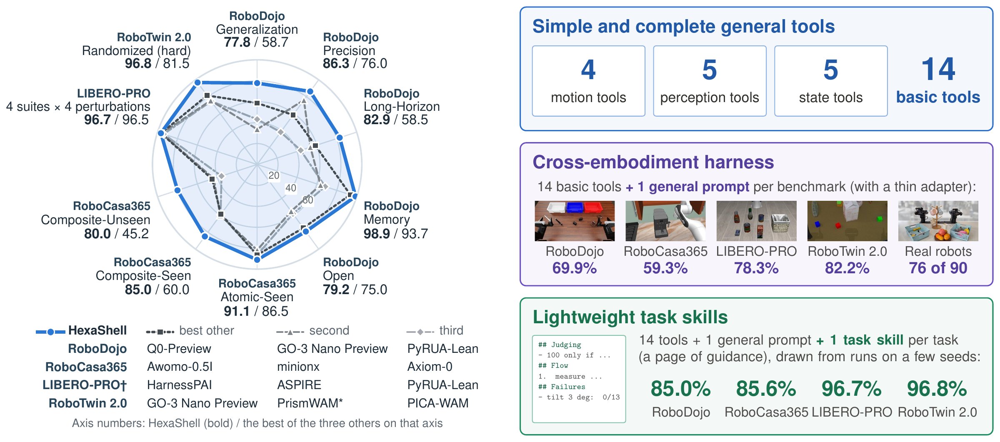
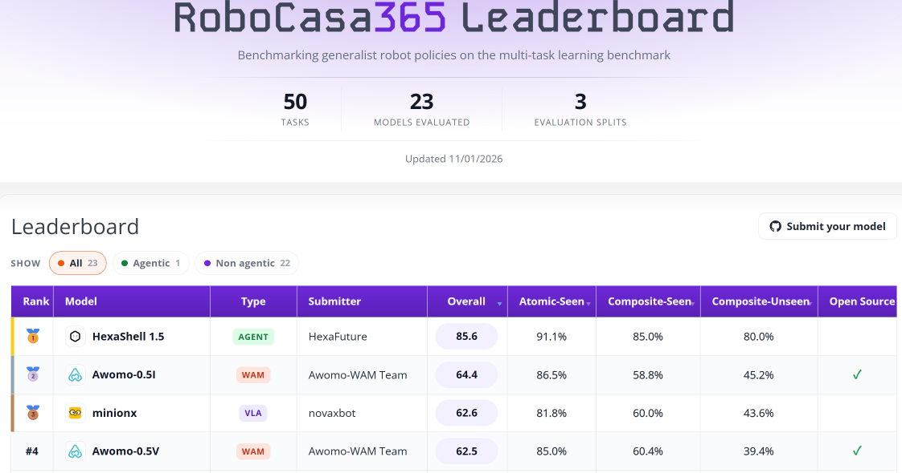
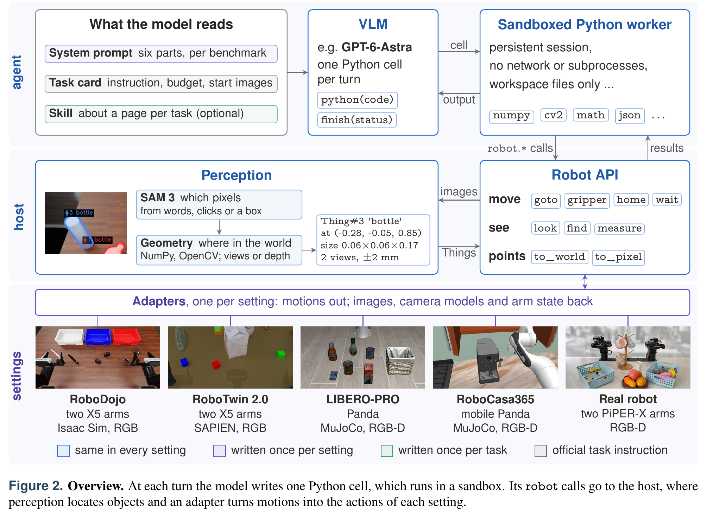
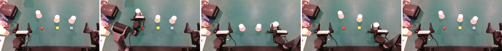

<h1 align="center">HexaShell&nbsp;&nbsp;<picture><source media="(prefers-color-scheme: dark)" srcset="assets/hexafuture-logo-dark.png"><source media="(prefers-color-scheme: light)" srcset="assets/hexafuture-logo-light.png"></picture></h1>

<p align="center">
  <strong>A Universal Harness for Robot Coding Agents in Simulation and the Real World</strong><br>
  面向仿真与真实世界的机器人编程智能体通用 harness
</p>

<p align="center">
  <a href="hexashell_paper.pdf">📄 论文 PDF</a> ·
  <a href="https://hexafuture.ai">🌐 主页</a> ·
  <a href="https://github.com/HexaFuture/HexaShell">💻 项目</a>
</p>

<p align="center"><a href="README.md">English</a> · 简体中文</p>

<p align="center"></p>

<p align="center"><sub><b>HexaShell 在四个仿真基准和真实机器人上的结果。</b>左：HexaShell 使用任务技能时的成功率（%，
蓝色），以及各基准上最强的三个其他方法（灰色），取自排行榜，LIBERO-PRO（†）取自已发表的论文；PrismWAM（*）使用深度。
每条轴上先给出 HexaShell 的成功率（粗体），斜杠后为另外三者中最好的一个。我们的结果为自行评测，评测协议与官方不同。
右：HexaShell 的三个组成部分及其结果：14 个基础工具；同样的工具加上每个基准或机器人一份通用提示词（不使用任务技能时
的成功率）；以及每个任务一份约一页的技能（使用技能时的成功率）。</sub></p>

---

## 📰 新闻

- 🔥 **2026-11-03** — HexaShell 发布：一个与任务无关的 harness，配有通用的感知与运动工具，运行于四个仿真基准和真实
  机器人上。每个任务配一份简短的技能（skill）时，它在 RoboDojo 上的成功率为 85.0%（得分 88.8），在 RoboCasa365 上
  为 85.6，在 LIBERO-PRO 上为 96.7%，在 RoboTwin 2.0 上为 96.8%，在四个基准上均高于我们所知的已发表最好结果（均为
  自行评测，见[结果](#results)）。在真实双臂机器人上，它在九个任务的 90 个回合中成功 76 个。RoboDojo 排行榜上的
  上一版本 HexaShell-Preview 仍可通过分支 [`v1.0`](https://github.com/HexaFuture/HexaShell/tree/v1.0) 获取。
- 🔥 **2026-11-01** — HexaShell 位列 **[RoboCasa365 排行榜](https://robocasa.ai/leaderboard.html)第一**，总分 85.6
  （atomic 91.1%，composite seen 85.0%，composite unseen 80.0%），领先于 Awomo-0.5I（64.4）、minionx（62.6）和
  Awomo-0.5V（62.5）。它是该榜的智能体（agentic）类条目；该结果是我们在 pretrain50 划分上对 50 个任务、每个任务
  30 个测试种子的自行评测，并非 RoboCasa 的官方协议（[详情](#casa-pretrain50)）。

  <p align="center"></p>

- **2026-10-19** — HexaShell-Preview（1.0）发布，位列 RoboDojo 排行榜第一：在 RoboDojo
  官方评测中成功率为 46.9%，进度得分为 53.2。

## 🧩 概述

基于视觉语言模型（VLM）的智能体已经能够通过编写代码来控制机器人，但其中最强的系统要经过多轮试错与修改，逐步打磨针对
具体任务的代码。这类代码容易过拟合于调试所用的基准，可能利用基准中的捷径，迁移到新的基准或机器人上的代价也很高。
HexaShell 是一个轻量、与任务无关的 harness，用来检验通用工具能走多远。它提供一套简单而完备的 14 个基础工具：4 个用于
运动，5 个用于感知，5 个用于状态；智能体每一轮写一个 Python 单元（cell）来调用它们。它的感知由两部分组成：SAM 3 根据
几个词或一次点击分割出物体，NumPy 与 OpenCV 实现的几何计算再把多台相机中的轮廓或一张深度图转换为物体的位置、尺寸和抓
取角度。机器人 API、智能体循环和沙箱为所有任务共享；接入新的仿真器或机器人，只需一个 350 到 1,450 行的适配层和一份描
述其环境的提示词；唯一与任务相关的输入是一份可选的技能，约一页的指导。系统中没有训练得到的策略，也没有示教数据。

- **简单而完备的通用工具。** 模型通过 14 个为所有任务共享的基础工具行动：运动（`goto`、`gripper`、`home`、`wait`）、
  感知（`look`、`find`、`measure`、`to_world`、`to_pixel`）和状态（`task`、`state`、`things`、`image`、`camera`）。
  `robot.goto` 移动一条机械臂，`robot.find(camera, "bottle")` 用 SAM 3 分割物体，`robot.measure(mask)` 在三维空间中
  定位物体，`robot.state()` 报告机械臂的状态和剩余步数。感知把 SAM 3 的分割与几何定位分开，模型得到的是带误差估计的
  三维度量位置，无需自己估计距离。API 以语言模型为使用者来设计：每个动作在消耗步数之前都可以先试运行（dry run）检查，
  返回结果先报告问题，报错会说明应当改什么。思考和观察不消耗步数。在没有为任何任务编写任何内容的情况下，GPT-6-Astra
  在 HexaShell 中于 RoboDojo 上达到 69.9% 的成功率，高于该排行榜上的所有条目；同一模型在 RoboDojo 团队的智能体中为
  22.5%。在十个回合中的九个里，模型没有自己编写任何视觉代码。
- **跨本体的 harness。** 同一套工具、循环和沙箱不加修改地运行于四个仿真基准，它们基于三种仿真器和两类机械臂，包含固
  定与轮式底座、带深度与不带深度的相机：RoboDojo（Isaac Sim，两台 ARX X5 机械臂）、RoboCasa365（MuJoCo，PandaOmron
  移动操作机器人）、LIBERO-PRO（MuJoCo，一台 Panda 机械臂）和 RoboTwin 2.0（SAPIEN，两台 ARX X5 机械臂）。它们也运行
  于真实机器人：在双臂 PiPER-X 机器人上，HexaShell 在九个任务的 90 个回合中成功 76 个（[见下文](#real-robot)）。每个
  设置只需一个轻量的适配层（350 到 1,450 行）和一份通用提示词。不使用任务技能时，智能体在 RoboDojo 上的成功率为
  69.9%，在 RoboCasa365 上为 59.3，在 LIBERO-PRO 上为 78.3%，在 RoboTwin 2.0 上为 82.2%。
- **轻量的任务技能。** 通用工具无法提供的内容（指令中没有明说的成功条件、只有接触才能得知的参数、步骤的顺序）每个任
  务约一页指导即可容纳；技能由分析智能体根据少数几个种子上以往运行的记录起草，再由人审阅（`skills/`）。使用技能后，
  HexaShell 在 RoboDojo 上的成功率为 85.0%，在 RoboCasa365 上为 85.6，在 LIBERO-PRO 上为 96.7%，在 RoboTwin 2.0 上为
  96.8%，在四个基准上均高于我们所知的已发表最好结果。在 RoboDojo 上，Open 维度以外的同一组 1,020 个回合，成功数从
  667 升至 864：234 个只在有技能时成功，37 个只在无技能时成功。
- **与 HexaShell-TaskTools 的对比**（1.0，分支 `v1.0`，在 RoboDojo 排行榜上名为 HexaShell-Preview）。这是我们智能体
  的上一版本，以为每个任务编写的工具来提供任务知识：每个失败的回合之后，由一个优化智能体编写或修复该任务的工具；
  769 轮优化留下了 327 条任务命令，约 78,000 行 Python，随后冻结。冻结后重新运行，这些工具在构建它们所用的 420 个
  开发回合中只通过了 152 个（36%）。下表为 RoboDojo 上的成功率 / 得分；TaskTools 一行为 RoboDojo 官方评测（隐藏
  种子，每个任务 50 个回合），HexaShell 两行为我们自己的测试（[结果](#results)）：

  | 系统 | 每个任务编写的内容 | 总体 | Generalization | Precision | Long-Horizon | Memory | Open |
  |---|---|---|---|---|---|---|---|
  | HexaShell-TaskTools（1.0） | 327 条工具命令，约 78,000 行 Python | 46.85 / 53.18 | 34.50 / 39.22 | 32.00 / 41.25 | 31.50 / 42.91 | 81.00 / 84.53 | 55.25 / 57.97 |
  | HexaShell，无技能 | 无 | 69.92 / 75.73 | 64.44 / 69.86 | 52.50 / 60.38 | 54.58 / 67.02 | 98.89 / 98.89 | 79.17 / 82.50 |
  | HexaShell，有技能 | 34 份技能，约 2,700 行文本 | **85.00 / 88.81** | **77.78 / 82.22** | **86.25 / 88.25** | **82.92 / 92.21** | **98.89 / 98.89** | **79.17 / 82.50** |

  在公开回合上，这一排序同样成立：在种子 0 的 420 个回合上，冻结的工具通过 157 个，HexaShell 无技能时通过 284 个，
  有技能时通过 351 个。两个版本在循环、感知、运动和提示词上也都不同，因此这一对比说明通用工具加简短技能优于为每个
  任务编写的工具，但不能说明哪一项改动最为重要。

本仓库包含下文结果所用的代码、提示词和技能，以及双臂 PiPER-X 真实机器人的适配层。开发记录（回合记录、分析、技能
和提示词的早期版本）不包含在内。

## 🔍 工作原理

<p align="center"></p>

```
 language model (OpenAI-compatible chat endpoint, or Anthropic Messages for Claude)
        │ a Python cell per reply                    ▲ the cell's printed output, the pictures it asked for
        ▼                                            │
 episode driver (hexashell/runtime) ──▶ sandboxed worker (hexashell/kernel) runs the cell: no network,
        │                                no processes, no writes outside its workspace, no API key
        │ robot calls
        ▼
 robot host: motion (hexashell/motion: IK, paths, one action at a time), vision (hexashell/vision: SAM3
 service, the robot's own mask, multi-view 3-D measurement), per-episode records
        │ joint targets ▲ observations
        ▼               │
 RoboDojo's simulator client (Isaac Sim) through XPolicyLab's websocket protocol (hexashell/xpl,
 xpolicylab/HexaShell), or a simulator server in the benchmark's own Python (hexashell/benches)
```

- **模型看到什么**：系统提示词（RoboDojo 为 `prompts/robodojo/`，其他基准为 `prompts/<bench>/`）；任务卡，包括指令、
  步数预算、机械臂的起始位姿和起始图片，RoboDojo 还附有该任务的官方评分表（`prompts/ladders/`），开启技能时还有该
  任务的技能（`skills/`）；之后是每个单元的输出和它所请求的图片。
- **模型看不到什么**：仿真器的状态。智能体得到的是基准提供的 RGB(-D) 相机图像、相机参数、本体感知、指令和预算；
  是否成功由基准自身的检查判定。测量时需要排除的机器人自身像素，在 RoboDojo 上根据关节读数由网格模型绘制，在
  RoboCasa365、LIBERO-PRO 和 RoboTwin 上取自渲染器对机器人自身部件的分割。
- **预算**：基准的步数上限（控制步），以及每个回合的回复数和墙钟时间上限。思考和观察不消耗步数。

<a id="results"></a>
## 📊 结果

全部结果使用 `gpt-6-astra`，时间为 2026 年 10 月至 11 月。使用技能时，HexaShell 在四个基准上均高于我们所知的已发表
最好结果。“其他最好结果”一列即该结果，各自基于其自身的回合与协议。

| 基准 | 回合数 | 有技能 | 无技能 | 其他最好结果 |
|---|---|---|---|---|
| [RoboDojo](https://robodojo-benchmark.com/LeaderBoard)：42 个任务，种子 0–2，布局 10–19（官方回合的五分之一，见[下文](#robodojo-eval)） | 1260 | **成功率 85.0%，得分 88.8**（1054/1260） | 成功率 69.9%，得分 75.7（857/1260） | Q0-Preview 68.9% / 74.2（排行榜，官方评测） |
| [RoboCasa365](https://robocasa.ai/leaderboard.html)：pretrain50 划分的 50 个任务 × 测试种子 20–49（非官方协议，见[下文](#casa-pretrain50)） | 1500 | **85.6**（1284/1500） | 59.3（890/1500） | Awomo-0.5I 64.4（排行榜） |
| LIBERO-PRO：156 个任务（LIBERO 四个套件的四种扰动）× 10 个初始状态 | 1560 | **96.7%**（1509/1560，测试状态 20–29） | 78.3%（1222/1560，验证状态 10–19） | HarnessPAI 96.5%，ASPIRE 96.0%<sup>‡</sup>（论文，各自的子集） |
| [RoboTwin 2.0](https://robotwin-platform.github.io/leaderboard)：50 个任务 × 15 个种子，clean2random（随机化场景，未见指令） | 750 | **96.8%**（726/750） | 82.2%（411/500，学习种子，已见指令） | GO-3 Nano Preview 81.5%（排行榜）；OmniBrain-0 报告 90.4% |

<sub>‡ ASPIRE 使用与我们相同的模型 GPT-6-Astra，在全部四个套件的相同扰动上（我们对其八个分项结果取的平均；使用
Claude Opus 5.5 时为 98.8%）。</sub>

- **设置。** RoboDojo 和 RoboCasa365 使用推理强度 `xhigh`，LIBERO-PRO 和 RoboTwin 使用 `high`。在 RoboDojo 上，两列
  只在技能上不同（八个 Open 任务没有技能；两列共用这些任务在 `high` 下的同一次运行）；在 RoboCasa365 上，两列在图片
  窗口上也不同。LIBERO-PRO 和 RoboTwin 的无技能运行用的是其他回合（开发种子），因此与测试不构成配对。
- **以上均不是完整的官方评测。** 我们的 RoboDojo 测试使用公开布局，每个任务 30 个回合；RoboDojo 官方评测每个任务
  150 个回合，布局不公开。HexaShell 的官方评测已经提交，结果将补充于此。RoboCasa365 的官方协议（每个任务 50 个
  回合）也尚未运行。
- 各基准的详情、逐任务结果和运行方法见下文各评测章节。

## 环境要求

- 带 NVIDIA GPU 的 Linux。RoboDojo（Isaac Sim 5.1）和 RoboTwin（光线追踪相机）需要 RTX GPU；我们在 RTX 4090 上运行。
  RoboCasa 和 LIBERO-PRO 用 MuJoCo 的 EGL 后端渲染，任何 NVIDIA GPU 均可。
- 支持流式输出的模型接口：OpenAI 兼容的 `/chat/completions`（用 `gpt-6-astra` 测试过），或用于 Claude 的 Anthropic
  Messages 接口（见[使用 Claude](#using-claude)），以及相应的密钥。
- 策略环境：Python 3.11 与 [requirements.txt](requirements.txt)。
- 用于分割的 SAM3：带 CUDA 的 torch 2.7、[sam3](https://github.com/facebookresearch/sam3) 及其权重 `sam3.pt`（在
  Hugging Face 上需申请访问：[facebook/sam3](https://huggingface.co/facebook/sam3)）。每台机器一个服务，供所有回合
  使用。
- RoboDojo：按 RoboDojo 的文档安装 RoboDojo 及其仿真环境、资产和 XPolicyLab，并需要 conda（RoboDojo 的脚本用
  `conda activate` 激活环境）。
- 其他基准：由 `scripts/setup/` 创建的仿真环境（见下文）。
- 真实机器人：一个运行中的 [URAI](https://github.com/HexaFuture/URAI) 服务（见[真实机器人](#real-robot)）。

## 安装

```bash
git clone --recurse-submodules https://github.com/HexaFuture/HexaShell.git && cd HexaShell
                                        # third_party/：RoboCasa 和 robosuite（只有 RoboCasa 移植版用到）
conda create -n hexashell python=3.11 -y && conda activate hexashell
pip install -r requirements.txt         # 策略环境（POLICY_ENV）
python -m pytest -q tests               # 不需要仿真器或 GPU
```

1. **SAM3。** 在本环境或另一个环境中安装带 CUDA 的 torch 2.7.0 和 torchvision 0.22.0、`timm` 以及 `sam3`（从其仓库
   安装）；把 `sam3.pt` 下载到 `checkpoints/sam3.pt`（或设置 `SAM3_CHECKPOINT_PATH`）。sam3 0.1.0 还需要它没有声明的
   `einops`、`pycocotools` 和 `psutil`，以及 `setuptools<81`（它导入 `pkg_resources`）。权重需要申请：先在 Hugging
   Face 上申请 `facebook/sam3` 的访问权限。
2. **机器配置。** 执行 `cp config/env.example.sh config/env.sh`，然后编辑其中的路径：RoboDojo 代码目录
   （`ROBODOJO_ROOT`）、RoboDojo 激活的两个环境（`POLICY_ENV`、`EVAL_ENV`）、SAM3 的 Python 和权重，以及各基准的
   环境。设置了 `$HEXASHELL_ENV` 时脚本读取它，否则读取 `config/env.sh`（已被 git 忽略）。模板把 `TMPDIR` 设在 `/tmp`
   下；如果 `/tmp` 空间较小，安装前请把它指向空间充足的磁盘（pip 会在那里解压 torch 和 CUDA 的 wheel，有数 GB）。
   单个回合在 `HEXASHELL_EGL_DEVICE`（或 `--egl`）指定的 GPU 上渲染。
3. **模型密钥。** 放在 `~/.config/hexashell/api-key`（一行，`chmod 600`）或 `$OPENAI_API_KEY` 中。密钥只留在回合
   驱动进程中，运行模型单元的进程拿不到它。切勿提交密钥。
4. **模型接口**（必填，没有默认值）。在 [xpolicylab/HexaShell/deploy.yml](xpolicylab/HexaShell/deploy.yml)（RoboDojo）
   和 [config/benches.yml](config/benches.yml)（其他基准）中设置 `api_base`（模型名不同时也设置 `model`）。两个文件中
   都是占位地址 `https://api.example.com/v1`。`bash scripts/gateway_ping.sh` 会向 benches.yml 中的接口发送一个很小的
   请求。
5. **直连。** RoboDojo 仿真器与策略服务器之间的 websocket 以及模型 API 都不能经过 HTTP 代理；`config/env.example.sh`
   会清除代理变量。
6. **启动 SAM3 服务**（每台机器一次；端口须与 deploy.yml 和 benches.yml 中的 `sam3_url` 一致）：

   ```bash
   bash scripts/sam3_service.sh start 0 18300     # GPU 0，端口 18300
   bash scripts/sam3_service.sh status 18300
   ```

### RoboDojo

按 RoboDojo 的文档安装 RoboDojo（含 Isaac Sim 5.1 的仿真环境、资产，以及其安装脚本克隆到代码目录中的 XPolicyLab）。
我们测试所用的版本为 RoboDojo `09bd5f5` 和 XPolicyLab `53c5da5`。然后把策略链接进 XPolicyLab（用符号链接而不是
复制：策略通过它找到 `hexashell` 包）：

```bash
ln -s "$PWD/xpolicylab/HexaShell" "$ROBODOJO_ROOT/XPolicyLab/policy/HexaShell"
```

`scripts/run_one.sh` 和 `scripts/batch.sh` 运行某个种子下指定的布局；为此 RoboDojo 需要一处小改动（一个由其种子
管理器读取的环境变量 `ROBODOJO_LAYOUT_IDS`；补丁基于 `09bd5f5`）。RoboDojo 自身的评测不需要它：

```bash
git -C "$ROBODOJO_ROOT" apply "$PWD/scripts/patches/robodojo-layout-ids.patch"
```

### RoboCasa365、LIBERO-PRO、RoboTwin 2.0

每个基准运行在自己的 Python 环境中（它们的 Python、numpy 和仿真器版本与策略环境不同）。
[scripts/setup/](scripts/setup/README.md) 中的脚本默认在代码目录内构建这些环境（`.venvs/`、`.bench-data/`，均被 git
忽略），可以重复运行：

```bash
bash scripts/setup/setup_robocasa.sh    # CPython 3.12 venv，打好补丁的子模块，bench-env.sh（资产见下文）
bash scripts/setup/setup_libero.sh      # CPython 3.11 venv，LIBERO-PRO 源码和资产，env.sh
bash scripts/setup/setup_robotwin.sh    # CPython 3.11 venv，torch cu128，本地编译的 cuRobo，资产，env.sh
```

代理较慢时，`INDEX=<PyPI 镜像> bash scripts/setup/setup_robocasa.sh` 会从镜像获取软件包。RoboCasa 的厨房资产用
RoboCasa 自己的脚本下载，脚本会在开始前询问：
`.venvs/bench-robocasa/bin/python -m robocasa.scripts.download_kitchen_assets --type all`。全部资产都需要（厨房也用到
生成的纹理）：压缩包约 11 GB，解压后 23 GB。网络较慢时，用多连接下载器获取同样的压缩包，再解压到脚本本应解压的
位置，会快很多。如果主机缺少 glvnd 的 `libEGL.so.1` 和 `libOpenGL.so.0`，需要按 `bench-env.sh` 中注释的说明把它们
加进去；`setup_robocasa.sh` 会重写 `bench-env.sh`，重新运行后需要再加一次。然后在 `config/env.sh` 中把
`HEXASHELL_<BENCH>_PYTHON` 和 `HEXASHELL_<BENCH>_ENV` 指向这些环境（模板中给出了默认路径）。各组件的版本以及我们对
RoboCasa 的改动列在 [THIRD_PARTY_VERSIONS.md](THIRD_PARTY_VERSIONS.md) 中。

## 配置

| 内容 | 位置 | 说明 |
|---|---|---|
| 机器路径 | `config/env.sh`（由 `config/env.example.sh` 复制） | 所有脚本都读取；`$HEXASHELL_ENV` 可以指定另一个文件 |
| RoboDojo 的智能体设置 | `xpolicylab/HexaShell/deploy.yml` | 接口、模型、推理强度、技能、每个回合的回复数和时间、图片窗口、运动参数、SAM3 地址 |
| 其他基准的智能体设置 | `config/benches.yml` | 同名设置，叠加在各基准自身的上限之上（RoboCasa：原子任务 40 次回复，组合任务 100 次；LIBERO-PRO 和 RoboTwin：40 次；全部：2 小时） |
| 单次运行的覆盖 | `HEXASHELL_<NAME>=value` | 任意设置，例如 `HEXASHELL_SKILLS=yes`、`HEXASHELL_MAX_TURNS=6`、`HEXASHELL_MODEL=...` |
| 单个基准回合 | `python -m hexashell.benches.run ... --set name=value` | 覆盖以上所有设置 |
| 模型密钥 | `~/.config/hexashell/api-key` 或 `$OPENAI_API_KEY` | 设置中的 `api_key_file` 可以指定另一个文件 |

deploy.yml 中是我们有技能的 RoboDojo 测试所用的设置（推理强度 `xhigh`、`max_tokens` 32000、图片窗口 20/14）；无技能
的测试只改了 `skills: false`。benches.yml 中技能关闭，推理强度为 `high`；我们在其他基准上有技能的运行用
`--set skills=yes` 打开技能。RoboCasa365 的 `xhigh` 运行还设置了 `reasoning_effort=xhigh`，其中无技能的那次还设置了
`images_max=50` 和 `images_low=30`。

<a id="using-claude"></a>
### 使用 Claude

设置 `api: anthropic` 后，同一循环改为与 Anthropic Messages 接口通信（`<api_base>/messages`，流式）；提示词、工具和
记录不变。

- 思考是自适应的，深度由 `reasoning_effort` 设定。`thinking_display: summarized`（默认）时，记录中保存思考的摘要；
  设为 `omitted` 时不返回思考内容。
- 每次回复的内容块（带签名的思考、文本、工具调用）原样保留，并随之后的每个请求发回，使模型能接着自己的推理继续。
- 当接口的证书需要私有 CA 时，用 `ca_file` 指定。
- 图片：Claude 的思考块与它之前的对话绑定。当图片窗口丢弃一张旧图片时，该位置之后的回复会失去思考块（否则请求会
  被拒绝），其文本和工具调用保留。因此使用 Claude 时应调大 `images_max` 和 `images_low`（例如都设为 90）。

```bash
HEXASHELL_API=anthropic HEXASHELL_API_BASE=https://<your endpoint>/v1 \
HEXASHELL_API_KEY_FILE=~/.config/hexashell/claude-key \
HEXASHELL_MODEL=claude-opus-5-5 HEXASHELL_REASONING_EFFORT=medium \
HEXASHELL_IMAGES_MAX=90 HEXASHELL_IMAGES_LOW=90 \
bash scripts/run_one.sh push_T 0 0 3
```

我们的结果全部用 `gpt-6-astra` 得到。

<a id="robodojo-eval"></a>
## 在 RoboDojo 上评测

### 官方协议

RoboDojo 自身的评测把 42 个任务分别以种子 0、1、2 运行，每个任务每个种子 50 个回合（`--eval-num native`；十二个
Generalization 任务为该任务 25 个回合加上其 `_random` 变体 25 个回合，后者添加了杂物）。随后 `summarize` 读取
`eval_result/RoboDojo/` 下的记录，写出 `eval_result/RoboDojo/_summary.md`：按任务和种子、以及按能力维度给出成功率和
得分（任务进度）。HexaShell 不加修改即可在其中运行：

```bash
source config/env.sh && cd "$ROBODOJO_ROOT"
for task in stack_blocks stack_blocks_random; do       # 每个任务，以及每个 Generalization 任务的 _random 变体
    for seed in 0 1 2; do
        bash scripts/robodojo.sh eval --policy-dir XPolicyLab/policy/HexaShell --task "$task" \
            --ckpt no-checkpoint --policy-env "$POLICY_ENV" --eval-env "$EVAL_ENV" --env-cfg arx_x5 \
            --action-type joint --seed "$seed" --eval-num native --policy-gpu 0 --env-gpu 0
    done
done
bash scripts/robodojo.sh summarize
```

`--action-type joint` 是必需的（HexaShell 发送关节目标）；检查点名称不会被使用。策略本身不需要 GPU。
`robodojo.sh benchmark` 可以对某个种子运行全部或部分任务，也可以分布到多块 GPU 上（`--gpu-ids`；见其 `--help`）。
每个回合都是与模型最多 100 次回复、90 分钟的对话（deploy.yml），因此完整协议（6300 个回合）代价很高，我们自己没有
运行过。HexaShell 已提交 RoboDojo 官方评测，结果将补充于此。

### 我们的测试

我们运行了官方回合的五分之一：42 个任务 × 种子 0–2 × 每个种子的布局 10–19，每个任务 30 个回合，共 1260 个
（Generalization 任务：该任务的布局 10–14 加上其 `_random` 变体的布局 10–14）。被 RoboDojo 判为物理不稳定而弃用的
布局换成布局号 + 20，在每次运行中都相同。开发（提示词、工具、技能）使用种子 0、布局 0–9；这些回合也属于官方协议。
八个 Open 任务没有技能，也没有任何针对任务的改动。代码注释、测试和技能中以 R0–R4 指代各开发轮次，以 l0–l9 指代
其布局。

| 维度 | 任务数 | 无技能 | 有技能 |
|---|---|---|---|
| Generalization | 12 | 232/360 (64.4%) | **280/360 (77.8%)** |
| Precision | 8 | 126/240 (52.5%) | **207/240 (86.3%)** |
| Long-Horizon | 8 | 131/240 (54.6%) | **199/240 (82.9%)** |
| Memory | 6 | 178/180 (98.9%) | 178/180 (98.9%) |
| Open | 8 | 190/240 (79.2%) | 190/240 (79.2%)：无技能，同一批回合 |
| 非 Open | 34 | 667/1020 (65.4%) | **864/1020 (84.7%)** |
| 全部 | 42 | 857/1260 (68.0%) | **1054/1260 (83.7%)** |
| 成功率（五个维度的平均） | | 69.9 | **85.0** |
| 得分（任务进度，五个维度的平均） | | 75.7 | **88.8** |

RoboDojo 的 `summarize` 先对每个维度内的任务取平均，再对五个维度取平均；每个任务 30 个回合时，结果就是成功率那一行。
得分以同样的方式平均每个回合在该任务官方评分表上的进度。

- **两列**都使用 deploy.yml 中的设置（推理强度 `xhigh`、`max_tokens` 32000、图片窗口 20/14）；无技能
  一列只设 `skills: false`，没有其他改动。Open 任务没有技能；两列共用它们的同一次无技能运行，推理强度为 `high`（图片
  窗口 90/60）。
- **技能的作用**，在 1020 个非 Open 回合上逐回合对比：234 个只在有技能时成功，37 个只在无技能时成功（667 → 864）。
  在推理强度 `high` 下，同样的技能使成功数从 615 升至 783（+228/−60）。
- **推理强度**：无技能时 `xhigh` 为 667，`high` 为 615（+120/−68，精确符号检验 p < 0.001）；使用该轮的技能时为 847
  对 804（+113/−70，p = 0.002）。两项增益可以叠加。更早一次在 `high`（图片窗口 90/60）下对全部 42 个任务的无技能
  测试为 818/1260：成功率 66.6，得分 72.1。图片窗口的影响（无技能，`high`）：在同样的 1140 个回合上，90/60 为 818，
  20/14 为 805（p = 0.40）。
- 在有技能的 `xhigh` 一轮中，有不到两个小时模型上游的首个 token 排队约 95 秒；排除这段时间，`xhigh` 仍有增益（相对
  `high` 为 +92/−46）。

<details>
<summary>逐任务结果（30 次中的成功数）</summary>

| 维度 | 任务 | 无技能 | 有技能 |
|---|---|---|---|
| Generalization | arrange_largest_number | 26 | 26 |
| Generalization | fold_clothes | 22 | 23 |
| Generalization | hang_mugs | 2 | 7 |
| Generalization | make_toast | 15 | 21 |
| Generalization | pack_objects_into_box | 8 | 26 |
| Generalization | pour_liquid_into_cup | 17 | 29 |
| Generalization | push_T | 30 | 30 |
| Generalization | sort_nesting_dolls_by_size | 25 | 29 |
| Generalization | stack_blocks | 30 | 30 |
| Generalization | stack_bowls | 30 | 30 |
| Generalization | store_laptop_and_headphones | 0 | 1 |
| Generalization | sweep_blocks | 27 | 28 |
| Precision | build_tower | 14 | 29 |
| Precision | deposit_coin | 13 | 13 |
| Precision | fasten_screws | 10 | 30 |
| Precision | insert_key | 0 | 20 |
| Precision | insert_tubes | 24 | 29 |
| Precision | play_Xylophone | 28 | 30 |
| Precision | plug_in_charger | 9 | 28 |
| Precision | pour_balls_into_vase | 28 | 28 |
| Long-Horizon | classify_objects | 30 | 29 |
| Long-Horizon | fill_egg_holder | 4 | 19 |
| Long-Horizon | fill_pen_holder | 2 | 16 |
| Long-Horizon | make_kong | 0 | 30 |
| Long-Horizon | organize_table | 10 | 16 |
| Long-Horizon | play_stacking_toy | 26 | 30 |
| Long-Horizon | play_tic_tac_toe | 29 | 30 |
| Long-Horizon | put_bottles_into_dustbin | 30 | 29 |
| Memory | cover_blocks | 30 | 30 |
| Memory | imitate_sorting_sequence | 29 | 30 |
| Memory | match_and_pick_from_conveyor | 30 | 30 |
| Memory | press_by_number | 29 | 30 |
| Memory | swap_T | 30 | 30 |
| Memory | swap_blocks | 30 | 28 |
| Open | align_blocks | 29 | –（无技能） |
| Open | classify_objects_by_language | 28 | –（无技能） |
| Open | general_pickup | 29 | –（无技能） |
| Open | pick_from_conveyor_by_image | 20 | –（无技能） |
| Open | pour_by_language | 28 | –（无技能） |
| Open | solve_equation | 27 | –（无技能） |
| Open | stack_blocks_by_language | 29 | –（无技能） |
| Open | store_tools_in_toolbox | 0 | –（无技能） |

</details>

### 单次运行与批量运行

以下命令用到上文的布局补丁。

```bash
source config/env.sh
bash scripts/run_one.sh stack_blocks 0 1 3       # 任务、种子、布局、仿真器 GPU [, 回合数, 运行名]
mkdir -p logs && printf 'stack_blocks 0 1\nswap_T 0 2\n' > logs/demo.todo
GPUS=1,2,3 bash scripts/batch.sh demo 2          # 每行 "task seed layout"；最多同时运行 2 个
python eval/report.py results/demo               # 每个任务的成功、进度、轮数、时间、token
```

`batch.sh` 在有空闲显存的 GPU 上启动回合（也可以与其他用户的任务并行），把从未启动或被模型网关中断的回合重新列入，
并把 RoboDojo 判为不稳定而弃用的布局换成布局号 + 20。其他设置列在脚本开头。

## 在 RoboCasa365 上评测

移植版不加修改地使用 RoboCasa 的厨房、任务和成功判定，通过 robosuite 的控制器驱动：50 个目标任务（18 个原子任务、
16 个已见组合任务、16 个未见组合任务）中的 PandaOmron 机器人，三台 512 × 512 的 RGB-D 相机（左、右、腕部）。

### 官方协议

- **划分** `pretrain`：厨房布局和风格 11–60，使用预训练物体；种子决定厨房（任务在其中无法构建时 RoboCasa 会重新
  抽取）、物体及其摆放。
- **回合**：每个任务 50 个，种子 1000–1049。
- **成功**：RoboCasa 的 `_check_success()`，每一步都检查；首次成功时回合结束。
- **时长**：各任务官方的时长，以 20 Hz 控制步计；此外，原子任务最多 40 次模型回复，组合任务最多 100 次，时间最多
  两小时。
- **得分**：各组（已见原子任务、已见组合任务、未见组合任务）的成功率，以及按 18/16/16（共 50）加权的平均值。

```bash
source config/env.sh                         # 按模板设置 HEXASHELL_ROBOCASA_SPLIT=pretrain
# 单个回合
$HEXASHELL_PYTHON -m hexashell.benches.run --bench robocasa --task CloseFridge --seed 1000 --split pretrain \
    --set skills=yes --out results/demo
# 完整协议：2500 个回合，在常驻的仿真器服务上运行，GPU 0 和 GPU 1 上各两个，最多同时 4 个
mkdir -p logs && $HEXASHELL_PYTHON -c 'from hexashell.benches.robocasa.protocol import TASKS
for tasks in TASKS.values():
    for task, _ in tasks:
        for seed in range(1000, 1050): print("robocasa", task, seed)' > logs/casa_official.todo
SETS="skills=yes" HEXASHELL_ROBOCASA_SPLIT=pretrain python3 scripts/bench_pool.py casa_official 0,0,1,1 4
python3 scripts/bench_score.py results/casa_official     # 各组成功率与加权得分
```

`scripts/bench_pool.py` 维护 `logs/NAME.todo` 中的列表（运行期间可以增删行），在常驻的仿真器服务上依次运行回合，
重跑因错误结束的回合，并把被模型网关中断的回合重新列入，同时暂缓一段时间再启动新回合。
`python3 scripts/pool_status.py . NAME` 显示批量运行的进度；`scripts/gateway_guard.sh . NAME` 在网关无响应时暂停
批量运行。`scripts/bench_batch.sh` 处理同样的列表，但每个回合使用新的仿真器。服务只在空闲显存不少于 3 GB（`NEED`）
的 GPU 上启动。

<a id="casa-pretrain50"></a>
### 另一个划分：pretrain50

未指定划分（`--split`、`$HEXASHELL_ROBOCASA_SPLIT`）时的默认划分：预训练集中固定的 50 个
厨房，种子 `s` 对应厨房 `s % 50`；种子 0–9 用于学习，10–19 用于验证，20–49 用于测试。RoboCasa 的技能
（`skills/robocasa/`）在种子 0–9 上编写，在 10–19 上检验。这些厨房都在官方划分的抽取范围内。

我们的测试使用本仓库一个较早版本的代码，它在 RoboCasa365 上与当前版本的区别仅在于对 GPU 画面的检查；50 个任务 ×
种子 20–49（每个任务 30 个回合），有技能和无技能均使用推理强度 `xhigh`（`config/benches.yml` 中的
`reasoning_effort: xhigh`，其他不变；无技能时另将图片窗口由 20/14 改为 50/30）：

| 组 | 无技能，`xhigh` | 有技能，`xhigh` |
|---|---|---|
| 原子任务（18 个） | 354/540 (65.6%) | **492/540 (91.1%)** |
| 已见组合任务（16 个） | 243/480 (50.6%) | **408/480 (85.0%)** |
| 未见组合任务（16 个） | 293/480 (61.0%) | **384/480 (80.0%)** |
| 加权（18/16/16） | 59.3 | **85.6** |

- 技能是为全部 50 个任务学习的，因此对 HexaShell 而言，“未见”组合任务并非未见：它们的技能来自我们自己在种子 0–9
  上的运行。
- **技能的作用**，在 `xhigh` 下逐回合对比：466 个回合只在有技能时成功，72 个只在无技能时成功。两次运行的图片窗口
  也不同，因此差距并非全部来自技能。无技能时下降最多的是 ScrubCuttingBoard 2/30、WashLettuce 1/30、
  LoadDishwasher 3/30、RinseSinkBasin 4/30、PreSoakPan 6/30 和 TurnOnSinkFaucet 7/30；有六个任务在无技能时多成功
  一到两次。无技能的 610 次失败中，393 次由模型自行结束，215 次用完步数，2 次用完时间。
- 第一次测试之后，部分技能以及系统提示词中关于放置的几行改写了措辞，使其中不再直白写出取自仿真器的信息；上表中
  有技能的运行使用的是改写后的文本。
- 有技能的运行期间，模型上游的行为没有变化；没有弃用任何回合。在 `high` 下，我们通过推理长度的突变来监测上游。
  这在 `xhigh` 下不适用，因为它本身推理更长，所以运行期间每 20 分钟以 `high` 重发 24 个固定请求。每次检查中推理
  超过 100 个 token 的至多 3 个；而在此前观察到的上游变化期间，这一比例达到 40% 以上。
- 有技能时，216 次失败中 159 次由模型自行结束，57 次用完步数。最弱的任务是 HeatKebabSandwich 10/30、
  PackIdenticalLunches 13/30、ArrangeTea 16/30、SteamInMicrowave 17/30、SeparateFreezerRack 18/30 和
  MakeIceLemonade 19/30。

<details>
<summary>逐任务结果（30 次中的成功数）</summary>

| 任务 | 组 | 无技能，`xhigh` | 有技能，`xhigh` |
|---|---|---|---|
| CloseBlenderLid | 原子 | 15 | 21 |
| CloseFridge | 原子 | 20 | 26 |
| CloseToasterOvenDoor | 原子 | 6 | 28 |
| CoffeeSetupMug | 原子 | 15 | 26 |
| NavigateKitchen | 原子 | 25 | 26 |
| OpenCabinet | 原子 | 14 | 27 |
| OpenDrawer | 原子 | 22 | 29 |
| OpenStandMixerHead | 原子 | 14 | 28 |
| PickPlaceCounterToCabinet | 原子 | 23 | 26 |
| PickPlaceCounterToStove | 原子 | 29 | 28 |
| PickPlaceDrawerToCounter | 原子 | 24 | 28 |
| PickPlaceSinkToCounter | 原子 | 28 | 27 |
| PickPlaceToasterToCounter | 原子 | 25 | 27 |
| SlideDishwasherRack | 原子 | 24 | 28 |
| TurnOffStove | 原子 | 27 | 28 |
| TurnOnElectricKettle | 原子 | 28 | 30 |
| TurnOnMicrowave | 原子 | 8 | 29 |
| TurnOnSinkFaucet | 原子 | 7 | 30 |
| DeliverStraw | 已见组合 | 23 | 28 |
| GetToastedBread | 已见组合 | 25 | 25 |
| KettleBoiling | 已见组合 | 29 | 28 |
| LoadDishwasher | 已见组合 | 3 | 27 |
| PackIdenticalLunches | 已见组合 | 9 | 13 |
| PreSoakPan | 已见组合 | 6 | 30 |
| PrepareCoffee | 已见组合 | 21 | 24 |
| RinseSinkBasin | 已见组合 | 4 | 26 |
| ScrubCuttingBoard | 已见组合 | 2 | 30 |
| SearingMeat | 已见组合 | 20 | 28 |
| SetUpCuttingStation | 已见组合 | 21 | 25 |
| StackBowlsCabinet | 已见组合 | 29 | 28 |
| SteamInMicrowave | 已见组合 | 10 | 17 |
| StirVegetables | 已见组合 | 20 | 28 |
| StoreLeftoversInBowl | 已见组合 | 20 | 25 |
| WashLettuce | 已见组合 | 1 | 26 |
| ArrangeBreadBasket | 未见组合 | 25 | 23 |
| ArrangeTea | 未见组合 | 18 | 16 |
| BreadSelection | 未见组合 | 23 | 28 |
| CategorizeCondiments | 未见组合 | 24 | 26 |
| CuttingToolSelection | 未见组合 | 15 | 30 |
| GarnishPancake | 未见组合 | 14 | 27 |
| GatherTableware | 未见组合 | 10 | 23 |
| HeatKebabSandwich | 未见组合 | 6 | 10 |
| MakeIceLemonade | 未见组合 | 19 | 19 |
| PanTransfer | 未见组合 | 24 | 25 |
| PortionHotDogs | 未见组合 | 27 | 27 |
| RecycleBottlesByType | 未见组合 | 30 | 30 |
| SeparateFreezerRack | 未见组合 | 3 | 18 |
| WaffleReheat | 未见组合 | 22 | 25 |
| WashFruitColander | 未见组合 | 9 | 30 |
| WeighIngredients | 未见组合 | 24 | 27 |
</details>

## 在 LIBERO-PRO 和 RoboTwin 2.0 上评测

运行器和评分与 RoboCasa 相同，列表每行的第一个词为 `libero` 或 `robotwin`：

```bash
$HEXASHELL_PYTHON -m hexashell.benches.run --bench libero --task libero_goal_swap_t3 --seed 20 --set skills=yes \
    --out results/demo
$HEXASHELL_PYTHON -m hexashell.benches.run --bench robotwin --task adjust_bottle --seed 100000 --set skills=yes \
    --out results/demo
# 测试列表：1560 和 750 个回合
mkdir -p logs
$HEXASHELL_PYTHON -c 'from hexashell.benches.libero.protocol import TEST_SEEDS, test_tasks
for task in test_tasks():
    for seed in TEST_SEEDS: print("libero", task, seed)' > logs/libero_test.todo
$HEXASHELL_PYTHON -c 'from hexashell.benches.robotwin.protocol import test_episodes
for task, seed in test_episodes(): print("robotwin", task, seed)' > logs/twin_test.todo
SETS="skills=yes" python3 scripts/bench_pool.py libero_test 0,0,1,1 4
python3 scripts/bench_score.py results/libero_test
```

两项测试结果都由本仓库代码在 benches.yml 的设置下、开启技能（`--set skills=yes`）得到。技能在开发种子上学习和
检验；测试种子的记录没有用于编写技能。

### LIBERO-PRO

LIBERO-PRO 对 LIBERO 的四个套件（spatial、object、goal、10）分别施加单一类型的扰动。我们测试其中四种扰动：物体
起始位置互换（`_swap`）、物体外观改变（`_object`）、指令改写（`_lan`），以及同一场景中的另一个任务（`_task`）：
共 16 个套件，每个十个任务（`<suite>_t<i>`，例如 `libero_goal_swap_t3`），其中四个任务在 LIBERO-PRO 的发布版本中
没有初始状态，因此共 156 个任务。种子 `s` 从该任务的初始状态 `s` 开始；种子 0–9 用于学习，10–19 用于验证，20–29
用于测试：共 1560 个回合。场景先稳定 10 个控制步，与 LIBERO-PRO 自身的评测一致；之后适用该套件的步数上限（20 Hz
控制步：spatial 220，object 280，goal 300，libero_10 520），回复最多 40 次，时间最多两小时。成功以 LIBERO 的目标
检查为准。有技能的 71 个任务是在学习轮（无技能）或验证轮中失败过的任务。

| 套件 | `_swap` | `_object` | `_lan` | `_task` | 全部 |
|---|---|---|---|---|---|
| libero_spatial | 97/100 | 90/100 | 96/100 | 77/80 | 360/380 |
| libero_object | 96/100 | 100/100 | 100/100 | 100/100 | 396/400 |
| libero_goal | 99/100 | 100/100 | 98/100 | 100/100 | 397/400 |
| libero_10 | 94/100 | 79/90 | 96/100 | 87/90 | 356/380 |
| **全部** | 386/400 | 369/390 | 390/400 | 364/370 | **1509/1560 (96.7%)** |

- 有技能的任务为 696/710，其余任务为 813/850（这些任务在学习中从未失败，因此在新的初始状态上有所下降在意料之中）。
- **无技能**时，在验证用初始状态（10–19）上为 1222/1560（78.3%），由两部分组成：当时没有技能的 102 个任务取自验证
  轮，其余 54 个任务另以关闭技能的方式运行。这 54 个任务即第一批技能所针对的任务（编写这些技能时未见过验证状态），
  无技能时为 252/540，有技能时为 531/540（逐回合 +286/−7）。

  | 套件，无技能 | `_swap` | `_object` | `_lan` | `_task` | 全部 |
  |---|---|---|---|---|---|
  | libero_spatial | 87/100 | 83/100 | 82/100 | 74/80 | 326/380 |
  | libero_object | 92/100 | 70/100 | 82/100 | 84/100 | 328/400 |
  | libero_goal | 76/100 | 78/100 | 84/100 | 68/100 | 306/400 |
  | libero_10 | 70/100 | 56/90 | 80/100 | 56/90 | 262/380 |
  | **全部** | 325/400 | 287/390 | 328/400 | 282/370 | **1222/1560 (78.3%)** |

- 全部 51 次失败都是用完步数或结束时剩余步数不足。libero_10_object_t3 十次全部失败（每一轮都如此；它的碗似乎太宽，
  抽屉无法在碗上合拢）。

### RoboTwin 2.0

测试遵循 RoboTwin 自身对 clean2random 设置的评测：`demo_randomized` 场景，各任务的步数上限（400–1700 步；一步是一次
`take_action`，即 aloha-agilex 机器人双臂的关节目标），取自任务未见描述模板的指令，以及每个任务从 100000 起由
RoboTwin 的专家策略能够完成的前若干个种子，按 RoboTwin 评测的方式查找（`scripts/setup/scan_robotwin_seeds.py`；
结果为 `hexashell/benches/robotwin/seeds.json`）。我们为每个任务取前 15 个：共 750 个回合，每个回合回复最多 40 次，
时间最多两小时。100000 以下的种子用于开发，每个任务 10 个用于学习、10 个用于验证，使用已见模板中的指令；技能只
使用这些措辞。任务为 RPent 评测列表（`eval_seeds.json`，见 NOTICE）中的 50 个。场景构建时对 RoboTwin 的运行时
做了三处修正（见 `hexashell/benches/robotwin/protocol.py`）。感知只使用彩色图像和相机模型，与 RoboDojo 相同
（`--set depth=true` 时也读取深度图）。

- **726/750（96.8%）**；36 个任务为 15/15。24 次失败中，14 次由模型自行结束，7 次用完回复，3 次用完步数。
- 在验证轮之后修订过技能的 15 个任务为 205/225，其余 35 个任务为 521/525。
- **无技能**时，学习轮（50 个任务 × 10 个学习种子，随机化场景，已见指令）通过 411/500（82.2%）。其种子和指令与
  测试不同，因此不是配对的对照；我们没有在测试种子上进行无技能运行，也没有运行 clean2clean（`demo_clean`，已见
  指令）。

<details>
<summary>逐任务结果（15 次中的成功数）</summary>

| 任务 | | 任务 | | 任务 | |
|---|---|---|---|---|---|
| adjust_bottle | 15 | open_microwave | 15 | place_object_stand | 15 |
| beat_block_hammer | 15 | pick_diverse_bottles | 14 | place_phone_stand | 14 |
| blocks_ranking_rgb | 15 | pick_dual_bottles | 14 | place_shoe | 15 |
| blocks_ranking_size | 15 | place_a2b_left | 15 | press_stapler | 15 |
| click_alarmclock | 15 | place_a2b_right | 15 | put_bottles_dustbin | 12 |
| click_bell | 15 | place_bread_basket | 14 | put_object_cabinet | 13 |
| dump_bin_bigbin | 14 | place_bread_skillet | 14 | rotate_qrcode | 14 |
| grab_roller | 15 | place_burger_fries | 15 | scan_object | 12 |
| handover_block | 15 | place_can_basket | 15 | shake_bottle | 15 |
| handover_mic | 15 | place_cans_plasticbox | 15 | shake_bottle_horizontally | 15 |
| hanging_mug | 12 | place_container_plate | 15 | stack_blocks_three | 15 |
| lift_pot | 15 | place_dual_shoes | 14 | stack_blocks_two | 15 |
| move_can_pot | 15 | place_empty_cup | 15 | stack_bowls_three | 11 |
| move_pillbottle_pad | 15 | place_fan | 15 | stack_bowls_two | 15 |
| move_playingcard_away | 15 | place_mouse_pad | 15 | stamp_seal | 15 |
| move_stapler_pad | 15 | place_object_basket | 14 | turn_switch | 15 |
| open_laptop | 15 | place_object_scale | 15 |  |  |

</details>

<a id="real-robot"></a>
## 真实机器人（URAI）

`hexashell/real/urai` 在两条 PiPER-X 机械臂上运行同一循环，配有一台头部相机和两台腕部相机（均为 RGB-D），由
[URAI](https://github.com/HexaFuture/URAI)（[论文](https://arxiv.org/abs/2609.39018)）管理：既可在真实机器人上，
也可在 URAI 自带的运动学仿真器上运行。适配层只通过 HTTP 接口与 URAI 通信，不导入 URAI；每个动作都由 URAI 规划和
执行（逆运动学、碰撞检测、时间缩放和执行）。除 URAI 的 draft、preview、execute 和 state 路由外，它还使用两个为
HexaShell 提供的路由：`GET /api/harness/model` 和 `POST /api/harness/observe`。URAI 本身不属于本仓库。

<p align="center"></p>

<p align="center"><sub><b>HexaShell 在两条 PiPER-X 机械臂上运行</b>，头部相机视角。智能体从左到右用杯子盖住三个
方块，然后再逐一揭开。从左到右依次为：开始、第一个杯子、第三个杯子、揭开、结束。</sub></p>

使用这一适配层（论文中的机器人 A），五个任务在 50 个回合中成功 44 次：

| 任务 | 成功次数 |
|---|---|
| 打乱方块 | 10/10 |
| 按语言指令分类方块 | 10/10 |
| 堆叠方块 | 9/10 |
| 拆开堆叠的方块 | 8/10 |
| 分拣笔和毛绒玩具 | 7/10 |

代码由 GPT-6.1-Terra 编写。真实机器人没有自动判定，因此由另一个模型 GPT-6-Astra 监督每个回合，并根据新拍摄的图像和
机械臂反馈给出判定；上述次数来自这些判定，而非对每个回合的人工复核，且各回合之间提示词和监督规则有所调整。监督者
不属于本仓库。论文中的两个木瓜任务（20 个回合中成功 14 次）运行于第二台双臂
PiPER-X 机器人上，使用它自己的适配层，未包含在本仓库中。论文还计入了用杯子盖住方块（cover blocks，10 个回合中成功 10 次，
运行于第三台双臂 PiPER-X 机器人上）和 PushT（10 个回合中成功 8 次，由团队成员报告，没有逐回合记录）：九个任务
共 90 个回合，成功 76 次。

1. 启动 URAI 的服务，按[其 README](https://github.com/HexaFuture/URAI) 的说明安装在单独的环境中：
   - 仿真器：`urai-robot --sim --host 127.0.0.1 --port 7860`；
   - 真实机器人：`urai-robot --calibration calib.json --rig rig.json --allow-motion --port 7860`。不加
     `--allow-motion` 时为只读：它会规划，但拒绝执行动作。在回环地址以外的地址上需要令牌，本侧通过 `URAI_TOKEN`
     传入。
2. 在这里运行一个回合（策略环境即可，无需安装 URAI）：

```bash
python -m hexashell.real.urai --url http://127.0.0.1:7860 \
  --task 'Move the red block to (0.20, -0.02).' --name move_block --results runs
```

- `--url` 或 `URAI_URL` 为必填。`--script cells.py` 运行以 `# %%` 分隔的单元，代替模型；`--config settings.json`
  给出设置（名称与 deploy.yml 相同；`HEXASHELL_<NAME>` 仍可覆盖）；`--step-limit` 是动作预算，在下一次调用前检查；
  `--speed` 是 `goto` 和 `home` 的速度（m/s，默认 0.12）。
- 真实机器人上暂时没有分割服务，因此没有 `find`、`measure` 和 `things`，也不使用 `sam3_url`。模型从图像上读取像素
  （`look`、`image`，可加网格或放大的局部），再用 `to_world` 转换为空间点：优先使用实测深度，其次是它给定高度的
  平面，再次是第二个视角；并用 `to_pixel` 把点投影回图像来检查。机器人自身所占的像素来自 URAI 的碰撞胶囊体在各图像
  中的投影。
- 提示词的六个部分（`prompts/urai/`）、任务卡、API 帮助以及所有消息均为英文，并要求模型用英文书写；任务和脚本也请
  用英文给出。
- 真实机器人没有自动判定：`finish` 多一个状态 `done`，`result.json` 中的 `success` 为 null，模型的报告保存为
  `agent_report`；结果由人来判断。
- 记录写入 `<results>/urai-<name>-<time>/`；`states.jsonl` 保存每次执行后 URAI 实测的状态和执行结果。
- 测试：`tests/test_real_urai.py` 不需要 URAI；`tests/test_real_urai_sim.py` 针对 URAI 的仿真器服务运行（环境中
  需要 urai、scipy、fastapi 和 uvicorn，缺少时跳过）。

## 记录

每个回合在 `results/` 下写一个文件夹（批量运行的写在 `results/<NAME>/` 下），RoboDojo 的命名为
`<task>_s<seed>_l<layout>-<time>`，其他基准为 `<task>_s<seed>-<time>`：

- `result.json`：判定结果、步数、回复数、token、时间（包括因模型网关损失的时间）以及设置；
- `prompt.md`：实际发送的系统提示词和任务卡；`transcript.json`：对话；
- `cells.jsonl` 和 `cells/NNN.py`：每个单元的代码、输出、时间、机器人调用和步数；
- `events.jsonl`：对模型的请求、动作、被丢弃的图像；`states.jsonl`：每个动作后双臂的状态；
- `pictures/`：展示给模型的每张图像；`frames/`：每个移动了机器人的单元之后各相机的画面。

`python eval/report.py DIR` 汇总一个记录文件夹；`python3 scripts/bench_score.py DIR [DIR2 ...]` 为基准的批量运行
评分（每个任务和种子取最新的记录），并逐任务比较多次运行。

## 目录结构

| 路径 | 内容 |
|---|---|
| `hexashell/runtime/` | 回合循环（`episode.py`）、模型客户端（`llm.py`：OpenAI 兼容或 Anthropic，流式）、系统提示词和任务卡（`card.py`）、对话及其图片窗口、记录 |
| `hexashell/kernel/` | 运行模型单元的沙箱工作进程 |
| `hexashell/robot/` | 单元可见的 `robot` 对象（`proxy.py`）、其宿主端，以及其调用返回的结果 |
| `hexashell/motion/` | 正运动学（`chain.py`）、逆运动学与路径（`ik.py`）、把动作逐个转换为控制量并判断执行情况的驱动（`driver.py`） |
| `hexashell/vision/` | `find` / `measure`：SAM3 客户端、多视角与深度测量、机器人自身的掩码、图像叠加标注 |
| `hexashell/xpl/`、`xpolicylab/HexaShell/` | XPolicyLab 适配层，以及链接进 RoboDojo 的策略文件夹（`deploy.yml`、`deploy.py`、`eval.sh`） |
| `hexashell/real/urai/` | 真实机器人：通过 URAI 的 HTTP 接口驱动两条 PiPER-X 机械臂（规划、碰撞检测和执行都在 URAI 中） |
| `hexashell/benches/` | RoboCasa365、LIBERO-PRO 和 RoboTwin 2.0 的移植：协议、仿真器服务、机器人宿主；`run.py` 运行单个回合；`gpucheck.py` 识别已不再出图的 GPU |
| `prompts/robodojo/` | RoboDojo 的系统提示词，分为六部分：规则、世界、API、观察、行动、检查 |
| `prompts/ladders/` | RoboDojo 的任务描述和官方评分表，来自 RoboProbe（见 NOTICE） |
| `prompts/robocasa/`、`prompts/libero/`、`prompts/robotwin/`、`prompts/urai/` | 其他设置的系统提示词（`urai/`：真实机器人） |
| `skills/` | 技能：`robodojo/`（34 个非 Open 任务）、`robocasa/`（50 个任务）、`libero/`（156 个任务中的 71 个）、`robotwin/`（50 个任务）；见 [skills/README.md](skills/README.md) |
| `services/sam3_server.py` | 本机共享的 SAM3 服务 |
| `scripts/` | 单次与批量运行（`run_one.sh`、`batch.sh`、`bench_batch.sh`、`bench_pool.py`）、评分（`bench_score.py`）、SAM3 服务、网关检查、RoboDojo 和 RoboCasa 的补丁、环境安装（`setup/`） |
| `eval/report.py` | 回合记录汇总：成功、进度、轮数、时间、token、图像 |
| `bench/` | 离线工具：机器人网格点（`build_robot_points.py`）、机械臂基座拟合（`fit_bases.py`） |
| `config/` | `env.example.sh`（机器路径）、`benches.yml`（其他基准的智能体设置） |
| `third_party/` | 子模块：RoboCasa 和 robosuite |
| `tests/` | pytest，不需要仿真器 |

## 📚 引用

arXiv 论文即将更新为本版本。

```bibtex
@misc{gao2026hexashellharnessexploringlimits,
      title={HexaShell: A Thin Harness for Exploring the Limits of VLM Agents as Robot Coding Agents},
      author={Hongcheng Gao and Jianshu Zeng and Alex Zhou and Shijia Ge and Xuan Shangguan and Yazhe Wang and Yexing Wan and Zelin Zheng and Jay Zhu and Xiping Li and Di Wu and Yongli Wang and Lingyu He and Zhiqi Jia and Sihang Wu and Xiao He},
      year={2026},
      eprint={2610.23479},
      archivePrefix={arXiv},
      primaryClass={cs.RO},
      url={https://arxiv.org/abs/2610.23479},
}
```

## 许可证

Apache License 2.0，见 [LICENSE](LICENSE)。[NOTICE](NOTICE) 列出了取自其他项目的文件、事实和思路（RoboDojo、
RoboProbe、PyRUA-Lean、HexaShell-Preview、RoboCasa、LIBERO、RoboTwin、RPent、URAI、SAM3）。

RoboCasa 和 robosuite 仅以 git 子模块的形式包含，并附有一个针对 RoboCasa 的补丁。本仓库不包含任何仿真器、基准资产
（场景、物体）或模型权重；它们各有自己的许可证。

## ⭐ Star 历史

<a href="https://star-history.com/#HexaFuture/HexaShell&Date">
  <picture>
    <source media="(prefers-color-scheme: dark)" srcset="https://api.star-history.com/svg?repos=HexaFuture/HexaShell&type=Date&theme=dark" />
    <source media="(prefers-color-scheme: light)" srcset="https://api.star-history.com/svg?repos=HexaFuture/HexaShell&type=Date" />
    
  </picture>
</a>
